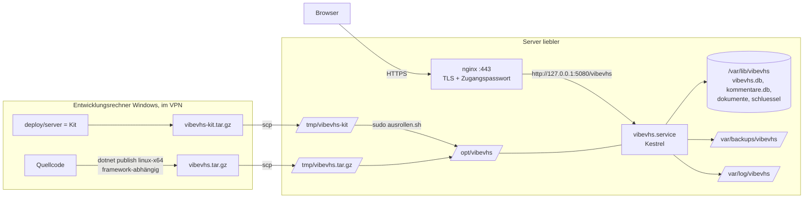

# Bereitstellung und Betrieb – Handbuch für Administratorinnen und Administratoren

Dieses Dokument erklärt, **wie VibeVHS auf einen Linux-Server kommt, wie es dort eingerichtet ist und wie Updates ablaufen**.
Es richtet sich an alle, die das System betreiben. Die einzelnen Einrichtungsbefehle stehen im Runbook
[`deploy/server/README-server.md`](../deploy/server/README-server.md); hier steht das Gesamtbild mit den Gründen.

Stand: 21.11.2026 · Zielsystem heute: **Testsystem** `https://liebler.iui.hs-osnabrueck.de/vibevhs` (Ubuntu 26.04, nginx).

---

## 1 · Überblick



Kernpunkte:

- **Gebaut wird auf dem Entwicklungsrechner**, nicht auf dem Server. `deploy.ps1` erzeugt einen *framework-abhängigen* Build für
  linux-x64 – die .NET-Laufzeit liegt einmal gemeinsam für alle Apps auf dem Server (Schritt 09) und wird nachts aktualisiert;
  mit `-MitRuntime` steckt sie wie früher im Paket (self-contained).
- **Programm und Daten sind getrennt:** Das Programm liegt in `/opt/vibevhs` und wird bei jedem Update komplett ersetzt;
  Datenbank, Dokumente, Schlüssel, Logs und Sicherungen liegen woanders und bleiben stehen.
- **Nach außen spricht nur nginx** (443, TLS mit dem Hochschulzertifikat, vorgeschaltetes Zugangspasswort). Die Anwendung lauscht
  ausschließlich auf `127.0.0.1:5080`.
- **Jeder Eingriff mit root-Rechten ist ein Skript** im Kit (`deploy/server/schritte/`): idempotent, mit Sicherung vorher
  (`/root/vibevhs-sicherung/<Zeitstempel>-<Schritt>`), Prüfung danach und Rückweg.
- **Geheimnisse liegen nie im Repository**, sondern nur auf dem Server (`/etc/vibevhs/vibevhs.env`, `/etc/nginx/vibevhs.htpasswd`,
  `/etc/ssl/liebler/privkey.pem`).

---

## 2 · Voraussetzungen

### Auf dem Entwicklungsrechner (von dort wird ausgerollt)

| Was | Wozu |
|---|---|
| .NET-11-SDK | `dotnet publish` für linux-x64 |
| Windows PowerShell 5.1 oder PowerShell 7 | `deploy.ps1` |
| OpenSSH-Client (`ssh`, `scp`) und `tar` | Hochladen; beides ist in Windows 11 enthalten. Scheitert der Schlüsselaustausch mit OpenSSH 10 auf dem Server, das `ssh` aus Git nehmen |
| eduVPN der Hochschule | SSH (Port 22) ist nach Schritt 07 nur aus dem VPN erreichbar |
| SSH-Schlüssel `%USERPROFILE%\.ssh\id_ed25519_liebler_iui_hs_osnabrueck` (mit Passphrase) und Eintrag `Host liebler` in `.ssh\config` | Anmeldung als `srvadmin`; Passwortanmeldung ist abgeschaltet |
| sudo-Passwort von `srvadmin` | Jedes Einspielen läuft mit sudo |

### Auf dem Server

| Was | Woher |
|---|---|
| Ubuntu (getestet: 26.04.1 LTS, x86_64, 2 CPU, 3,8 GiB RAM) | vorhanden |
| Benutzer `srvadmin` mit sudo | vorhanden |
| Pakete `nginx`, `ufw`, `apache2-utils` (htpasswd), `at`, `sqlite3`, `curl`, `ca-certificates`, `openssl`, `libicuNN` | Schritt 02 |
| Hochschulzertifikat (GEANT TCS/HARICA) mit Kette und Schlüssel | Hochschul-IT; Schritt 03 legt es nach `/etc/ssl/liebler` |
| Systemzeitzone `Europe/Berlin` | ist gesetzt (sonst zeigt VibeVHS UTC-Uhrzeiten, siehe Abschnitt 8) |

`libicu` ist nötig, weil .NET die deutsche Kultur (Datumsformate, Sortierung) aus ICU bezieht. **sqlite3** braucht das
Ausrollskript für die konsistente Datenbanksicherung vor jedem Update.

---

## 3 · Einmalige Einrichtung

Reihenfolge laut Runbook: **A → 01 → 02 → 03 → 04 → 05 → 06 → erstes Ausrollen → 07 → (später) 08.**
Jeden Schritt gibt Klaus einzeln frei; während eines Schritts bleibt eine zweite SSH-Sitzung als Rettungsanker offen.
Das Kit kommt vorher mit `.\deploy\server\deploy.ps1 -NurKit` nach `/tmp/vibevhs-kit`, jeder Schritt startet mit
`ssh -t liebler "sudo bash /tmp/vibevhs-kit/schritte/<schritt>.sh"`.

| Schritt | Was eingerichtet wird | Rückweg |
|---|---|---|
| A | SSH-Schlüssel erzeugen und hinterlegen | – |
| 01 `ssh-haerten` | `/etc/ssh/sshd_config.d/10-haertung.conf`: nur Schlüssel, kein root-Login, `AllowUsers srvadmin` | `01-zurueck.sh` |
| 02 `pakete` | Pakete siehe oben; nginx bleibt noch aus | nicht nötig |
| 03 `nginx-statt-apache` | Zertifikat nach `/etc/ssl/liebler`, nginx-Grundgerüst `liebler.conf` + `liebler.d/*.conf`, Zugangspasswort (`htpasswd`, Benutzer `vhs-test`), Ablaufwarnung (`zertifikat-ablauf.timer`), Apache aus → nginx an | `03-zurueck.sh` |
| 04 `nodered-lokal` | Node-RED nur noch lokal, erreichbar unter `/nodered` | `04-zurueck.sh` |
| 05 `mosquitto-zertifikat` | MQTT (8883) nutzt ebenfalls das Hochschulzertifikat | `05-zurueck.sh` |
| 06 `vibevhs-einrichten` | Dienstbenutzer, Verzeichnisse, `/etc/vibevhs/vibevhs.env`, systemd-Unit (Details in Abschnitt 4) | `systemctl disable --now vibevhs` |
| Ausrollen | Programm nach `/opt/vibevhs` (Abschnitt 6) | `ausrollen.sh --zurueck` |
| 07 `firewall` | ufw ergänzen: 443/80 offen, 22 nur aus dem VPN, 1880 zu; automatischer Rückweg nach 10 min, falls man sich aussperrt | `07-zurueck.sh` |
| 08 `certbot-aufraeumen` | Let's Encrypt/certbot entfernen (nach Rückfrage je Teil) | `08-zurueck.sh` |
| 09 `dotnet-runtime` | gemeinsame ASP.NET-Core-Runtime 11.0 für alle .NET-Apps, nachts aktualisiert (`dotnet-runtime-aktualisieren.timer`) | `09-zurueck.sh` |

Schritt 03 nutzt ein **gemeinsames nginx-Schema** mit anderen Anwendungen auf demselben Server: `liebler.conf` enthält TLS und
`include /etc/nginx/liebler.d/*.conf;`, jede Anwendung pflegt nur ihre eigene Datei darin. Ein erneuter Schritt 03 überschreibt
deshalb die Einträge anderer Anwendungen nicht.

---

## 4 · Was liegt wo auf dem Server

| Pfad | Besitzer, Rechte | Inhalt | Bei Update |
|---|---|---|---|
| `/opt/vibevhs/` | root:root, 755/644 | Programm (Binärdatei `VibeVHS.Web`, Laufzeit, `appsettings*.json`, `wwwroot`, `Startdaten/`) | **komplett ersetzt** |
| `/opt/vibevhs.vorher/` | root | vorige Programmversion | wird zur Rückweg-Kopie |
| `/opt/vibevhs.defekt/` | root | nach einem Rückweg: die verworfene Version (zur Analyse) | beim nächsten Rückweg überschrieben |
| `/var/lib/vibevhs/vibevhs.db` (+`-wal`, `-shm`) | vibevhs, 0750-Ordner | **Hauptdatenbank** (SQLite) | bleibt (außer `-DbNeu`) |
| `/var/lib/vibevhs/kommentare.db` | vibevhs | Kommentare zu Spezifikation und Doku | bleibt **immer** |
| `/var/lib/vibevhs/dokumente/` | vibevhs | Dokumentarchiv (Briefe, Bescheinigungen, Uploads) | bleibt |
| `/var/lib/vibevhs/schluessel/` | vibevhs | ASP.NET-Data-Protection-Schlüssel (Anmelde-Cookies, Tokens) | bleibt – **nicht löschen**, sonst sind alle abgemeldet (und ggf. geschützte Links ungültig) |
| `/var/lib/vibevhs/beiseite/` | vibevhs, 0700 | mit `-DbNeu` beiseitegelegte Datenbanken | bleibt, **von Hand aufräumen** |
| `/var/log/vibevhs/vibevhs-JJJJMMTT.log` | vibevhs | Anwendungslog (Serilog), täglich neue Datei, 30 Tage | bleibt |
| `/var/backups/vibevhs/` | vibevhs | nächtliche Sicherungen `vibevhs-*.db` + `.json` + `kommentare-*.db`; vor jedem Update `vor-update-*.db` | bleibt |
| `/etc/vibevhs/vibevhs.env` | root:vibevhs, 0640 | Geheimnisse und Abweichungen (Umgebungsvariablen) | bleibt |
| `/etc/systemd/system/vibevhs.service` | root | systemd-Unit | aus dem Kit nur in Schritt 06 |
| `/etc/nginx/liebler.conf`, `/etc/nginx/liebler.d/vibevhs.conf` | root | Server-Grundgerüst, Pfad `/vibevhs` | nur in Schritt 03 |
| `/etc/nginx/snippets/vibevhs-proxy.conf` | root | gemeinsame Proxy-Einstellungen (WebSocket, Timeouts 1 h für Blazor) | nur in Schritt 03 |
| `/etc/nginx/snippets/vibevhs-ohne-passwort.conf` | root | Pfade ohne Zugangspasswort (Abschnitt 8) | nur in Schritt 03 |
| `/etc/nginx/vibevhs.htpasswd` | root | Zugangspasswort (Basic Auth) | bleibt |
| `/etc/ssl/liebler/fullchain.pem`, `privkey.pem` | root:ssl-cert, Schlüssel 0640 | Hochschulzertifikat für nginx und mosquitto | nur per `zertifikat-tauschen.sh` |
| `/tmp/vibevhs-kit/` | srvadmin | hochgeladenes Kit (Skripte, Vorlagen) | bei jedem Ausrollen neu |
| `/root/vibevhs-sicherung/` | root | Sicherungen der Konfiguration vor jedem Schritt | wächst, gelegentlich aufräumen |

Der Dienst `vibevhs.service` läuft als Systembenutzer **`vibevhs`** (keine Shell) mit Härtung
(`ProtectSystem=strict`, `ProtectHome`, `PrivateTmp`, `NoNewPrivileges` …). Schreiben darf er nur in `/var/lib/vibevhs`,
`/var/log/vibevhs` und `/var/backups/vibevhs`. Eine neue Datenablage außerhalb dieser Ordner muss deshalb auch in
`ReadWritePaths=` der Unit ergänzt werden.

---

## 5 · Konfiguration

### Woher die Anwendung ihre Einstellungen nimmt

Spätere Quellen überschreiben frühere:

1. `appsettings.json` im Programm – Grundwerte (für den Entwicklungsrechner).
2. `appsettings.<Umgebung>.json` im Programm. Die Umgebung setzt die Unit mit `ASPNETCORE_ENVIRONMENT`; auf dem Testsystem ist das
   **`Testsystem`** → `appsettings.Testsystem.json`.
3. `Environment=`-Zeilen in `/etc/systemd/system/vibevhs.service` – Pfade, Proxy, Port.
4. `/etc/vibevhs/vibevhs.env` (`EnvironmentFile=`) – Geheimnisse und örtliche Abweichungen; überschreibt Punkt 3.

Umgebungsvariablen schreiben Abschnitte mit doppeltem Unterstrich: `Sicherung:Behalten` → `Sicherung__Behalten=14`.
Nach jeder Änderung an Unit oder `vibevhs.env`: `sudo systemctl daemon-reload` (nur bei der Unit) und `sudo systemctl restart vibevhs`.

`appsettings.Development.json` wird beim Bauen entfernt und kommt nie auf den Server. `deploy/server/appsettings.Production.json.vorlage`
ist **nur eine Vorlage** für den späteren Echtbetrieb und wird von `deploy.ps1` nicht ausgerollt.

### Einstellungen, die auf dem Server gesetzt sind oder gesetzt werden können

| Schlüssel | Testsystem | Wo gesetzt | Bedeutung |
|---|---|---|---|
| `ASPNETCORE_ENVIRONMENT` | `Testsystem` | Unit | wählt `appsettings.Testsystem.json` |
| `ASPNETCORE_URLS` | `http://127.0.0.1:5080` | Unit | nur lokal; nginx leitet weiter |
| `ConnectionStrings__VibeVHS` | `Data Source=/var/lib/vibevhs/vibevhs.db` | Unit | Hauptdatenbank |
| `ConnectionStrings__Kommentare` | (leer → `kommentare.db` neben der Hauptdatenbank) | – | Kommentar-Datenbank |
| `Speicher__Dokumente` | `/var/lib/vibevhs/dokumente` | Unit | Dokumentarchiv |
| `Speicher__Schluessel` | `/var/lib/vibevhs/schluessel` | Unit | Data-Protection-Schlüssel |
| `Speicher__Logs` | `/var/log/vibevhs` | Unit | Logdateien |
| `Sicherung__Ordner` | `/var/backups/vibevhs` | Unit | Ziel der nächtlichen Sicherung |
| `Sicherung__Aktiv` / `__Zeitplan` / `__Behalten` | `true` / `0 30 1 * * ?` (01:30) / `14` | Standard | Sicherungsjob (Quartz-Cron) |
| `ReverseProxy__Aktiv`, `ReverseProxy__Host` | `true`, `liebler.iui.hs-osnabrueck.de` | Unit | `X-Forwarded-*` von nginx übernehmen, nur für diesen Hostnamen |
| `PathBase` | `/vibevhs` | appsettings.Testsystem | Anwendung läuft unter einem Unterpfad |
| `OeffentlicheAdresse` | `https://liebler.iui.hs-osnabrueck.de/vibevhs/` | appsettings.Testsystem | Basis für Links in Mails, QR-Codes, Kalender-Abos |
| `Testsystem__Aktiv` | `true` | appsettings.Testsystem | Banner „Testsystem“ |
| `Abnahmemodus__Aktiv` | `true` | appsettings.Testsystem | Abnahme-/Schulungsmodus |
| `Demodaten__Anlegen`, `Demodaten__Massendaten` | `true`, `3000` | appsettings.Testsystem / `vibevhs.env` | fiktive Demodaten und 3000 Massenpersonen; `0` = nur benannte Demopersonen |
| `Anmeldung__Zugangscode` | leer | `vibevhs.env` (**Geheimnis**) | zusätzlicher Code auf der Testanmeldeseite (zweite Hürde hinter dem nginx-Passwort) |
| `Anmeldung__ZugangscodeErforderlich` | `false` | – | `true`: ohne gesetzten Code ist keine Anmeldung möglich |
| `Shop__ErlaubteOrigins__0` … | leer | `vibevhs.env` | Websites, die die Shop-API per CORS aufrufen dürfen (z. B. `https://www.vhs-egs.de`) |
| `Zeitzone` | (leer → Systemzeitzone `Europe/Berlin`) | optional `vibevhs.env` | Anzeige- und Eingabezeitzone |
| `Startdaten__Datei` | (leer → `Startdaten/testbenutzer-vhs-egs.json` im Programm) | – | Briefkopf, Fachbereiche, Benutzerkonten der vhs EGS |

**Geheimnisse** (Zugangscode, später SMTP-Passwort, S3-Schlüssel für Litestream …) gehören ausschließlich in
`/etc/vibevhs/vibevhs.env` (root:vibevhs, 0640). Die Datei legt Schritt 06 aus `vibevhs.env.beispiel` an, falls sie fehlt; danach
wird sie nie wieder überschrieben.

### Was das Testsystem bewusst anders macht als ein Echtbetrieb

- **Testanmeldung (Mock)** mit Rollenwahl statt echter Anmeldung – geschützt durch das nginx-Zugangspasswort.
- **Mails gehen nur in den Postausgang** der Anwendung, es wird nichts verschickt; Übersetzer, Virenprüfung, Geokodierer und BAMF
  sind Mocks.
- **Demodaten** werden angelegt und sind relativ zum Tagesdatum.

---

## 6 · Ausrollen und Updates

Ein Update ist dasselbe wie das erste Ausrollen. Auf dem Entwicklungsrechner, im Repository-Ordner, im VPN:

```powershell
.\deploy\server\deploy.ps1
```

### Was dabei passiert

**Auf dem Entwicklungsrechner (`deploy.ps1`):**

1. `dotnet publish src\VibeVHS.Web -c Release -r linux-x64 --self-contained false` nach `deploy\ausgabe\vibevhs` (`-MitRuntime`: `true`)
   (ohne PDB-Dateien), `appsettings.Development.json` wird entfernt, Ergebnis gepackt als `deploy\ausgabe\vibevhs.tar.gz`.
2. Kit (`deploy/server`) packen und nach `/tmp/vibevhs-kit` hochladen (der Ordner wird jedes Mal sauber ersetzt).
3. Archiv nach `/tmp/vibevhs.tar.gz` hochladen.
4. `sudo bash /tmp/vibevhs-kit/schritte/ausrollen.sh /tmp/vibevhs.tar.gz` – sudo fragt nach dem Passwort von `srvadmin`.

**Auf dem Server (`ausrollen.sh`):**

1. **Voraussetzungen prüfen** (Dienstbenutzer, Unit, Verzeichnisse aus Schritt 06). Fehlt etwas: Abbruch, nichts geändert.
2. Archiv in einen temporären Ordner `/opt/vibevhs.neu.XXXX` entpacken, Rechte festlegen (root:root, 755/644, Programm ausführbar –
   unter Windows gebaute Archive haben keine Unix-Rechte).
3. **Datenbanken sichern** mit `sqlite3 .backup` (konsistent, auch bei laufendem Dienst):
   `/var/backups/vibevhs/vor-update-<Zeit>.db` und `vor-update-<Zeit>-kommentare.db`.
4. Dienst stoppen.
5. Nur mit `-DbNeu`: `vibevhs.db` samt `-wal`/`-shm` nach `/var/lib/vibevhs/beiseite/<datei>.<Zeit>` verschieben.
6. **Tauschen:** altes `/opt/vibevhs.vorher` löschen, `/opt/vibevhs` → `/opt/vibevhs.vorher`, neuer Ordner → `/opt/vibevhs`.
7. Dienst starten und `http://127.0.0.1:5080/vibevhs/gesund` abfragen (bis 90 s, mit `-DbNeu` bis 5 min).
8. **Antwortet die Anwendung:** fertig, Archiv in `/tmp` gelöscht.
   **Antwortet sie nicht:** Startlog anzeigen, mit `-DbNeu` die neu angelegte Datenbank verwerfen und die vorige zurücklegen,
   automatisch zur vorigen Version zurück (`--zurueck`). Lag es am Schema, nennt das Skript den Ausweg `-DbNeu`.

Ausfallzeit: vom Stoppen bis zur ersten Antwort, normalerweise wenige Sekunden. Offene Blazor-Sitzungen verbinden sich danach neu;
angemeldet bleiben alle, weil die Schlüssel in `/var/lib/vibevhs/schluessel` erhalten bleiben. Ungespeicherte Eingaben in gerade
offenen Formularen gehen verloren – Updates deshalb nicht mitten in der Arbeitszeit einspielen bzw. vorher ankündigen.

### Optionen

| Aufruf | Wirkung |
|---|---|
| `deploy.ps1` | bauen, hochladen, einspielen (Normalfall) |
| `deploy.ps1 -DbNeu` | wie oben, aber Datenbank vorher beiseitelegen; die Anwendung baut sie aus Start- und Demodaten neu auf. Fragt nach („j“), **alle auf dem Server erfassten Daten sind danach nicht mehr in der Anwendung** |
| `deploy.ps1 -DbNeu -OhneRueckfrage` | dasselbe ohne Rückfrage (für Skripte) |
| `deploy.ps1 -NurKit` | nur das Kit nach `/tmp/vibevhs-kit` hochladen (vor den Einrichtungsschritten oder nach Änderungen am Kit) |
| `deploy.ps1 -NurBauen` | nur bauen (`deploy\ausgabe\vibevhs.tar.gz`), nichts hochladen – z. B. zum Prüfen des Builds |
| `deploy.ps1 -Ziel benutzer@host` | anderer Zielserver (Standard `srvadmin@liebler.iui.hs-osnabrueck.de`) |
| `deploy.ps1 -Schluessel <pfad>` | anderer SSH-Schlüssel |
| `ssh -t liebler "sudo bash /tmp/vibevhs-kit/schritte/ausrollen.sh --zurueck"` | **von Hand zurück** zur vorigen Version (`/opt/vibevhs.vorher`); die verworfene landet in `/opt/vibevhs.defekt`. Die Datenbank wird dabei **nicht** zurückgesetzt |

`-DbNeu` lässt sich nicht mit `-NurKit` oder `-NurBauen` kombinieren. Es gibt genau **eine** Rückweg-Version; zwei Updates
hintereinander überschreiben die vorletzte.

### Was ein Update nicht ändert

Systemd-Unit, nginx-Konfiguration, Zertifikat, Firewall und `vibevhs.env` werden beim Ausrollen **nicht** angefasst – das Kit wird
zwar hochgeladen, aber nur die Einrichtungsschritte spielen seine Vorlagen ein. Ändert sich etwa `systemd/vibevhs.service` im
Repository, muss Schritt 06 erneut laufen (idempotent: spielt nur Abweichungen ein und sichert vorher); bei nginx-Vorlagen Schritt 03.

---

## 7 · Was mit der Datenbank beim Update passiert

### Heute: Entwicklungsphase ohne Migrationen

VibeVHS nutzt zurzeit **keine EF-Core-Migrationen**. Beim Start gilt:

- **Keine Datenbank vorhanden** → die Anwendung legt sie aus dem aktuellen Modell an (`EnsureCreated`), erzeugt die lesbaren Sichten
  `v_…` und schreibt eine **Schemaversion** (Prüfsumme über Tabellen, Indizes und Sichten) in die Tabelle `Schemainfo`. Danach
  Startdaten (Benutzer, Briefkopf, Fachbereiche), Grundeinstellungen und – im Testsystem – Demodaten. Dauer mit 3000 Massenpersonen:
  rund 1,5 Minuten.
- **Datenbank vorhanden, Schemaversion passt** → die Daten bleiben vollständig erhalten. Start- und Demodaten werden nur ergänzt,
  soweit sie fehlen (idempotent).
- **Datenbank vorhanden, Schemaversion passt nicht** (das Modell hat sich geändert) → Start bricht mit Exit-Code 2 ab:
  „Datenbankschema veraltet (…: Version …, erwartet …)“. Das Ausrollskript erkennt das, kehrt zur vorigen Version zurück (die zur
  Datenbank passt) und empfiehlt `-DbNeu`.

Daraus folgt:

| Update | Was mit den Daten passiert |
|---|---|
| ohne Modelländerung, `deploy.ps1` | bleiben erhalten |
| mit Modelländerung, `deploy.ps1` | Update wird abgewiesen, alte Version läuft weiter, Daten unverändert |
| mit Modelländerung, `deploy.ps1 -DbNeu` | Datenbank wird **neu aus Start- und Demodaten** aufgebaut; die alte Datei liegt in `/var/lib/vibevhs/beiseite/` und in `vor-update-*.db`, ist aber **nicht mehr in der Anwendung** |

Ob ein Stand das Schema ändert, sieht man vor dem Ausrollen am einfachsten an Änderungen in `docs/datenmodell.md` (wird automatisch aus
dem Modell erzeugt, ein Test schlägt bei veralteter Doku fehl) oder am Commit. Im Zweifel einfach `deploy.ps1` ohne `-DbNeu` – der
Rückweg ist automatisch.

**Ausnahme `kommentare.db`:** Die Kommentar-Datenbank wird von `-DbNeu` **nie** angefasst. Sie hat eine eigene Schemaversion
(`PRAGMA user_version`); passt sie nicht, bricht der Start ebenfalls ab – dann muss die Datei per Skript angepasst werden,
sie wird nicht neu angelegt.

### Was mit `-DbNeu` verloren geht und was nicht

- Verloren (in der Anwendung): alles, was auf dem Testsystem erfasst wurde – Personen, Kurse, Anmeldungen, Rechnungen, Protokoll,
  Aufgaben, Postausgang, geänderte Einstellungen (z. B. Logo, Website, Benutzer aus Einstellungen → Benutzer).
- Erhalten: Kommentare (`kommentare.db`), Dokumentarchiv-Dateien in `dokumente/` (verwaist, ohne Verweis aus der neuen Datenbank),
  Anmelde-Schlüssel, Logs, alle Sicherungen.
- Die alte Datei bleibt lesbar (`sqlite3 /var/lib/vibevhs/beiseite/vibevhs.db.<Zeit>` bzw. DB-Browser über die Sichten `v_…`),
  lässt sich aber nicht mit der neuen Version weiterverwenden.

### Später: Echtbetrieb

**Vor dem ersten Produktivbetrieb werden wieder EF-Migrationen eingeführt** (Anfangsmigration aus dem dann aktuellen Modell, Sichten
und Collation-Index per SQL in der Migration). Ab dann gilt: Die Anwendung bringt die Datenbank beim Start selbst auf den neuen
Stand, Daten bleiben erhalten, `-DbNeu` ist für den Echtbetrieb tabu. Die Sicherung `vor-update-*.db` bleibt der Rückweg, falls eine
Migration fehlschlägt (Version **und** Datenbank zurück). Siehe `docs/betrieb.md`.

---

## 8 · Was man im Betrieb wissen muss

### Dienst und Zustand

```bash
systemctl status vibevhs                     # läuft? seit wann? Neustarts?
sudo systemctl restart vibevhs               # Neustart (z. B. nach Änderung an vibevhs.env)
curl -s http://127.0.0.1:5080/vibevhs/gesund # „ok“ = Anwendung läuft und Datenbank erreichbar
journalctl -u vibevhs -f                     # Konsolenausgabe live
less /var/log/vibevhs/vibevhs-$(date +%Y%m%d).log
sudo tail -f /var/log/nginx/access.log /var/log/nginx/error.log
```

Die Seite **Betrieb** in der Anwendung (Rolle Systemverwaltung) zeigt Sicherungen, Wiederherstellungstests und Hintergrundjobs.
Logs und Protokoll enthalten **keine Personendaten** (Pseudonyme) – so bleibt es auch bei eigenen Erweiterungen.

### Typische Störungen

| Erscheinung | Ursache | Abhilfe |
|---|---|---|
| **502 Bad Gateway** | Anwendung läuft nicht (oft Startschleife: `systemctl status` zeigt „activating … restart counter“) | `journalctl -u vibevhs -n 50`; bei „Datenbankschema veraltet“ siehe Abschnitt 7 (Vorfall: `deploy/server/protokoll/2026-11-17-diagnose-502.md`) |
| Ausrollen bricht mit „Schritt 06 fehlt“ ab | Dienst noch nicht eingerichtet | Schritt 06 ausführen |
| Uhrzeiten um 1–2 Stunden verschoben | Zeitzone UTC | `timedatectl` prüfen oder `Zeitzone=Europe/Berlin` in `vibevhs.env` |
| Alle Nutzer nach Neustart abgemeldet | `schluessel/` gelöscht oder ersetzt | Ordner aus Sicherung zurück, sonst hinnehmen |
| Seite lädt ohne Gestaltung / fragt beim Kalender-Abo nach Passwort | Pfad fehlt in `vibevhs-ohne-passwort.conf` | siehe „Zugang“ |
| `ssh liebler` hängt | nicht im VPN (Port 22 nur aus dem VPN) | eduVPN verbinden |

### Datensicherung und Wiederherstellung

- **Täglich 01:30** sichert die Anwendung beide Datenbanken online nach `/var/backups/vibevhs` (`vibevhs-<Zeit>.db`, `.json` mit
  SHA-256, `kommentare-<Zeit>.db`) und **testet die Wiederherstellung** sofort (Prüfsumme, `integrity_check`, Schemaversion,
  Zeilenzahlen). Es bleiben die letzten 14.
- **Vor jedem Update** zusätzlich `vor-update-*.db` – diese räumt **niemand automatisch auf**, ebenso wenig `beiseite/` und
  `/root/vibevhs-sicherung/`. Plattenplatz gelegentlich prüfen (`df -h /var`, `du -sh /var/backups/vibevhs /var/lib/vibevhs/beiseite`).
- Der Sicherungsordner liegt **auf demselben Datenträger**. Für echten Schutz braucht es eine Kopie außerhalb: Dateisicherung des
  Rechenzentrums für `/var/backups/vibevhs` (und `/var/lib/vibevhs/dokumente`, `/var/lib/vibevhs/schluessel`, `/etc/vibevhs`) oder
  **Litestream** (fortlaufende Replikation, Vorlage `deploy/server/litestream/litestream.yml`; heute nicht eingerichtet).
- **Rücksicherung:**

  ```bash
  sudo systemctl stop vibevhs
  cd /var/lib/vibevhs
  sudo -u vibevhs mkdir -p beiseite
  sudo mv vibevhs.db beiseite/vibevhs.db.$(date +%Y%m%d-%H%M%S)          # ebenso -wal und -shm, falls vorhanden
  sudo cp /var/backups/vibevhs/vibevhs-<Zeit>.db vibevhs.db
  sudo chown vibevhs:vibevhs vibevhs.db
  sudo systemctl start vibevhs && curl -s http://127.0.0.1:5080/vibevhs/gesund
  ```

  Vorher die SHA-256 mit der `.json` vergleichen (`sha256sum`). Eine Sicherung mit anderer Schemaversion startet nur mit der dazu
  passenden Programmversion. Danach im Protokoll festhalten, welcher Zeitraum verloren ist, und den Postausgang prüfen.

### Zugang

- **Zugangspasswort** (vor der Anwendung, Benutzer `vhs-test`): ändern bzw. weitere Benutzer anlegen mit
  `sudo htpasswd /etc/nginx/vibevhs.htpasswd <benutzer>`; wirkt sofort.
- **Pfade ohne Zugangspasswort** steuert `/etc/nginx/snippets/vibevhs-ohne-passwort.conf`. Frei sind heute Kalender-Abos, Check-in
  und Kurs-QR sowie statische Dateien. Shop-API, Brief-/Übersetzungslinks und Portale sind vorbereitet, aber auskommentiert – erst
  freigeben, wenn echte Außenstehende sie brauchen. Nach jeder Änderung: `sudo nginx -t && sudo systemctl reload nginx`.
- **Anwendungskonten** kommen aus den Startdaten bzw. Einstellungen → Benutzer.

### Zertifikat

Das Hochschulzertifikat (GEANT TCS/HARICA, heute gültig bis **07.02.2027**) wird **jährlich von Hand** getauscht – Ablauf im Runbook
(„Zertifikat tauschen“, Werkzeug `zertifikat-tauschen.sh` mit Prüfung und Rückweg). Der Timer `zertifikat-ablauf.timer` warnt ab
30 Tagen vor Ablauf, aber **nur im Journal** (`journalctl -t zertifikat-ablauf`), solange auf dem Server kein Mailversand eingerichtet
ist. Kurzprüfung: `zertifikat-ablauf --kurz`. Empfehlung: zusätzlich einen Check im vorhandenen Nagios-Monitoring.

### Sicherheitsupdates

- **Betriebssystem:** `unattended-upgrades` ist auf dem Server aktiv (Sicherheitsupdates von Ubuntu, inkl. nginx, OpenSSL, ICU).
- **.NET-Laufzeit:** gemeinsam für alle Apps auf dem Server (Schritt 09); `dotnet-runtime-aktualisieren.timer` spielt Patches nachts
  ein und startet die Dienste nur bei neuer Version neu – kein neues Ausrollen nötig. Nur Pakete mit `-MitRuntime` (self-contained)
  bleiben auf dem Stand ihres Builds.
- NuGet-Pakete der Anwendung ebenso: Update im Repository, Tests, ausrollen.

### Firewall und Netz

ufw: 443 und 80 (nur Umleitung) für alle, 22 nur aus dem eduVPN, 1880 (Node-RED) zu, 8883/8181/5666 wie bisher. Docker (snap)
veröffentlicht Ports an ufw vorbei. Davor filtert zusätzlich die Hochschul-Firewall.

### Spielregeln für Eingriffe

- Änderungen am Server nur nach Freigabe und **jeden ssh-Befehl vorher** in `deploy/server/protokoll/<datum>-<anlass>.md`
  eintragen (Befehl wörtlich, gekürzte Ausgabe, Geheimnisse geschwärzt).
- Bei Eingriffen an SSH, Firewall oder nginx immer eine **zweite SSH-Sitzung offen** lassen.
- Lieber die Skripte erneut laufen lassen (idempotent, mit Sicherung) als Konfigurationsdateien von Hand zu ändern; wer doch von
  Hand ändert, trägt die Änderung auch in die Vorlage im Kit ein – sonst überschreibt der nächste Schritt sie.

---

## 9 · Vor einem Echtbetrieb noch offen

| Punkt | Heute | Für den Echtbetrieb |
|---|---|---|
| Datenbank-Updates | ohne Migrationen, `-DbNeu` bei Modelländerung | EF-Migrationen, Daten bleiben bei jedem Update |
| Umgebung | `Testsystem` | `Production` mit `appsettings.Production.json` (Vorlage im Kit), keine Demodaten, kein Banner |
| Anmeldung | Testanmeldung (Mock) hinter Zugangspasswort | echte Anmeldung (Verfahren offen) |
| Mail, Übersetzer, Virenprüfung, BAMF | Mocks / Postausgang | echte Anbindungen, Zugangsdaten in `vibevhs.env` |
| Sicherung | täglich, gleicher Datenträger | zusätzlich außerhalb (Rechenzentrum, Litestream) |
| Zertifikat | Hand-Tausch, Warnung nur im Journal | Mail-Relay oder Monitoring-Check; ggf. ACME mit EAB bei HARICA |
| HSTS | aus | in `liebler.conf` einschalten |

Weiterführend: [`docs/betrieb.md`](betrieb.md) (Sicherung, Zeitzone, Schema), [`docs/sicherheit.md`](sicherheit.md),
[`deploy/server/README-server.md`](../deploy/server/README-server.md) (Runbook mit allen Befehlen).
