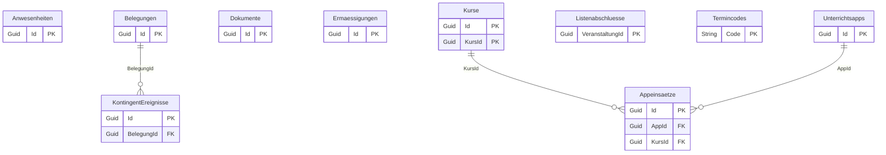
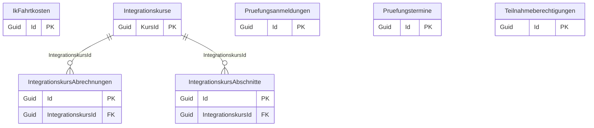
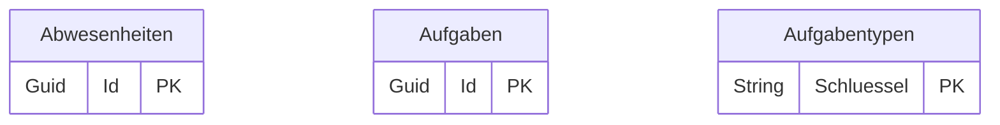
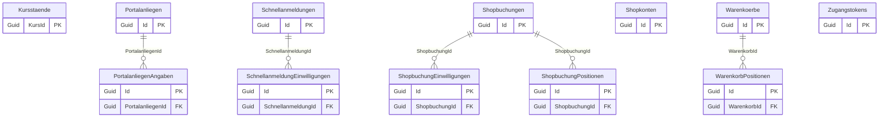
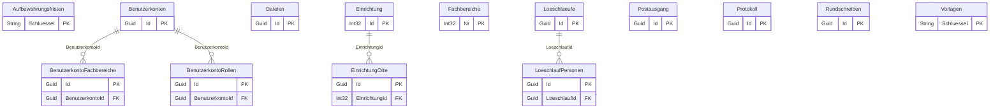

# Datenbank – Tabellenstrukturen

Automatisch erzeugt aus dem EF-Modell (`DatenbankDokuTests`, Zwecktexte in `DatenmodellBeschreibung.cs`), nicht von Hand ändern.
PostgreSQL 17, angelegt beim ersten Start per `EnsureCreated` aus dem Modell (noch keine Migrationen, siehe docs/betrieb.md); die
Schemaversion steht in der Tabelle `Schemainfo`. Speicherformate: Ids als `uuid` (UUIDv7, zeitlich sortiert), Kalendertage als `date`
(offenes Ende 9999-12-31), Zeitpunkte (`DateTimeOffset`) und Termine als `timestamptz` in UTC (Millisekunden), Aufzählungen als Text.
Namen sortieren per ICU-Collation `DIN5007_2` (de-DE, Telefonbuch). Gesucht wird über die SQL-Funktionen `suchtext`, `suchwoerter` und
`namensuchtext` mit Trigramm-Indizes (pg_trgm). Keine Kopien: Namen, Anzeigetexte und Stände werden zur Laufzeit aus den Quellen
gelesen. Keine JSON-Spalten: Listen stehen in eigenen Tabellen (je Eintrag eine Zeile).

**Bitemporale Versionstabellen** (Namen, Merkmale, Adressen, …): `GueltigVon`/`GueltigBis` = fachliche Zeit (halboffen);
Wissenszeit, Person und Grund stehen im Änderungsvorgang (`ErfasstDurchVorgangId`, ersetzt durch `ErsetztDurchVorgangId` → Tabelle
`Aenderungsvorgaenge`); `Erfassungsart` = Rolle der Zeile im Vorgang. „Einstufung“: F = führend, A = nur nach Anonymisierung
(siehe `Spalteneinstufung.cs`).

**Lesbare Sichten:** Zu jeder Tabelle gibt es eine Sicht `v_<Tabelle>` (offenes Ende als NULL; bei Versionstabellen zusätzlich
`ErfasstAm`, `ErfasstVon`, `Grund`, `ErsetztAm` aus dem Vorgang) – zum Prüfen im DB-Werkzeug.

## Bitemporale Datenhaltung

Alle Personenangaben (Namen, Merkmale wie Titel, Rollen, Sprache, Geburtsdatum, Anrede, Adressen, Adresskennzeichen, Rufnummern,
E-Mail-Adressen, Organisationen, Vollmachten, Einwilligungen, Qualifikationen) und weitere Stammdaten (Entgelte, Ortsmerkmale) werden
**bitemporal** („zwei Zeitachsen“) gespeichert:

| Achse | Spalten | Bedeutung | Beispiel |
|---|---|---|---|
| **Gültigkeitszeit** (valid time) | `GueltigVon`, `GueltigBis` | Wann galt die Angabe **in der Welt**? Halboffen: `GueltigVon` einschließlich, `GueltigBis` ausschließlich (`NULL` = offen). | „wohnte bis 31.07. in der Lindenstraße“ |
| **Wissenszeit** (transaction/system time) | `ErfasstAm`, `ErsetztAm` | Wann **wussten wir** es? Ab `ErfasstAm`, bis `ErsetztAm` (`NULL` = aktueller Wissensstand). | „das wussten wir vom 15.03. bis zum 20.09.“ |

**Versionen werden nie geändert.** Jede Änderung – eine Änderung ab Datum (z. B. ein gemeldeter Umzug), eine Korrektur, das Beenden –
erzeugt neue Zeilen und markiert die bisherige als ersetzt (`ErsetztAm`). `ErsetztAm` heißt also nicht „war falsch“, sondern „ab da
wussten wir es anders bzw. genauer“. Nur so bleibt beantwortbar, was das System zu einem früheren Zeitpunkt wusste (z. B. warum ein Brief
an die alte Adresse ging).

**Änderungsvorgang:** Zeitpunkt, Person und Grund stehen nicht in jeder Zeile, sondern einmal je Aktion in der Tabelle
`Aenderungsvorgaenge`; die Zeilen verweisen mit `ErfasstDurchVorgangId` (angelegt durch) und `ErsetztDurchVorgangId` (ersetzt durch)
darauf. `ErfasstAm` ist der Zeitpunkt des anlegenden, `ErsetztAm` der des ersetzenden Vorgangs. `Erfassungsart` (Ersterfassung, Änderung ab
Datum, Korrektur, Abgrenzung, Beendet) beschreibt die Rolle der Zeile im Vorgang. Die Sichten `v_…` zeigen alles wieder zusammen.

**Stabile Identität vs. Version:** Die Spalte `Id` ist die Zeilen-Id einer *Version*. Gegenstände, von denen eine Person mehrere haben kann,
tragen zusätzlich eine stabile Identität, die über alle Versionen gleich bleibt: `AdressId` (eine Adresse), `NummerId` (eine Rufnummer) usw.
Darauf verweisen andere Versionen, z. B. das Kennzeichen „üblicher Aufenthaltsort“ (`PersonAdressKennzeichen.AdressId`).
`AdressId` ist also **kein Adresstyp** – der Typ ergibt sich aus den Kennzeichen.

### Beispiel: Umzug mit nachträglicher Korrektur

- Frau Muster wohnt seit 01.01.2020 in der Lindenstraße 5 (bei uns erfasst am 10.01.2020).
- Am 15.03.2026 meldet sie: „Ab 01.08. wohne ich im Bergweg 2.“ (Vorgang „Umzug gemeldet“)
- Am 10.07. geht die Kursbestätigung raus – in die Lindenstraße.
- Am 20.09. legt sie die Meldebescheinigung vor: Der Umzug war schon am 01.07. (Vorgang „Meldebescheinigung“, Funktion
  „Umzugsdatum korrigieren“)

| Zeile | Adresse | gültig von | gültig bis (einschl.) | erfasst (Vorgang) | ersetzt (Vorgang) | Erfassungsart |
|---|---|---|---|---|---|---|
| A | Lindenstr. 5 | 01.01.2020 | offen | 10.01.2020 (Ersterfassung) | 15.03.2026 (Umzug gemeldet) | Ersterfassung |
| B | Lindenstr. 5 | 01.01.2020 | 31.07.2026 | 15.03.2026 (Umzug gemeldet) | 20.09.2026 (Meldebescheinigung) | Abgrenzung |
| C | Bergweg 2 | 01.08.2026 | offen | 15.03.2026 (Umzug gemeldet) | 20.09.2026 (Meldebescheinigung) | Änderung ab Datum |
| D | Lindenstr. 5 | 01.01.2020 | 30.06.2026 | 20.09.2026 (Meldebescheinigung) | – | Korrektur |
| E | Bergweg 2 | 01.07.2026 | offen | 20.09.2026 (Meldebescheinigung) | – | Korrektur |

(In der Datenbank steht `GueltigBis` ausschließlich, also bei B `20260801`, bei D `20260701`.)

So liest man es:
- B sagt **„wohnte bis 31.07. in der Lindenstraße“** – das war unser Wissen vom 15.03. bis 20.09. (`ErfasstAm` bis `ErsetztAm`).
- D sagt **„wohnte bis 30.06. in der Lindenstraße“** – das ist unser Wissen seit 20.09. (`ErsetztAm` leer = aktueller Stand).

Zwei typische Fragen:
- **„Wo wohnte sie am 10.07.?“** (heutiger Wissensstand) → nur nicht ersetzte Zeilen D, E → **Bergweg 2**.
- **„Wohin hätten wir am 10.07. geschrieben?“** (Wissensstand 10.07.) → Zeilen, die am 10.07. bekannt und nicht ersetzt waren: B, C →
  **Lindenstraße 5**. Der Brief ging also zu Recht dorthin, obwohl wir heute wissen, dass sie schon umgezogen war.

Beide Fragen beantwortet dieselbe Abfrage mit zwei Parametern – Stichtag `:tag` und Wissensstand `:bekannt`:

```sql
SELECT a.*
FROM "PersonAdressen" a
JOIN "Aenderungsvorgaenge" e ON e."Id" = a."ErfasstDurchVorgangId"
LEFT JOIN "Aenderungsvorgaenge" r ON r."Id" = a."ErsetztDurchVorgangId"
WHERE a."PersonId" = :person
  AND a."GueltigVon" <= :tag AND a."GueltigBis" > :tag                 -- galt am Stichtag (offenes Ende = 9999-12-31)
  AND e."Am" <= :bekannt AND (r."Id" IS NULL OR r."Am" > :bekannt);    -- war zu diesem Zeitpunkt bekannt
-- „Wo wohnte sie am 10.07.?“                 :tag = DATE '2026-07-10', :bekannt = now()
-- „Wohin hätten wir am 10.07. geschrieben?“  :tag = DATE '2026-07-10', :bekannt = TIMESTAMPTZ '2026-07-11 00:00 Europe/Berlin'
```

Für den aktuellen Wissensstand genügt `a.ErsetztDurchVorgangId IS NULL`. Im Code übernimmt das `ZeitlicheHistorie.AlsStichtag(gueltigAm,
bekanntAm)`; `Person.StandAm(tag, bekannt)` liefert den gesamten Stand. Speicherformate: Tage als `date`, Zeitpunkte als
`timestamptz` (UTC, Millisekunden), Ids als `uuid` (UUIDv7); zum Lesen von Hand dienen die Sichten `v_…` (z. B. `v_PersonAdressen`).

### Sortierung nach DIN 5007-2 (Collation `DIN5007_2`)

Personen werden nach Nachname, dann Vorname sortiert, wie im Telefonbuch (DIN 5007-2): ä→ae, ö→oe, ü→ue, ß→ss, Akzente ohne Zeichen,
Groß-/Kleinschreibung egal; der Namensvorsatz („von“) steht in einer eigenen Spalte und zählt für die Sortierung nicht. Dafür tragen die
Spalten `PersonNamen.Nachname` und `PersonNamen.Vorname` die ICU-Collation `DIN5007_2` (`de-DE-u-co-phonebk`), die PostgreSQL selbst
kennt; der Teilindex `IX_PersonNamen_Sortierung` (Nachname, Vorname, nur gültige Wissensstände) liegt auf ihr, die Personenliste blättert
per Keyset (Nachname, Vorname, Id) über diesen Index (geprüft mit `EXPLAIN`, siehe `MessungTests`). Es gibt keine gespeicherte Sortierspalte.
Jedes Werkzeug (psql, DBeaver, pgAdmin) sortiert deshalb gleich wie die Anwendung.

### Suche

Gesucht wird direkt in den Versionstabellen über die SQL-Funktionen `suchtext(x)` (gleiche Normalisierung wie `Suchtext.Normalisieren`:
klein, ä = ae = a, ß = ss, Akzente weg), `suchwoerter(x)` und `namensuchtext(vorname, vorsatz, nachname, zusatz)`. Auf diesen Ausdrücken
liegen Trigramm-Indizes (`IX_…_Suche`, pg_trgm), sodass „Wortanfang enthält“ (`LIKE '% muell%'`) ohne Suchtabelle schnell bleibt.
Zum Prüfen deshalb die lesbaren Sichten bzw. die Anwendung verwenden; Änderungen an den Daten nur über die Anwendung.

## Übersicht

### Personen

- [Aenderungsvorgaenge](#aenderungsvorgaenge) – Änderungsvorgang: Zeitpunkt, Person, Grund – einmal je Aktion; Versionszeilen verweisen mit ErfasstDurch-/ErsetztDurchVorgangId darauf.
- [DublettenAusschluesse](#dublettenausschluesse) – Als „keine Dublette“ markierte Personenpaare.
- [Identitaetspruefungen](#identitaetspruefungen) – Nachweis der Ausweisprüfung (z. B. für Integrationskurse).
- [ImportZuordnungen](#importzuordnungen) – Zuordnung Altnummer → Person eines Importlaufs.
- [Importlaeufe](#importlaeufe) – CSV-Importläufe (Probelauf, Übernahme, Protokoll).
- [Lichtbilder](#lichtbilder) – Lichtbild einer Person (Ausweis, Teilnahmenachweis).
- [Organisationen](#organisationen) – Firmen, Behörden, Vereine (Auftraggeber, Arbeitgeber, Bevollmächtigte).
- [PersonAdressKennzeichen](#personadresskennzeichen) – Welche Adresse ab wann üblicher Aufenthaltsort bzw. Briefanschrift ist.
- [PersonAdressen](#personadressen) – Postadressen (je AdressId ein Gegenstand mit Versionen).
- [PersonEMails](#personemails) – E-Mail-Adressen (versioniert, mit bevorzugter Adresse).
- [PersonEinwilligungen](#personeinwilligungen) – Einwilligungen je Kanal und Zweck (versioniert, Nachweis).
- [PersonFachbereiche](#personfachbereiche) – Zuordnung einer Person zu Fachbereichen (Organisation).
- [PersonMerkmale](#personmerkmale) – Versionierte Einzelangaben: Geburtsdatum, Sprache, Rollen (Bitmaske), Titel, Anrede, Geschlecht, Geburtsname, Ansprache.
- [PersonNamen](#personnamen) – Namensversionen (Vorname, Vorsatz, Nachname, Zusatz); Sortierung nach DIN 5007-2 per Collation.
- [PersonOrganisationen](#personorganisationen) – Zugehörigkeit zu Organisationen (versioniert); der Name kommt aus Organisationen.
- [PersonQualifikationen](#personqualifikationen) – Qualifikationen und Lehrbefugnisse mit Gültigkeit und Nachweis (versioniert).
- [PersonRufnummern](#personrufnummern) – Rufnummern mit Messengerdiensten und Einwilligung (versioniert).
- [PersonVollmachten](#personvollmachten) – Buchungsvollmachten (versioniert, mit Nachweis; Name des Bevollmächtigten als Nachweis eingefroren).
- [Personen](#personen) – Person (Teilnehmende, Lehrkräfte, Mitarbeitende …): nur Kennung und Prozesszustand; alle Angaben stehen versioniert in den Person…-Tabellen.

```mermaid
erDiagram
    Aenderungsvorgaenge {
        Guid Id PK
    }
    DublettenAusschluesse {
        Guid PersonA PK
        Guid PersonB PK
    }
    Identitaetspruefungen {
        Guid Id PK
    }
    ImportZuordnungen {
        Guid Id PK
        Guid ImportlaufId FK
    }
    Importlaeufe {
        Guid Id PK
    }
    Lichtbilder {
        Guid Id PK
    }
    Organisationen {
        Guid Id PK
    }
    PersonAdressKennzeichen {
        Guid Id PK
        Guid ErfasstDurchVorgangId FK
        Guid ErsetztDurchVorgangId FK
        Guid PersonId FK
    }
    PersonAdressen {
        Guid Id PK
        Guid ErfasstDurchVorgangId FK
        Guid ErsetztDurchVorgangId FK
        Guid PersonId FK
    }
    PersonEMails {
        Guid Id PK
        Guid ErfasstDurchVorgangId FK
        Guid ErsetztDurchVorgangId FK
        Guid PersonId FK
    }
    PersonEinwilligungen {
        Guid Id PK
        Guid ErfasstDurchVorgangId FK
        Guid ErsetztDurchVorgangId FK
        Guid PersonId FK
    }
    PersonFachbereiche {
        Guid Id PK
        Guid PersonId FK
    }
    PersonMerkmale {
        Guid Id PK
        Guid ErfasstDurchVorgangId FK
        Guid ErsetztDurchVorgangId FK
        Guid PersonId FK
    }
    PersonNamen {
        Guid Id PK
        Guid ErfasstDurchVorgangId FK
        Guid ErsetztDurchVorgangId FK
        Guid PersonId FK
    }
    PersonOrganisationen {
        Guid Id PK
        Guid ErfasstDurchVorgangId FK
        Guid ErsetztDurchVorgangId FK
        Guid OrganisationId FK
        Guid PersonId FK
    }
    PersonQualifikationen {
        Guid Id PK
        Guid ErfasstDurchVorgangId FK
        Guid ErsetztDurchVorgangId FK
        Guid PersonId FK
    }
    PersonRufnummern {
        Guid Id PK
        Guid ErfasstDurchVorgangId FK
        Guid ErsetztDurchVorgangId FK
        Guid PersonId FK
    }
    PersonVollmachten {
        Guid Id PK
        Guid ErfasstDurchVorgangId FK
        Guid ErsetztDurchVorgangId FK
        Guid PersonId FK
    }
    Personen {
        Guid Id PK
    }
    Aenderungsvorgaenge ||--o{ PersonAdressKennzeichen : "ErfasstDurchVorgangId"
    Aenderungsvorgaenge ||--o{ PersonAdressKennzeichen : "ErsetztDurchVorgangId"
    Aenderungsvorgaenge ||--o{ PersonAdressen : "ErfasstDurchVorgangId"
    Aenderungsvorgaenge ||--o{ PersonAdressen : "ErsetztDurchVorgangId"
    Aenderungsvorgaenge ||--o{ PersonEMails : "ErfasstDurchVorgangId"
    Aenderungsvorgaenge ||--o{ PersonEMails : "ErsetztDurchVorgangId"
    Aenderungsvorgaenge ||--o{ PersonEinwilligungen : "ErfasstDurchVorgangId"
    Aenderungsvorgaenge ||--o{ PersonEinwilligungen : "ErsetztDurchVorgangId"
    Aenderungsvorgaenge ||--o{ PersonMerkmale : "ErfasstDurchVorgangId"
    Aenderungsvorgaenge ||--o{ PersonMerkmale : "ErsetztDurchVorgangId"
    Aenderungsvorgaenge ||--o{ PersonNamen : "ErfasstDurchVorgangId"
    Aenderungsvorgaenge ||--o{ PersonNamen : "ErsetztDurchVorgangId"
    Aenderungsvorgaenge ||--o{ PersonOrganisationen : "ErfasstDurchVorgangId"
    Aenderungsvorgaenge ||--o{ PersonOrganisationen : "ErsetztDurchVorgangId"
    Aenderungsvorgaenge ||--o{ PersonQualifikationen : "ErfasstDurchVorgangId"
    Aenderungsvorgaenge ||--o{ PersonQualifikationen : "ErsetztDurchVorgangId"
    Aenderungsvorgaenge ||--o{ PersonRufnummern : "ErfasstDurchVorgangId"
    Aenderungsvorgaenge ||--o{ PersonRufnummern : "ErsetztDurchVorgangId"
    Aenderungsvorgaenge ||--o{ PersonVollmachten : "ErfasstDurchVorgangId"
    Aenderungsvorgaenge ||--o{ PersonVollmachten : "ErsetztDurchVorgangId"
    Importlaeufe ||--o{ ImportZuordnungen : "ImportlaufId"
    Organisationen ||--o{ PersonOrganisationen : "OrganisationId"
    Personen ||--o{ PersonAdressKennzeichen : "PersonId"
    Personen ||--o{ PersonAdressen : "PersonId"
    Personen ||--o{ PersonEMails : "PersonId"
    Personen ||--o{ PersonEinwilligungen : "PersonId"
    Personen ||--o{ PersonFachbereiche : "PersonId"
    Personen ||--o{ PersonMerkmale : "PersonId"
    Personen ||--o{ PersonNamen : "PersonId"
    Personen ||--o{ PersonOrganisationen : "PersonId"
    Personen ||--o{ PersonQualifikationen : "PersonId"
    Personen ||--o{ PersonRufnummern : "PersonId"
    Personen ||--o{ PersonVollmachten : "PersonId"
```



### Kurse, Termine und Orte

- [Ferien](#ferien) – Schulferien und Feiertage (Serien lassen sie aus).
- [Infomonitore](#infomonitore) – Bildschirme im Foyer („Heute im Haus“): Standort, Prüfwert der geheimen Adresse, Vorschau, Sperre.
- [KursBuchungsrechte](#kursbuchungsrechte) – Buchungswege der Richtlinie des Kurses.
- [KursEntgelte](#kursentgelte) – Entgelt eines Kurses (versioniert, z. B. Erhöhung ab Frühjahr).
- [KursLehranforderungen](#kurslehranforderungen) – Anforderungen an die Lehrkräfte des Kurses.
- [KursRaumanforderungen](#kursraumanforderungen) – Raumanforderungen des Kurses (aus der Kursart übernommen, änderbar).
- [KursSerieOrte](#kursserieorte) – Orte der Serienregel.
- [KursSerieWochentage](#kursseriewochentage) – Wochentage der Serienregel.
- [KursTeam](#kursteam) – Lehrkräfte im Kursteam (Leitung markiert); Namen zur Laufzeit.
- [KursartBuchungsrechte](#kursartbuchungsrechte) – Buchungswege der Richtlinie einer Kursart (wer darf buchen/überbuchen).
- [KursartLehranforderungen](#kursartlehranforderungen) – Anforderungen an Lehrkräfte der Kursart (Vorlage).
- [KursartRaumanforderungen](#kursartraumanforderungen) – Raumanforderungen der Kursart (Vorlage), je Anforderung eine Zeile.
- [Kursarten](#kursarten) – Kursarten mit Nutzungsart, Vorlagen für Raum- und Lehranforderungen und Buchungsrichtlinie (Spalten Richtlinie_…).
- [Kurse](#kurse) – Kurs mit Planungsdaten, Buchungsrichtlinie (Richtlinie_…) und Serienregel (Serie_…); Nutzungsart über die Kursart.
- [Kursunterlagen](#kursunterlagen) – Unterlagen zu Kursen (Datei, Freigabe, Sichtbarkeit).
- [MerkmalInaktiveWerte](#merkmalinaktivewerte) – Nicht mehr wählbare Auswahlwerte eines Merkmals.
- [MerkmalWerte](#merkmalwerte) – Auswahlwerte eines Merkmals.
- [Merkmale](#merkmale) – Merkmalskatalog (Ausstattung, Qualifikationen) mit Typ und Einheit.
- [OrtKapazitaeten](#ortkapazitaeten) – Kapazität eines Orts je Nutzungsart.
- [OrtMerkmale](#ortmerkmale) – Ausstattung und Zulassungen eines Orts (versioniert, mit Nachweis).
- [Orte](#orte) – Liegenschaften, Gebäude, Räume, virtuelle Räume, Treffpunkte (Hierarchie).
- [Qualifikationsausnahmen](#qualifikationsausnahmen) – Begründete Ausnahmen bei fehlender Qualifikation einer Lehrkraft.
- [Schluessel](#schluessel) – Schlüssel und Transponder je Kursort (Nummer, Bezeichnung, außer Betrieb).
- [Schluesselausgaben](#schluesselausgaben) – Ausgabe eines Schlüssels an Kursleitung oder Mitarbeitende mit Rückgabe; höchstens eine offene je Schlüssel.
- [Semester](#semester) – Semester (Programmzeitraum) mit Kürzel.
- [VeranstaltungOrte](#veranstaltungorte) – Orte eines Termins (hybrid: mehrere), optional eigene Höchstzahl.
- [Veranstaltungen](#veranstaltungen) – Einzelne Termine eines Kurses (UTC-Zeiten), Lehrkraft, Ausfall.

```mermaid
erDiagram
    Aenderungsvorgaenge {
        Guid Id PK
    }
    Ferien {
        Guid Id PK
    }
    Infomonitore {
        Guid Id PK
        Guid OrtId FK
    }
    KursBuchungsrechte {
        Guid Id PK
        Guid KursId FK
    }
    KursEntgelte {
        Guid Id PK
        Guid ErfasstDurchVorgangId FK
        Guid ErsetztDurchVorgangId FK
        Guid KursId FK
    }
    KursLehranforderungen {
        Guid Id PK
        Guid KursId FK
    }
    KursRaumanforderungen {
        Guid Id PK
        Guid KursId FK
    }
    KursSerieOrte {
        Guid Id PK
        Guid KursId FK
    }
    KursSerieWochentage {
        Guid Id PK
        Guid KursId FK
    }
    KursTeam {
        Guid Id PK
        Guid KursId FK
    }
    KursartBuchungsrechte {
        Guid Id PK
        Guid KursartId FK
    }
    KursartLehranforderungen {
        Guid Id PK
        Guid KursartId FK
    }
    KursartRaumanforderungen {
        Guid Id PK
        Guid KursartId FK
    }
    Kursarten {
        Guid Id PK
        Guid KursartId PK
    }
    Kurse {
        Guid Id PK
        Guid KursId PK
    }
    Kursunterlagen {
        Guid Id PK
    }
    MerkmalInaktiveWerte {
        Guid Id PK
        String MerkmalSchluessel FK
    }
    MerkmalWerte {
        Guid Id PK
        String MerkmalSchluessel FK
    }
    Merkmale {
        String Schluessel PK
    }
    OrtKapazitaeten {
        Guid Id PK
        Guid OrtId FK
    }
    OrtMerkmale {
        Guid Id PK
        Guid ErfasstDurchVorgangId FK
        Guid ErsetztDurchVorgangId FK
        Guid OrtId FK
    }
    Orte {
        Guid Id PK
    }
    Personen {
        Guid Id PK
    }
    Qualifikationsausnahmen {
        Guid Id PK
    }
    Schluessel {
        Guid Id PK
        Guid OrtId FK
    }
    Schluesselausgaben {
        Guid Id PK
        Guid PersonId FK
        Guid SchluesselId FK
    }
    Semester {
        Guid Id PK
    }
    VeranstaltungOrte {
        Guid Id PK
        Guid VeranstaltungId FK
    }
    Veranstaltungen {
        Guid Id PK
        Guid KursId FK
    }
    Aenderungsvorgaenge ||--o{ KursEntgelte : "ErfasstDurchVorgangId"
    Aenderungsvorgaenge ||--o{ KursEntgelte : "ErsetztDurchVorgangId"
    Aenderungsvorgaenge ||--o{ OrtMerkmale : "ErfasstDurchVorgangId"
    Aenderungsvorgaenge ||--o{ OrtMerkmale : "ErsetztDurchVorgangId"
    Kursarten ||--o{ KursartBuchungsrechte : "KursartId"
    Kursarten ||--o{ KursartLehranforderungen : "KursartId"
    Kursarten ||--o{ KursartRaumanforderungen : "KursartId"
    Kurse ||--o{ KursBuchungsrechte : "KursId"
    Kurse ||--o{ KursEntgelte : "KursId"
    Kurse ||--o{ KursLehranforderungen : "KursId"
    Kurse ||--o{ KursRaumanforderungen : "KursId"
    Kurse ||--o{ KursSerieOrte : "KursId"
    Kurse ||--o{ KursSerieWochentage : "KursId"
    Kurse ||--o{ KursTeam : "KursId"
    Kurse ||--o{ Veranstaltungen : "KursId"
    Merkmale ||--o{ MerkmalInaktiveWerte : "MerkmalSchluessel"
    Merkmale ||--o{ MerkmalWerte : "MerkmalSchluessel"
    Orte ||--o{ Infomonitore : "OrtId"
    Orte ||--o{ OrtKapazitaeten : "OrtId"
    Orte ||--o{ OrtMerkmale : "OrtId"
    Orte ||--o{ Schluessel : "OrtId"
    Personen ||--o{ Schluesselausgaben : "PersonId"
    Schluessel ||--o{ Schluesselausgaben : "SchluesselId"
    Veranstaltungen ||--o{ VeranstaltungOrte : "VeranstaltungId"
```



### Anmeldung und Teilnahme

- [Anwesenheiten](#anwesenheiten) – Anwesenheit je Termin und Person (Weg: Liste, QR, Selbst-Check-in).
- [Appeinsaetze](#appeinsaetze) – Einsatz einer Unterrichts-App in einem Kurs durch die Kursleitung (Titel, Auftrag), für Teilnehmende im Portal sichtbar.
- [Belegungen](#belegungen) – Anmeldung einer Person zu einem Kurs (Status, Weg, Entgelt, Kontingent).
- [Dokumente](#dokumente) – Archiv erzeugter Briefe und Bescheinigungen (PDF mit SHA-256).
- [Ermaessigungen](#ermaessigungen) – Ermäßigungsberechtigungen mit Nachweis und Zeitraum.
- [KontingentEreignisse](#kontingentereignisse) – Ereignisse eines Kontingents (eingebucht, besucht, verfallen; nur anfügen).
- [Listenabschluesse](#listenabschluesse) – Abschluss einer Anwesenheitsliste (wer, wann).
- [Termincodes](#termincodes) – QR-Codes für den Check-in je Termin und Ort.
- [Unterrichtsapps](#unterrichtsapps) – Katalog der Unterrichts-Apps (eingebaut wie Podium oder angebunden mit Freigabe) mit Hinweis, wohin Daten gehen.



### Finanzen

- [Bankverbindungen](#bankverbindungen) – Bankverbindungen von Personen bzw. Organisationen.
- [Belege](#belege) – Rechnungen, Gutschriften, Mahnungen (GoBD: festgeschrieben, Empfänger eingefroren, Hash).
- [Belegpositionen](#belegpositionen) – Positionen eines Belegs.
- [Finanzeinstellungen](#finanzeinstellungen) – Bankverbindung, Gläubiger-Id, Zahlungsziel, Gebühren der Einrichtung.
- [Finanzprotokoll](#finanzprotokoll) – Manipulationsgeschütztes Änderungsprotokoll der Finanzdaten (Hash-Kette).
- [Honorarvertraege](#honorarvertraege) – Honorarverträge mit Lehrkräften (Honorarmodell).
- [HonorarvertragParameter](#honorarvertragparameter) – Parameter eines Honorarvertrags (Name/Wert).
- [Kontoauszuege](#kontoauszuege) – Eingelesene Kontoauszüge.
- [Mahnlaeufe](#mahnlaeufe) – Mahnvorschläge und freigegebene Mahnläufe.
- [Mahnposten](#mahnposten) – Posten eines Mahnlaufs (Abbild zum Zeitpunkt des Laufs).
- [Mahnstufen](#mahnstufen) – Mahnstufen mit Abstand und Gebühr.
- [Nummernkreise](#nummernkreise) – Fortlaufende Belegnummern je Art und Jahr.
- [SepaMandate](#sepamandate) – SEPA-Lastschriftmandate.
- [Uebergaben](#uebergaben) – Übergaben an die Kämmerei (GoBD-Export).
- [Umsaetze](#umsaetze) – Umsätze eines Kontoauszugs mit Zuordnung zu Belegen.
- [Zahlungslaeufe](#zahlungslaeufe) – Lastschrift- und Überweisungsläufe (Vorschlag, Freigabe, Export).
- [Zahlungsposten](#zahlungsposten) – Posten eines Zahlungslaufs (Abbild der SEPA-Datei).

```mermaid
erDiagram
    Bankverbindungen {
        Guid PersonId PK
    }
    Belege {
        Guid Id PK
    }
    Belegpositionen {
        Guid BelegId PK
        Int32 Nr PK
    }
    Finanzeinstellungen {
        Int32 Id PK
    }
    Finanzprotokoll {
        Int64 Nr PK
    }
    Honorarvertraege {
        Guid Id PK
    }
    HonorarvertragParameter {
        Guid Id PK
        Guid HonorarvertragId FK
    }
    Kontoauszuege {
        Guid Id PK
    }
    Mahnlaeufe {
        Guid Id PK
    }
    Mahnposten {
        Guid Id PK
        Guid MahnlaufId FK
    }
    Mahnstufen {
        Guid Id PK
        Int32 FinanzeinstellungenId FK
    }
    Nummernkreise {
        Belegart Art PK
        Int32 Jahr PK
    }
    SepaMandate {
        Guid Id PK
    }
    Uebergaben {
        Guid Id PK
    }
    Umsaetze {
        Guid Id PK
    }
    Zahlungslaeufe {
        Guid Id PK
    }
    Zahlungsposten {
        Guid Id PK
        Guid ZahlungslaufId FK
    }
    Belege ||--o{ Belegpositionen : "BelegId"
    Finanzeinstellungen ||--o{ Mahnstufen : "FinanzeinstellungenId"
    Honorarvertraege ||--o{ HonorarvertragParameter : "HonorarvertragId"
    Mahnlaeufe ||--o{ Mahnposten : "MahnlaufId"
    Zahlungslaeufe ||--o{ Zahlungsposten : "ZahlungslaufId"
```



### Integrationskurse

- [IkFahrtkosten](#ikfahrtkosten) – Fahrtkostenerstattung für Integrationskurse.
- [IntegrationskursAbrechnungen](#integrationskursabrechnungen) – Abrechnungen je Abschnitt (Beleg, Vorgang beim BAMF).
- [IntegrationskursAbschnitte](#integrationskursabschnitte) – Kursabschnitte mit Unterrichtseinheiten.
- [Integrationskurse](#integrationskurse) – BAMF-Daten eines Integrationskurses (Kursnummer, Art, Sätze).
- [Pruefungsanmeldungen](#pruefungsanmeldungen) – Anmeldungen und Ergebnisse zu Prüfungen.
- [Pruefungstermine](#pruefungstermine) – Prüfungstermine (DTZ, LiD …).
- [Teilnahmeberechtigungen](#teilnahmeberechtigungen) – Berechtigungen bzw. Verpflichtungen zur Teilnahme (Aktenzeichen).



### Aufgaben

- [Abwesenheiten](#abwesenheiten) – Abwesenheiten mit Vertretung (Namen aus den Benutzerkonten).
- [Aufgaben](#aufgaben) – Aufgaben in Gruppenkörben mit Bearbeitung und Eskalation; Namen aus den Benutzerkonten.
- [Aufgabentypen](#aufgabentypen) – Aufgabentypen (Korb, Frist, Eskalation).



### Portale und Webshop

- [Kursstaende](#kursstaende) – Veröffentlichungsstand je Kurs für Delta-Abrufe (ETag).
- [Portalanliegen](#portalanliegen) – Anliegen aus den Portalen (Ausfall, Bankverbindung, Merkmal …) mit Bearbeitung.
- [PortalanliegenAngaben](#portalanliegenangaben) – Angaben eines Anliegens (Name/Wert).
- [SchnellanmeldungEinwilligungen](#schnellanmeldungeinwilligungen) – Einwilligungsnachweise einer Schnellanmeldung.
- [Schnellanmeldungen](#schnellanmeldungen) – Schnellanmeldungen per Kurs-QR mit Stornolink.
- [ShopbuchungEinwilligungen](#shopbuchungeinwilligungen) – Einwilligungsnachweise einer Shopbuchung (AGB, Datenschutz).
- [ShopbuchungPositionen](#shopbuchungpositionen) – Ergebnis je Kurs einer Shopbuchung.
- [Shopbuchungen](#shopbuchungen) – Buchungen aus dem Webshop (Idempotenz, Ergebnis).
- [Shopkonten](#shopkonten) – Kundenkonten des Webshops.
- [Warenkoerbe](#warenkoerbe) – Warenkörbe des Webshops.
- [WarenkorbPositionen](#warenkorbpositionen) – Kurse im Warenkorb.
- [Zugangstokens](#zugangstokens) – Zugangs- und Kalendertokens (nur Hash gespeichert).



### System

- [Aufbewahrungsfristen](#aufbewahrungsfristen) – Aufbewahrungsfristen je Datenart (Datenschutz).
- [Benutzerkonten](#benutzerkonten) – Anmeldekonten; Name nur bei Funktionskonten, sonst aus der Person.
- [BenutzerkontoFachbereiche](#benutzerkontofachbereiche) – Zuständige Fachbereiche eines Kontos.
- [BenutzerkontoRollen](#benutzerkontorollen) – Rollen eines Kontos (die erste ist beim Anmelden aktiv).
- [Dateien](#dateien) – Gespeicherte Dateien (Inhalt, Virenprüfung).
- [Einrichtung](#einrichtung) – Briefkopf der Einrichtung (Name, Logo, Website) und Impressum.
- [EinrichtungOrte](#einrichtungorte) – Orte im Briefkopf.
- [Fachbereiche](#fachbereiche) – Fachbereiche der VHS.
- [Loeschlaeufe](#loeschlaeufe) – Löschläufe mit Vier-Augen-Freigabe.
- [LoeschlaufPersonen](#loeschlaufpersonen) – Personen eines Löschlaufs (bis zur Ausführung).
- [Postausgang](#postausgang) – Ausgehende Mails mit Status (Abbild der gesendeten Nachricht).
- [Protokoll](#protokoll) – Auditprotokoll (nur anfügen, Pseudonyme statt Personendaten).
- [Rundschreiben](#rundschreiben) – Archiv gesendeter Rundschreiben: Betreff, Text mit Platzhaltern, Gestaltung, Zielgruppe, Zahlen – Vorlage für neue.
- [Vorlagen](#vorlagen) – Text- und Mailvorlagen (Anredestil).



## Aenderungsvorgaenge

Änderungsvorgang: Zeitpunkt, Person, Grund – einmal je Aktion; Versionszeilen verweisen mit ErfasstDurch-/ErsetztDurchVorgangId darauf. (Bereich: Personen)

Klasse: `VibeVHS.Domain.Gemeinsam.Aenderungsvorgang`

| Spalte | Typ | Pflicht | Schlüssel/Verweis | Einstufung / Hinweis |
|---|---|---|---|---|
| Id | uuid | ja | PK |  |
| Am | timestamp with time zone | ja | Index |  |
| Grund | character varying(500) | ja |  |  |
| Von | character varying(200) | ja |  |  |

Indizes: `IX_Aenderungsvorgaenge_Am` (Am)

## DublettenAusschluesse

Als „keine Dublette“ markierte Personenpaare. (Bereich: Personen)

Klasse: `VibeVHS.Application.Personen.DublettenAusschluss`

| Spalte | Typ | Pflicht | Schlüssel/Verweis | Einstufung / Hinweis |
|---|---|---|---|---|
| PersonA | uuid | ja | PK |  |
| PersonB | uuid | ja | PK |  |
| Am | timestamp with time zone | ja |  |  |
| Von | character varying(200) | ja |  |  |

## Identitaetspruefungen

Nachweis der Ausweisprüfung (z. B. für Integrationskurse). (Bereich: Personen)

Klasse: `VibeVHS.Domain.Integration.Identitaetspruefung`

| Spalte | Typ | Pflicht | Schlüssel/Verweis | Einstufung / Hinweis |
|---|---|---|---|---|
| Id | uuid | ja | PK |  |
| Bemerkung | character varying(500) |  |  |  |
| Dokument | character varying(40) | ja |  |  |
| GeprueftAm | timestamp with time zone | ja |  |  |
| GeprueftVon | text | ja |  |  |
| PersonId | uuid | ja | Index |  |
| StimmtUeberein | boolean | ja |  |  |

Indizes: `IX_Identitaetspruefungen_PersonId` (PersonId)

## ImportZuordnungen

Zuordnung Altnummer → Person eines Importlaufs. (Bereich: Personen)

Klasse: `VibeVHS.Domain.Personen.Importzuordnung`

| Spalte | Typ | Pflicht | Schlüssel/Verweis | Einstufung / Hinweis |
|---|---|---|---|---|
| Id | uuid | ja | PK |  |
| Altnummer | text | ja |  |  |
| ImportlaufId | uuid | ja | → Importlaeufe, Index |  |
| PersonId | uuid | ja |  |  |

Indizes: `IX_ImportZuordnungen_ImportlaufId` (ImportlaufId)

## Importlaeufe

CSV-Importläufe (Probelauf, Übernahme, Protokoll). (Bereich: Personen)

Klasse: `VibeVHS.Domain.Personen.Importlauf`

| Spalte | Typ | Pflicht | Schlüssel/Verweis | Einstufung / Hinweis |
|---|---|---|---|---|
| Id | uuid | ja | PK |  |
| Am | timestamp with time zone | ja |  |  |
| Angelegt | integer | ja |  |  |
| Art | text | ja |  |  |
| Datei | text | ja |  |  |
| Dubletten | integer | ja |  |  |
| Fehler | integer | ja |  |  |
| Sha256 | text | ja | Index |  |
| Von | text | ja |  |  |
| Zeilen | integer | ja |  |  |

Indizes: `IX_Importlaeufe_Sha256` (Sha256)

## Lichtbilder

Lichtbild einer Person (Ausweis, Teilnahmenachweis). (Bereich: Personen)

Klasse: `VibeVHS.Domain.Integration.Lichtbild`

| Spalte | Typ | Pflicht | Schlüssel/Verweis | Einstufung / Hinweis |
|---|---|---|---|---|
| Id | uuid | ja | PK |  |
| AufgenommenAm | timestamp with time zone | ja |  |  |
| AufgenommenVon | text | ja |  |  |
| GeloeschtAm | timestamp with time zone |  |  |  |
| Inhalt | bytea | ja |  |  |
| KursId | uuid | ja | Index |  |
| LoeschenAb | date | ja |  |  |
| PersonId | uuid | ja | Index |  |
| Typ | text | ja |  |  |

Indizes: `IX_Lichtbilder_PersonId_KursId` (PersonId, KursId)

## Organisationen

Firmen, Behörden, Vereine (Auftraggeber, Arbeitgeber, Bevollmächtigte). (Bereich: Personen)

Klasse: `VibeVHS.Domain.Personen.Organisation`

| Spalte | Typ | Pflicht | Schlüssel/Verweis | Einstufung / Hinweis |
|---|---|---|---|---|
| Id | uuid | ja | PK | F: Schlüssel |
| Art | character varying(40) | ja |  | F: Stammdatum Organisation |
| LeitwegId | text |  |  | F: XRechnung |
| Name | character varying(300) | ja |  | F: Stammdatum Organisation |
| Ort | character varying(200) |  |  | F: Stammdatum Organisation |
| RechnungsEMail | text |  |  | F: Stammdatum Organisation |
| Rechnungsanschrift | text |  |  | F: Belege frieren ihre Anschrift selbst ein (GoBD) |

## PersonAdressKennzeichen

Welche Adresse ab wann üblicher Aufenthaltsort bzw. Briefanschrift ist. (Bereich: Personen)

Klasse: `VibeVHS.Domain.Personen.AdressKennzeichen`

| Spalte | Typ | Pflicht | Schlüssel/Verweis | Einstufung / Hinweis |
|---|---|---|---|---|
| Id | uuid | ja | PK |  |
| AdressId | uuid | ja |  |  |
| Art | character varying(40) | ja |  |  |
| ErfasstDurchVorgangId | uuid | ja | → Aenderungsvorgaenge, Index |  |
| Erfassungsart | character varying(40) | ja |  |  |
| ErsetztDurchVorgangId | uuid |  | → Aenderungsvorgaenge, Index |  |
| GueltigBis | date |  |  |  |
| GueltigVon | date | ja | Index |  |
| PersonId | uuid | ja | → Personen, Index |  |

Indizes: `IX_PersonAdressKennzeichen_ErfasstDurchVorgangId` (ErfasstDurchVorgangId); `IX_PersonAdressKennzeichen_ErsetztDurchVorgangId` (ErsetztDurchVorgangId); `IX_PersonAdressKennzeichen_PersonId_Stand` (PersonId, GueltigVon), nur "ErsetztDurchVorgangId" IS NULL

## PersonAdressen

Postadressen (je AdressId ein Gegenstand mit Versionen). (Bereich: Personen)

Klasse: `VibeVHS.Domain.Personen.Postadresse`

| Spalte | Typ | Pflicht | Schlüssel/Verweis | Einstufung / Hinweis |
|---|---|---|---|---|
| Id | uuid | ja | PK |  |
| AdressId | uuid | ja | Index |  |
| ErfasstDurchVorgangId | uuid | ja | → Aenderungsvorgaenge, Index |  |
| Erfassungsart | character varying(40) | ja |  |  |
| ErsetztDurchVorgangId | uuid |  | → Aenderungsvorgaenge, Index |  |
| GueltigBis | date |  |  |  |
| GueltigVon | date | ja | Index |  |
| Land | character varying(2) | ja |  |  |
| Ort | character varying(200) | ja |  |  |
| PersonId | uuid | ja | → Personen, Index |  |
| Postleitzahl | character varying(20) | ja |  |  |
| Strasse | character varying(200) | ja |  |  |
| Zusatz | character varying(200) |  |  |  |

Indizes: `IX_PersonAdressen_AdressId` (AdressId); `IX_PersonAdressen_ErfasstDurchVorgangId` (ErfasstDurchVorgangId); `IX_PersonAdressen_ErsetztDurchVorgangId` (ErsetztDurchVorgangId); `IX_PersonAdressen_PersonId_Stand` (PersonId, GueltigVon), nur "ErsetztDurchVorgangId" IS NULL

## PersonEMails

E-Mail-Adressen (versioniert, mit bevorzugter Adresse). (Bereich: Personen)

Klasse: `VibeVHS.Domain.Personen.EMailAdresse`

| Spalte | Typ | Pflicht | Schlüssel/Verweis | Einstufung / Hinweis |
|---|---|---|---|---|
| Id | uuid | ja | PK |  |
| AdressId | uuid | ja | Index |  |
| Adresse | character varying(320) | ja |  |  |
| Art | character varying(40) | ja |  |  |
| Bevorzugt | boolean | ja |  |  |
| ErfasstDurchVorgangId | uuid | ja | → Aenderungsvorgaenge, Index |  |
| Erfassungsart | character varying(40) | ja |  |  |
| ErsetztDurchVorgangId | uuid |  | → Aenderungsvorgaenge, Index |  |
| GueltigBis | date |  |  |  |
| GueltigVon | date | ja | Index |  |
| PersonId | uuid | ja | → Personen, Index |  |

Indizes: `IX_PersonEMails_AdressId` (AdressId); `IX_PersonEMails_ErfasstDurchVorgangId` (ErfasstDurchVorgangId); `IX_PersonEMails_ErsetztDurchVorgangId` (ErsetztDurchVorgangId); `IX_PersonEMails_PersonId_Stand` (PersonId, GueltigVon), nur "ErsetztDurchVorgangId" IS NULL

## PersonEinwilligungen

Einwilligungen je Kanal und Zweck (versioniert, Nachweis). (Bereich: Personen)

Klasse: `VibeVHS.Domain.Personen.Einwilligung`

| Spalte | Typ | Pflicht | Schlüssel/Verweis | Einstufung / Hinweis |
|---|---|---|---|---|
| Id | uuid | ja | PK |  |
| ErfasstDurchVorgangId | uuid | ja | → Aenderungsvorgaenge, Index |  |
| Erfassungsart | character varying(40) | ja |  |  |
| ErsetztDurchVorgangId | uuid |  | → Aenderungsvorgaenge, Index |  |
| Erteilt | boolean | ja |  |  |
| GueltigBis | date |  |  |  |
| GueltigVon | date | ja | Index |  |
| Kanal | character varying(40) | ja |  |  |
| PersonId | uuid | ja | → Personen, Index |  |
| Zweck | character varying(40) | ja |  |  |

Indizes: `IX_PersonEinwilligungen_ErfasstDurchVorgangId` (ErfasstDurchVorgangId); `IX_PersonEinwilligungen_ErsetztDurchVorgangId` (ErsetztDurchVorgangId); `IX_PersonEinwilligungen_PersonId_Stand` (PersonId, GueltigVon), nur "ErsetztDurchVorgangId" IS NULL

## PersonFachbereiche

Zuordnung einer Person zu Fachbereichen (Organisation). (Bereich: Personen)

Klasse: `VibeVHS.Domain.Gemeinsam.Listenwert`1[[System.Int32, System.Private.CoreLib, Version=11.0.0.0, Culture=neutral, PublicKeyToken=7cec85d7bea7798e]]`

| Spalte | Typ | Pflicht | Schlüssel/Verweis | Einstufung / Hinweis |
|---|---|---|---|---|
| Id | uuid | ja | PK |  |
| PersonId | uuid | ja | → Personen, Index |  |
| Wert | integer | ja |  |  |

Indizes: `IX_PersonFachbereiche_PersonId` (PersonId)

## PersonMerkmale

Versionierte Einzelangaben: Geburtsdatum, Sprache, Rollen (Bitmaske), Titel, Anrede, Geschlecht, Geburtsname, Ansprache. (Bereich: Personen)

Klasse: `VibeVHS.Domain.Personen.PersonMerkmal`

| Spalte | Typ | Pflicht | Schlüssel/Verweis | Einstufung / Hinweis |
|---|---|---|---|---|
| Id | uuid | ja | PK |  |
| Art | character varying(40) | ja |  |  |
| ErfasstDurchVorgangId | uuid | ja | → Aenderungsvorgaenge, Index |  |
| Erfassungsart | character varying(40) | ja |  |  |
| ErsetztDurchVorgangId | uuid |  | → Aenderungsvorgaenge, Index |  |
| GueltigBis | date |  |  |  |
| GueltigVon | date | ja | Index |  |
| Inhalt | character varying(200) | ja |  |  |
| PersonId | uuid | ja | → Personen, Index |  |

Indizes: `IX_PersonMerkmale_ErfasstDurchVorgangId` (ErfasstDurchVorgangId); `IX_PersonMerkmale_ErsetztDurchVorgangId` (ErsetztDurchVorgangId); `IX_PersonMerkmale_PersonId_Stand` (PersonId, GueltigVon), nur "ErsetztDurchVorgangId" IS NULL

## PersonNamen

Namensversionen (Vorname, Vorsatz, Nachname, Zusatz); Sortierung nach DIN 5007-2 per Collation. (Bereich: Personen)

Klasse: `VibeVHS.Domain.Personen.PersonName`

| Spalte | Typ | Pflicht | Schlüssel/Verweis | Einstufung / Hinweis |
|---|---|---|---|---|
| Id | uuid | ja | PK |  |
| ErfasstDurchVorgangId | uuid | ja | → Aenderungsvorgaenge, Index |  |
| Erfassungsart | character varying(40) | ja |  |  |
| ErsetztDurchVorgangId | uuid |  | → Aenderungsvorgaenge, Index |  |
| GueltigBis | date |  |  |  |
| GueltigVon | date | ja | Index |  |
| Nachname | character varying(200) | ja | Index |  |
| PersonId | uuid | ja | → Personen, Index |  |
| Vorname | character varying(200) | ja | Index |  |
| Vorsatz | character varying(30) | ja |  |  |
| Zusatz | character varying(20) | ja |  |  |

Indizes: `IX_PersonNamen_ErfasstDurchVorgangId` (ErfasstDurchVorgangId); `IX_PersonNamen_ErsetztDurchVorgangId` (ErsetztDurchVorgangId); `IX_PersonNamen_PersonId_Stand` (PersonId, GueltigVon), nur "ErsetztDurchVorgangId" IS NULL; `IX_PersonNamen_Sortierung` (Nachname COLLATE DIN5007_2, Vorname COLLATE DIN5007_2), nur "ErsetztDurchVorgangId" IS NULL

## PersonOrganisationen

Zugehörigkeit zu Organisationen (versioniert); der Name kommt aus Organisationen. (Bereich: Personen)

Klasse: `VibeVHS.Domain.Personen.Organisationszugehoerigkeit`

| Spalte | Typ | Pflicht | Schlüssel/Verweis | Einstufung / Hinweis |
|---|---|---|---|---|
| Id | uuid | ja | PK |  |
| ErfasstDurchVorgangId | uuid | ja | → Aenderungsvorgaenge, Index |  |
| Erfassungsart | character varying(40) | ja |  |  |
| ErsetztDurchVorgangId | uuid |  | → Aenderungsvorgaenge, Index |  |
| Funktion | character varying(200) |  |  |  |
| GueltigBis | date |  |  |  |
| GueltigVon | date | ja | Index |  |
| OrganisationId | uuid | ja | → Organisationen, Index |  |
| PersonId | uuid | ja | → Personen, Index |  |

Indizes: `IX_PersonOrganisationen_ErfasstDurchVorgangId` (ErfasstDurchVorgangId); `IX_PersonOrganisationen_ErsetztDurchVorgangId` (ErsetztDurchVorgangId); `IX_PersonOrganisationen_OrganisationId` (OrganisationId); `IX_PersonOrganisationen_PersonId_Stand` (PersonId, GueltigVon), nur "ErsetztDurchVorgangId" IS NULL

## PersonQualifikationen

Qualifikationen und Lehrbefugnisse mit Gültigkeit und Nachweis (versioniert). (Bereich: Personen)

Klasse: `VibeVHS.Domain.Personen.PersonQualifikation`

| Spalte | Typ | Pflicht | Schlüssel/Verweis | Einstufung / Hinweis |
|---|---|---|---|---|
| Id | uuid | ja | PK |  |
| AusstellendeStelle | character varying(200) |  |  |  |
| Bezeichnung | character varying(200) | ja |  |  |
| ErfasstDurchVorgangId | uuid | ja | → Aenderungsvorgaenge, Index |  |
| Erfassungsart | character varying(40) | ja |  |  |
| ErsetztDurchVorgangId | uuid |  | → Aenderungsvorgaenge, Index |  |
| GueltigBis | date |  |  |  |
| GueltigVon | date | ja | Index |  |
| Nachweis | character varying(500) |  |  |  |
| PersonId | uuid | ja | → Personen, Index |  |
| Schluessel | character varying(40) | ja |  |  |
| WertText | character varying(200) |  |  |  |

Indizes: `IX_PersonQualifikationen_ErfasstDurchVorgangId` (ErfasstDurchVorgangId); `IX_PersonQualifikationen_ErsetztDurchVorgangId` (ErsetztDurchVorgangId); `IX_PersonQualifikationen_PersonId_Stand` (PersonId, GueltigVon), nur "ErsetztDurchVorgangId" IS NULL

## PersonRufnummern

Rufnummern mit Messengerdiensten und Einwilligung (versioniert). (Bereich: Personen)

Klasse: `VibeVHS.Domain.Personen.Rufnummer`

| Spalte | Typ | Pflicht | Schlüssel/Verweis | Einstufung / Hinweis |
|---|---|---|---|---|
| Id | uuid | ja | PK |  |
| Art | character varying(40) | ja |  |  |
| Bevorzugt | boolean | ja |  |  |
| Dienste | integer | ja |  |  |
| Einwilligung | boolean | ja |  |  |
| ErfasstDurchVorgangId | uuid | ja | → Aenderungsvorgaenge, Index |  |
| Erfassungsart | character varying(40) | ja |  |  |
| ErsetztDurchVorgangId | uuid |  | → Aenderungsvorgaenge, Index |  |
| GueltigBis | date |  |  |  |
| GueltigVon | date | ja | Index |  |
| Nummer | character varying(50) | ja |  |  |
| NummerId | uuid | ja | Index |  |
| PersonId | uuid | ja | → Personen, Index |  |

Indizes: `IX_PersonRufnummern_ErfasstDurchVorgangId` (ErfasstDurchVorgangId); `IX_PersonRufnummern_ErsetztDurchVorgangId` (ErsetztDurchVorgangId); `IX_PersonRufnummern_NummerId` (NummerId); `IX_PersonRufnummern_PersonId_Stand` (PersonId, GueltigVon), nur "ErsetztDurchVorgangId" IS NULL

## PersonVollmachten

Buchungsvollmachten (versioniert, mit Nachweis; Name des Bevollmächtigten als Nachweis eingefroren). (Bereich: Personen)

Klasse: `VibeVHS.Domain.Personen.Buchungsvollmacht`

| Spalte | Typ | Pflicht | Schlüssel/Verweis | Einstufung / Hinweis |
|---|---|---|---|---|
| Id | uuid | ja | PK |  |
| Art | character varying(40) | ja |  |  |
| BevollmaechtigterId | uuid | ja | Index |  |
| ErfasstDurchVorgangId | uuid | ja | → Aenderungsvorgaenge, Index |  |
| Erfassungsart | character varying(40) | ja |  |  |
| ErsetztDurchVorgangId | uuid |  | → Aenderungsvorgaenge, Index |  |
| GueltigBis | date |  |  |  |
| GueltigVon | date | ja | Index |  |
| Nachweis | character varying(500) | ja |  |  |
| PersonId | uuid | ja | → Personen, Index |  |
| VollmachtId | uuid | ja |  |  |

Indizes: `IX_PersonVollmachten_BevollmaechtigterId` (BevollmaechtigterId); `IX_PersonVollmachten_ErfasstDurchVorgangId` (ErfasstDurchVorgangId); `IX_PersonVollmachten_ErsetztDurchVorgangId` (ErsetztDurchVorgangId); `IX_PersonVollmachten_PersonId_Stand` (PersonId, GueltigVon), nur "ErsetztDurchVorgangId" IS NULL

## Personen

Person (Teilnehmende, Lehrkräfte, Mitarbeitende …): nur Kennung und Prozesszustand; alle Angaben stehen versioniert in den Person…-Tabellen. (Bereich: Personen)

Klasse: `VibeVHS.Domain.Personen.Person`

| Spalte | Typ | Pflicht | Schlüssel/Verweis | Einstufung / Hinweis |
|---|---|---|---|---|
| Id | uuid | ja | PK | F: Schlüssel |
| AngelegtAm | timestamp with time zone | ja |  | F: Zeitpunkt der Ersterfassung |
| AnonymisiertAm | timestamp with time zone |  |  | F: Anonymisierung (Prozess) |
| AnonymisiertGebiet | character varying(100) |  |  | A: Kreis/PLZ-Gebiet statt Adresse |
| AnonymisiertGeburtskohorte | character varying(20) |  |  | A: Geburtsjahr-Kohorte statt Geburtsdatum |
| ArchiviertAm | timestamp with time zone |  |  | F: Archivierung (Prozess) |
| Datenschutz | character varying(20) | ja | Index | F: Datenschutzstatus (aktiv, gesperrt, archiviert, anonymisiert) |
| GesperrtAm | timestamp with time zone |  |  | F: Sperre (Prozess) |
| GesperrtBis | date |  |  | F: Sperre (Prozess) |
| Sperrgrund | character varying(2000) |  |  | F: Sperre (Prozess) |
| Status | character varying(30) | ja | Index | F: Prozesszustand (aktiv, ruhend, zusammengeführt …), Änderungen im Protokoll |
| ZusammengefuehrtIn | uuid |  |  | F: Dublettenzusammenführung (Prozess) |

Indizes: `IX_Personen_Datenschutz` (Datenschutz); `IX_Personen_Status` (Status)

## Ferien

Schulferien und Feiertage (Serien lassen sie aus). (Bereich: Kurse, Termine und Orte)

Klasse: `VibeVHS.Domain.Programm.Ferienzeitraum`

| Spalte | Typ | Pflicht | Schlüssel/Verweis | Einstufung / Hinweis |
|---|---|---|---|---|
| Id | uuid | ja | PK |  |
| Bis | date | ja |  |  |
| Bundesland | character varying(10) | ja |  |  |
| Name | character varying(100) | ja |  |  |
| Quelle | text |  |  |  |
| Von | date | ja |  |  |

## Infomonitore

Bildschirme im Foyer („Heute im Haus“): Standort, Prüfwert der geheimen Adresse, Vorschau, Sperre. (Bereich: Kurse, Termine und Orte)

Klasse: `VibeVHS.Domain.Programm.Infomonitor`

| Spalte | Typ | Pflicht | Schlüssel/Verweis | Einstufung / Hinweis |
|---|---|---|---|---|
| Id | uuid | ja | PK |  |
| AngelegtAm | timestamp with time zone | ja |  |  |
| GesperrtAm | timestamp with time zone |  |  |  |
| Name | character varying(200) | ja |  |  |
| OrtId | uuid |  | → Orte, Index |  |
| Pruefwert | character varying(64) | ja | eindeutig |  |
| Ueberschrift | character varying(200) |  |  |  |
| VorschauBis | timestamp with time zone |  |  |  |
| VorschauPruefwert | character varying(64) |  | Index |  |
| ZuletztAbgerufen | timestamp with time zone |  |  |  |

Indizes: `IX_Infomonitore_OrtId` (OrtId); `IX_Infomonitore_Pruefwert` (Pruefwert), eindeutig; `IX_Infomonitore_VorschauPruefwert` (VorschauPruefwert)

## KursBuchungsrechte

Buchungswege der Richtlinie des Kurses. (Bereich: Kurse, Termine und Orte)

Klasse: `VibeVHS.Domain.Programm.Buchungsrecht`

| Spalte | Typ | Pflicht | Schlüssel/Verweis | Einstufung / Hinweis |
|---|---|---|---|---|
| Id | uuid | ja | PK |  |
| DarfBuchen | boolean | ja |  |  |
| DarfUeberbuchen | boolean | ja |  |  |
| KursId | uuid | ja | → Kurse, Index |  |
| Weg | character varying(40) | ja |  |  |

Indizes: `IX_KursBuchungsrechte_KursId` (KursId)

## KursEntgelte

Entgelt eines Kurses (versioniert, z. B. Erhöhung ab Frühjahr). (Bereich: Kurse, Termine und Orte)

Klasse: `VibeVHS.Domain.Programm.KursEntgelt`

| Spalte | Typ | Pflicht | Schlüssel/Verweis | Einstufung / Hinweis |
|---|---|---|---|---|
| Id | uuid | ja | PK |  |
| Cent | bigint | ja |  |  |
| ErfasstDurchVorgangId | uuid | ja | → Aenderungsvorgaenge, Index |  |
| Erfassungsart | character varying(40) | ja |  |  |
| ErmaessigtCent | bigint |  |  |  |
| ErsetztDurchVorgangId | uuid |  | → Aenderungsvorgaenge, Index |  |
| GueltigBis | date |  |  |  |
| GueltigVon | date | ja | Index |  |
| KursId | uuid | ja | → Kurse, Index |  |

Indizes: `IX_KursEntgelte_ErfasstDurchVorgangId` (ErfasstDurchVorgangId); `IX_KursEntgelte_ErsetztDurchVorgangId` (ErsetztDurchVorgangId); `IX_KursEntgelte_KursId_Stand` (KursId, GueltigVon), nur "ErsetztDurchVorgangId" IS NULL

## KursLehranforderungen

Anforderungen an die Lehrkräfte des Kurses. (Bereich: Kurse, Termine und Orte)

Klasse: `VibeVHS.Domain.Gemeinsam.Listenwert`1[[System.String, System.Private.CoreLib, Version=11.0.0.0, Culture=neutral, PublicKeyToken=7cec85d7bea7798e]]`

| Spalte | Typ | Pflicht | Schlüssel/Verweis | Einstufung / Hinweis |
|---|---|---|---|---|
| Id | uuid | ja | PK |  |
| KursId | uuid | ja | → Kurse, Index |  |
| Wert | character varying(100) |  |  |  |

Indizes: `IX_KursLehranforderungen_KursId` (KursId)

## KursRaumanforderungen

Raumanforderungen des Kurses (aus der Kursart übernommen, änderbar). (Bereich: Kurse, Termine und Orte)

Klasse: `VibeVHS.Domain.Gemeinsam.Listenwert`1[[System.String, System.Private.CoreLib, Version=11.0.0.0, Culture=neutral, PublicKeyToken=7cec85d7bea7798e]]`

| Spalte | Typ | Pflicht | Schlüssel/Verweis | Einstufung / Hinweis |
|---|---|---|---|---|
| Id | uuid | ja | PK |  |
| KursId | uuid | ja | → Kurse, Index |  |
| Wert | character varying(100) |  |  |  |

Indizes: `IX_KursRaumanforderungen_KursId` (KursId)

## KursSerieOrte

Orte der Serienregel. (Bereich: Kurse, Termine und Orte)

Klasse: `VibeVHS.Domain.Gemeinsam.Listenwert`1[[System.Guid, System.Private.CoreLib, Version=11.0.0.0, Culture=neutral, PublicKeyToken=7cec85d7bea7798e]]`

| Spalte | Typ | Pflicht | Schlüssel/Verweis | Einstufung / Hinweis |
|---|---|---|---|---|
| Id | uuid | ja | PK |  |
| KursId | uuid | ja | → Kurse, Index |  |
| Wert | uuid | ja |  |  |

Indizes: `IX_KursSerieOrte_KursId` (KursId)

## KursSerieWochentage

Wochentage der Serienregel. (Bereich: Kurse, Termine und Orte)

Klasse: `VibeVHS.Domain.Gemeinsam.Listenwert`1[[System.DayOfWeek, System.Private.CoreLib, Version=11.0.0.0, Culture=neutral, PublicKeyToken=7cec85d7bea7798e]]`

| Spalte | Typ | Pflicht | Schlüssel/Verweis | Einstufung / Hinweis |
|---|---|---|---|---|
| Id | uuid | ja | PK |  |
| KursId | uuid | ja | → Kurse, Index |  |
| Wert | character varying(40) | ja |  |  |

Indizes: `IX_KursSerieWochentage_KursId` (KursId)

## KursTeam

Lehrkräfte im Kursteam (Leitung markiert); Namen zur Laufzeit. (Bereich: Kurse, Termine und Orte)

Klasse: `VibeVHS.Domain.Programm.KursDozent`

| Spalte | Typ | Pflicht | Schlüssel/Verweis | Einstufung / Hinweis |
|---|---|---|---|---|
| Id | uuid | ja | PK |  |
| KursId | uuid | ja | → Kurse, Index |  |
| Leitung | boolean | ja |  |  |
| PersonId | uuid | ja | Index |  |

Indizes: `IX_KursTeam_KursId` (KursId); `IX_KursTeam_PersonId` (PersonId)

## KursartBuchungsrechte

Buchungswege der Richtlinie einer Kursart (wer darf buchen/überbuchen). (Bereich: Kurse, Termine und Orte)

Klasse: `VibeVHS.Domain.Programm.Buchungsrecht`

| Spalte | Typ | Pflicht | Schlüssel/Verweis | Einstufung / Hinweis |
|---|---|---|---|---|
| Id | uuid | ja | PK |  |
| DarfBuchen | boolean | ja |  |  |
| DarfUeberbuchen | boolean | ja |  |  |
| KursartId | uuid | ja | → Kursarten, Index |  |
| Weg | character varying(40) | ja |  |  |

Indizes: `IX_KursartBuchungsrechte_KursartId` (KursartId)

## KursartLehranforderungen

Anforderungen an Lehrkräfte der Kursart (Vorlage). (Bereich: Kurse, Termine und Orte)

Klasse: `VibeVHS.Domain.Gemeinsam.Listenwert`1[[System.String, System.Private.CoreLib, Version=11.0.0.0, Culture=neutral, PublicKeyToken=7cec85d7bea7798e]]`

| Spalte | Typ | Pflicht | Schlüssel/Verweis | Einstufung / Hinweis |
|---|---|---|---|---|
| Id | uuid | ja | PK |  |
| KursartId | uuid | ja | → Kursarten, Index |  |
| Wert | character varying(100) |  |  |  |

Indizes: `IX_KursartLehranforderungen_KursartId` (KursartId)

## KursartRaumanforderungen

Raumanforderungen der Kursart (Vorlage), je Anforderung eine Zeile. (Bereich: Kurse, Termine und Orte)

Klasse: `VibeVHS.Domain.Gemeinsam.Listenwert`1[[System.String, System.Private.CoreLib, Version=11.0.0.0, Culture=neutral, PublicKeyToken=7cec85d7bea7798e]]`

| Spalte | Typ | Pflicht | Schlüssel/Verweis | Einstufung / Hinweis |
|---|---|---|---|---|
| Id | uuid | ja | PK |  |
| KursartId | uuid | ja | → Kursarten, Index |  |
| Wert | character varying(100) |  |  |  |

Indizes: `IX_KursartRaumanforderungen_KursartId` (KursartId)

## Kursarten

Kursarten mit Nutzungsart, Vorlagen für Raum- und Lehranforderungen und Buchungsrichtlinie (Spalten Richtlinie_…). (Bereich: Kurse, Termine und Orte)

Klasse: `VibeVHS.Domain.Programm.Kursart`, `VibeVHS.Domain.Programm.Buchungsrichtlinie`

| Spalte | Typ | Pflicht | Schlüssel/Verweis | Einstufung / Hinweis |
|---|---|---|---|---|
| Id | uuid | ja | PK |  |
| KursartId | uuid | ja | PK, → Kursarten |  |
| AustragefristStunden | integer | ja |  |  |
| BearbeitungsgebuehrCent | bigint | ja |  |  |
| Belegung | character varying(40) | ja |  |  |
| EinbuchungsfristStunden | integer | ja |  |  |
| FerienAuslassen | boolean | ja |  |  |
| KontingentAnzahl | integer |  |  |  |
| KontingentGueltigMonate | integer |  |  |  |
| NachrueckfristTage | integer | ja |  |  |
| Name | character varying(200) | ja |  |  |
| NichterscheinenZaehlt | boolean | ja |  |  |
| Nutzungsart | character varying(40) | ja |  |  |
| SelbstCheckin | character varying(40) | ja |  |  |
| Sichtbarkeit | character varying(40) | ja |  |  |
| StornofristTage | integer | ja |  |  |
| UmbuchungsgebuehrCent | bigint | ja |  |  |
| VorabEinbuchung | boolean | ja |  |  |
| Warteliste | boolean | ja |  |  |

## Kurse

Kurs mit Planungsdaten, Buchungsrichtlinie (Richtlinie_…) und Serienregel (Serie_…); Nutzungsart über die Kursart. (Bereich: Kurse, Termine und Orte)

Klasse: `VibeVHS.Domain.Programm.Kurs`, `VibeVHS.Domain.Programm.Buchungsrichtlinie`, `VibeVHS.Domain.Programm.Serienregel`

| Spalte | Typ | Pflicht | Schlüssel/Verweis | Einstufung / Hinweis |
|---|---|---|---|---|
| Id | uuid | ja | PK | F: Schlüssel |
| KursId | uuid | ja | PK, → Kurse |  |
| Anzahl | integer |  |  |  |
| ArchiviertAm | timestamp with time zone |  |  | F: Archivierung (Prozess) |
| AuftraggeberId | uuid |  |  | F: Verweis auf die Organisation |
| AustragefristStunden | integer | ja |  |  |
| BearbeitungsgebuehrCent | bigint | ja |  |  |
| Beginn | time without time zone | ja |  |  |
| Belegung | character varying(40) | ja |  |  |
| Beschreibung | text |  |  | F: Planungsdatum |
| Bildungsurlaub | character varying(100) |  |  | F: Anerkennung |
| DauerMinuten | integer | ja |  |  |
| DozentId | uuid |  |  |  |
| EinbuchungsfristStunden | integer | ja |  |  |
| Ende | date |  |  |  |
| ErzeugtBis | date |  |  | F: Prozesszustand: wie weit die Termine einer unbefristeten Serie erzeugt sind |
| Fachbereich | integer | ja |  | F: Planungsdatum |
| FerienAuslassen | boolean | ja |  |  |
| IntervallWochen | integer | ja |  |  |
| KontingentAnzahl | integer |  |  |  |
| KontingentGueltigMonate | integer |  |  |  |
| KursartId | uuid | ja |  | F: Planungsdatum |
| Kursnummer | character varying(30) | ja | eindeutig | F: Planungsdatum |
| MaxTeilnehmende | integer | ja |  | F: Planungsdatum |
| MinTeilnehmende | integer | ja |  | F: Planungsdatum |
| NachrueckfristTage | integer | ja |  |  |
| NichterscheinenZaehlt | boolean | ja |  |  |
| SelbstCheckin | character varying(40) | ja |  |  |
| SemesterId | uuid | ja | Index | F: Planungsdatum |
| Sichtbarkeit | character varying(40) | ja |  | F: Planungsdatum |
| Start | date | ja |  |  |
| Status | character varying(40) | ja |  | F: Prozesszustand |
| StornofristTage | integer | ja |  |  |
| Titel | character varying(300) | ja |  | F: Planungsdatum |
| UmbuchungsgebuehrCent | bigint | ja |  |  |
| Umfang | character varying(40) | ja |  | F: Planungsdatum |
| VorabEinbuchung | boolean | ja |  |  |
| Warteliste | boolean | ja |  |  |

Indizes: `IX_Kurse_Kursnummer` (Kursnummer), eindeutig; `IX_Kurse_SemesterId` (SemesterId)

## Kursunterlagen

Unterlagen zu Kursen (Datei, Freigabe, Sichtbarkeit). (Bereich: Kurse, Termine und Orte)

Klasse: `VibeVHS.Domain.Portal.Kursunterlage`

| Spalte | Typ | Pflicht | Schlüssel/Verweis | Einstufung / Hinweis |
|---|---|---|---|---|
| Id | uuid | ja | PK |  |
| Abrufe | integer | ja |  |  |
| DateiId | uuid | ja |  |  |
| GueltigBis | timestamp with time zone | ja |  |  |
| HochgeladenAm | timestamp with time zone | ja |  |  |
| HochgeladenVon | uuid | ja |  |  |
| KursId | uuid | ja | Index |  |
| Titel | text | ja |  |  |
| TokenHash | text | ja | eindeutig |  |
| ZurueckgezogenAm | timestamp with time zone |  |  |  |

Indizes: `IX_Kursunterlagen_KursId` (KursId); `IX_Kursunterlagen_TokenHash` (TokenHash), eindeutig

## MerkmalInaktiveWerte

Nicht mehr wählbare Auswahlwerte eines Merkmals. (Bereich: Kurse, Termine und Orte)

Klasse: `VibeVHS.Domain.Gemeinsam.Listenwert`1[[System.String, System.Private.CoreLib, Version=11.0.0.0, Culture=neutral, PublicKeyToken=7cec85d7bea7798e]]`

| Spalte | Typ | Pflicht | Schlüssel/Verweis | Einstufung / Hinweis |
|---|---|---|---|---|
| Id | uuid | ja | PK |  |
| MerkmalSchluessel | character varying(200) | ja | → Merkmale, Index |  |
| Wert | character varying(200) |  |  |  |

Indizes: `IX_MerkmalInaktiveWerte_MerkmalSchluessel` (MerkmalSchluessel)

## MerkmalWerte

Auswahlwerte eines Merkmals. (Bereich: Kurse, Termine und Orte)

Klasse: `VibeVHS.Domain.Gemeinsam.Listenwert`1[[System.String, System.Private.CoreLib, Version=11.0.0.0, Culture=neutral, PublicKeyToken=7cec85d7bea7798e]]`

| Spalte | Typ | Pflicht | Schlüssel/Verweis | Einstufung / Hinweis |
|---|---|---|---|---|
| Id | uuid | ja | PK |  |
| MerkmalSchluessel | character varying(200) | ja | → Merkmale, Index |  |
| Wert | character varying(200) |  |  |  |

Indizes: `IX_MerkmalWerte_MerkmalSchluessel` (MerkmalSchluessel)

## Merkmale

Merkmalskatalog (Ausstattung, Qualifikationen) mit Typ und Einheit. (Bereich: Kurse, Termine und Orte)

Klasse: `VibeVHS.Domain.Programm.Merkmal`

| Spalte | Typ | Pflicht | Schlüssel/Verweis | Einstufung / Hinweis |
|---|---|---|---|---|
| Schluessel | character varying(40) | ja | PK |  |
| Ausschlussgruppe | character varying(60) |  |  |  |
| Bezug | character varying(20) | ja |  |  |
| Einheit | character varying(30) |  |  |  |
| Gesetzlich | boolean | ja |  |  |
| Gruppe | character varying(60) | ja |  |  |
| Max | integer |  |  |  |
| Mehrfach | boolean | ja |  |  |
| Min | integer |  |  |  |
| NachweisPflicht | boolean | ja |  |  |
| Name | character varying(200) | ja |  |  |
| Typ | character varying(20) | ja |  |  |
| Vererbbar | boolean | ja |  |  |
| VorlaufTage | integer | ja |  |  |

## OrtKapazitaeten

Kapazität eines Orts je Nutzungsart. (Bereich: Kurse, Termine und Orte)

Klasse: `VibeVHS.Domain.Programm.OrtKapazitaet`

| Spalte | Typ | Pflicht | Schlüssel/Verweis | Einstufung / Hinweis |
|---|---|---|---|---|
| Id | uuid | ja | PK |  |
| Nutzungsart | character varying(40) | ja |  |  |
| OrtId | uuid | ja | → Orte, Index |  |
| Plaetze | integer | ja |  |  |

Indizes: `IX_OrtKapazitaeten_OrtId` (OrtId)

## OrtMerkmale

Ausstattung und Zulassungen eines Orts (versioniert, mit Nachweis). (Bereich: Kurse, Termine und Orte)

Klasse: `VibeVHS.Domain.Programm.OrtMerkmal`

| Spalte | Typ | Pflicht | Schlüssel/Verweis | Einstufung / Hinweis |
|---|---|---|---|---|
| Id | uuid | ja | PK |  |
| ErfasstDurchVorgangId | uuid | ja | → Aenderungsvorgaenge, Index |  |
| Erfassungsart | character varying(40) | ja |  |  |
| ErsetztDurchVorgangId | uuid |  | → Aenderungsvorgaenge, Index |  |
| GueltigBis | date |  |  |  |
| GueltigVon | date | ja | Index |  |
| Nachweis | text |  |  |  |
| OrtId | uuid | ja | → Orte, Index |  |
| Schluessel | character varying(40) | ja |  |  |
| WertText | text |  |  |  |

Indizes: `IX_OrtMerkmale_ErfasstDurchVorgangId` (ErfasstDurchVorgangId); `IX_OrtMerkmale_ErsetztDurchVorgangId` (ErsetztDurchVorgangId); `IX_OrtMerkmale_OrtId_Stand` (OrtId, GueltigVon), nur "ErsetztDurchVorgangId" IS NULL

## Orte

Liegenschaften, Gebäude, Räume, virtuelle Räume, Treffpunkte (Hierarchie). (Bereich: Kurse, Termine und Orte)

Klasse: `VibeVHS.Domain.Programm.Ort`

| Spalte | Typ | Pflicht | Schlüssel/Verweis | Einstufung / Hinweis |
|---|---|---|---|---|
| Id | uuid | ja | PK | F: Schlüssel |
| Aktiv | boolean | ja |  | F: Prozesszustand |
| Art | character varying(40) | ja |  | F: Stammdatum Ort |
| Breitengrad | double precision |  |  | F: Geo |
| ElternId | uuid |  | Index | F: Hierarchie |
| Kurzname | character varying(40) |  |  | F: Stammdatum Ort |
| Laengengrad | double precision |  |  | F: Geo |
| Lage | character varying(1000) |  |  | F: Wegbeschreibung |
| Name | character varying(200) | ja |  | F: Stammdatum Ort |
| Postleitzahl | character varying(10) |  |  | F: Adresse des Orts |
| Stadt | character varying(100) |  |  | F: Adresse des Orts |
| Strasse | character varying(200) |  |  | F: Adresse des Orts (nicht personenbezogen) |
| Zugang | character varying(500) |  |  | F: Zugangshinweis |

Indizes: `IX_Orte_ElternId` (ElternId)

## Qualifikationsausnahmen

Begründete Ausnahmen bei fehlender Qualifikation einer Lehrkraft. (Bereich: Kurse, Termine und Orte)

Klasse: `VibeVHS.Domain.Programm.Qualifikationsausnahme`

| Spalte | Typ | Pflicht | Schlüssel/Verweis | Einstufung / Hinweis |
|---|---|---|---|---|
| Id | uuid | ja | PK |  |
| Begruendung | character varying(1000) | ja |  |  |
| ErteiltAm | timestamp with time zone | ja |  |  |
| ErteiltVon | character varying(200) | ja |  |  |
| KursId | uuid | ja | Index |  |
| PersonId | uuid | ja |  |  |
| Schluessel | character varying(40) | ja |  |  |

Indizes: `IX_Qualifikationsausnahmen_KursId` (KursId)

## Schluessel

Schlüssel und Transponder je Kursort (Nummer, Bezeichnung, außer Betrieb). (Bereich: Kurse, Termine und Orte)

Klasse: `VibeVHS.Domain.Programm.Schluessel`

| Spalte | Typ | Pflicht | Schlüssel/Verweis | Einstufung / Hinweis |
|---|---|---|---|---|
| Id | uuid | ja | PK |  |
| AngelegtAm | timestamp with time zone | ja |  |  |
| AusserBetriebGrund | character varying(300) |  |  |  |
| AusserBetriebSeit | date |  |  |  |
| Bezeichnung | character varying(200) | ja |  |  |
| Nummer | character varying(50) | ja | eindeutig |  |
| OrtId | uuid | ja | → Orte, Index |  |

Indizes: `IX_Schluessel_Nummer` (Nummer), eindeutig; `IX_Schluessel_OrtId` (OrtId)

## Schluesselausgaben

Ausgabe eines Schlüssels an Kursleitung oder Mitarbeitende mit Rückgabe; höchstens eine offene je Schlüssel. (Bereich: Kurse, Termine und Orte)

Klasse: `VibeVHS.Domain.Programm.Schluesselausgabe`

| Spalte | Typ | Pflicht | Schlüssel/Verweis | Einstufung / Hinweis |
|---|---|---|---|---|
| Id | uuid | ja | PK |  |
| AusgegebenAm | date | ja |  |  |
| AusgegebenVon | character varying(200) | ja |  |  |
| Bemerkung | character varying(500) |  |  |  |
| PersonId | uuid | ja | → Personen, Index |  |
| SchluesselId | uuid | ja | → Schluessel, eindeutig |  |
| ZurueckAm | date |  |  |  |
| ZurueckVon | character varying(200) |  |  |  |

Indizes: `IX_Schluesselausgaben_PersonId` (PersonId); `IX_Schluesselausgaben_offen` (SchluesselId), eindeutig, nur "ZurueckAm" IS NULL

## Semester

Semester (Programmzeitraum) mit Kürzel. (Bereich: Kurse, Termine und Orte)

Klasse: `VibeVHS.Domain.Programm.Semester`

| Spalte | Typ | Pflicht | Schlüssel/Verweis | Einstufung / Hinweis |
|---|---|---|---|---|
| Id | uuid | ja | PK |  |
| ArchiviertAm | timestamp with time zone |  |  |  |
| Beginn | date | ja |  |  |
| Ende | date | ja |  |  |
| Kuerzel | character varying(10) | ja |  |  |
| Name | character varying(100) | ja |  |  |

## VeranstaltungOrte

Orte eines Termins (hybrid: mehrere), optional eigene Höchstzahl. (Bereich: Kurse, Termine und Orte)

Klasse: `VibeVHS.Domain.Programm.VeranstaltungsOrt`

| Spalte | Typ | Pflicht | Schlüssel/Verweis | Einstufung / Hinweis |
|---|---|---|---|---|
| Id | uuid | ja | PK |  |
| Hoechstzahl | integer |  |  |  |
| OrtId | uuid | ja | Index |  |
| VeranstaltungId | uuid | ja | → Veranstaltungen, Index |  |

Indizes: `IX_VeranstaltungOrte_OrtId` (OrtId); `IX_VeranstaltungOrte_VeranstaltungId` (VeranstaltungId)

## Veranstaltungen

Einzelne Termine eines Kurses (UTC-Zeiten), Lehrkraft, Ausfall. (Bereich: Kurse, Termine und Orte)

Klasse: `VibeVHS.Domain.Programm.Veranstaltung`

| Spalte | Typ | Pflicht | Schlüssel/Verweis | Einstufung / Hinweis |
|---|---|---|---|---|
| Id | uuid | ja | PK |  |
| AusSerie | boolean | ja |  |  |
| Ausgefallen | boolean | ja |  |  |
| AusgefallenAm | timestamp with time zone |  |  |  |
| Ausnahme | boolean | ja |  |  |
| Beginn | timestamp with time zone | ja | Index |  |
| Bemerkung | character varying(500) |  |  |  |
| DozentId | uuid |  | Index |  |
| Ende | timestamp with time zone | ja |  |  |
| KursId | uuid | ja | → Kurse, Index |  |
| Nummer | integer | ja |  |  |

Indizes: `IX_Veranstaltungen_Beginn` (Beginn); `IX_Veranstaltungen_DozentId` (DozentId); `IX_Veranstaltungen_KursId` (KursId)

## Anwesenheiten

Anwesenheit je Termin und Person (Weg: Liste, QR, Selbst-Check-in). (Bereich: Anmeldung und Teilnahme)

Klasse: `VibeVHS.Domain.Durchfuehrung.Anwesenheit`

| Spalte | Typ | Pflicht | Schlüssel/Verweis | Einstufung / Hinweis |
|---|---|---|---|---|
| Id | uuid | ja | PK |  |
| BelegungId | uuid | ja | eindeutig |  |
| Bemerkung | character varying(500) |  |  |  |
| Datum | date | ja |  |  |
| ErfasstAm | timestamp with time zone | ja |  |  |
| ErfasstVon | character varying(200) | ja |  |  |
| ErstErfasstAm | timestamp with time zone | ja |  |  |
| KursId | uuid | ja | Index |  |
| Minuten | integer | ja |  |  |
| OrtId | uuid |  |  |  |
| PersonId | uuid | ja | Index |  |
| Status | character varying(40) | ja |  |  |
| VeranstaltungId | uuid | ja | eindeutig |  |
| Vorlaeufig | boolean | ja |  |  |
| VorlaeufigGrund | text |  |  |  |
| Weg | character varying(40) | ja |  |  |

Indizes: `IX_Anwesenheiten_KursId` (KursId); `IX_Anwesenheiten_PersonId` (PersonId); `IX_Anwesenheiten_VeranstaltungId_BelegungId` (VeranstaltungId, BelegungId), eindeutig

## Appeinsaetze

Einsatz einer Unterrichts-App in einem Kurs durch die Kursleitung (Titel, Auftrag), für Teilnehmende im Portal sichtbar. (Bereich: Anmeldung und Teilnahme)

Klasse: `VibeVHS.Domain.Durchfuehrung.Appeinsatz`

| Spalte | Typ | Pflicht | Schlüssel/Verweis | Einstufung / Hinweis |
|---|---|---|---|---|
| Id | uuid | ja | PK |  |
| AngelegtAm | timestamp with time zone | ja |  |  |
| AppId | uuid | ja | → Unterrichtsapps, Index |  |
| Auftrag | character varying(2000) |  |  |  |
| BeendetAm | timestamp with time zone |  |  |  |
| KursId | uuid | ja | → Kurse, Index |  |
| PersonId | uuid | ja |  |  |
| Titel | character varying(200) | ja |  |  |

Indizes: `IX_Appeinsaetze_AppId` (AppId); `IX_Appeinsaetze_KursId` (KursId)

## Belegungen

Anmeldung einer Person zu einem Kurs (Status, Weg, Entgelt, Kontingent). (Bereich: Anmeldung und Teilnahme)

Klasse: `VibeVHS.Domain.Anmeldung.Belegung`

| Spalte | Typ | Pflicht | Schlüssel/Verweis | Einstufung / Hinweis |
|---|---|---|---|---|
| Id | uuid | ja | PK |  |
| AngebotBis | timestamp with time zone |  | Index |  |
| Belegungsart | character varying(40) | ja |  |  |
| BevollmaechtigterId | uuid |  | Index |  |
| EntgeltCent | bigint | ja |  |  |
| ErinnertAm | timestamp with time zone |  |  |  |
| Ermaessigt | boolean | ja |  |  |
| ErmaessigungNachweis | character varying(500) |  |  |  |
| GebuchtAm | timestamp with time zone | ja |  |  |
| GebuchtInRolle | character varying(50) |  |  |  |
| GebuchtVon | character varying(200) | ja |  |  |
| GebuchtVonKennung | character varying(100) |  |  |  |
| GebuehrCent | bigint |  |  |  |
| KontingentAnzahl | integer |  |  |  |
| KontingentGueltigBis | date |  |  |  |
| KursId | uuid | ja | Index |  |
| Kursnummer | character varying(30) | ja |  |  |
| PersonId | uuid | ja | Index |  |
| Status | character varying(40) | ja | Index |  |
| StorniertAm | timestamp with time zone |  |  |  |
| StorniertVon | character varying(200) |  |  |  |
| StornoGrund | character varying(500) |  |  |  |
| UmgebuchtNachId | uuid |  |  |  |
| UmgebuchtVonId | uuid |  |  |  |
| VollmachtId | uuid |  |  |  |
| WartelisteSeit | timestamp with time zone |  |  |  |
| Weg | character varying(40) | ja |  |  |
| Zahlart | character varying(40) | ja |  |  |

Indizes: `IX_Belegungen_BevollmaechtigterId` (BevollmaechtigterId); `IX_Belegungen_KursId` (KursId); `IX_Belegungen_PersonId` (PersonId); `IX_Belegungen_Status_AngebotBis` (Status, AngebotBis)

## Dokumente

Archiv erzeugter Briefe und Bescheinigungen (PDF mit SHA-256). (Bereich: Anmeldung und Teilnahme)

Klasse: `VibeVHS.Domain.Dokumente.Dokument`

| Spalte | Typ | Pflicht | Schlüssel/Verweis | Einstufung / Hinweis |
|---|---|---|---|---|
| Id | uuid | ja | PK |  |
| AnonymisiertAm | timestamp with time zone |  |  |  |
| Art | character varying(40) | ja |  |  |
| BelegungId | uuid |  | Index |  |
| DatenJson | text | ja |  |  |
| ErsetztDurch | uuid |  |  |  |
| ErstelltAm | timestamp with time zone | ja |  |  |
| ErstelltVon | character varying(200) | ja |  |  |
| Klartext | text | ja |  |  |
| KursId | uuid |  | Index |  |
| NeuausstellungGrund | character varying(500) |  |  |  |
| NeuausstellungVon | uuid |  |  |  |
| Pdf | bytea | ja |  |  |
| PersonId | uuid | ja | Index |  |
| Sha256 | character varying(64) | ja |  |  |
| Titel | character varying(300) | ja |  |  |
| UebersetzbarBis | timestamp with time zone | ja |  |  |
| UebersetzungsToken | character varying(64) | ja | eindeutig |  |

Indizes: `IX_Dokumente_BelegungId` (BelegungId); `IX_Dokumente_KursId` (KursId); `IX_Dokumente_PersonId` (PersonId); `IX_Dokumente_UebersetzungsToken` (UebersetzungsToken), eindeutig

## Ermaessigungen

Ermäßigungsberechtigungen mit Nachweis und Zeitraum. (Bereich: Anmeldung und Teilnahme)

Klasse: `VibeVHS.Domain.Anmeldung.Ermaessigung`

| Spalte | Typ | Pflicht | Schlüssel/Verweis | Einstufung / Hinweis |
|---|---|---|---|---|
| Id | uuid | ja | PK |  |
| Art | character varying(100) | ja |  |  |
| ErfasstAm | timestamp with time zone | ja |  |  |
| ErfasstVon | character varying(200) | ja |  |  |
| GueltigBis | date | ja |  |  |
| GueltigVon | date | ja |  |  |
| Nachweis | character varying(500) | ja |  |  |
| PersonId | uuid | ja | Index |  |

Indizes: `IX_Ermaessigungen_PersonId` (PersonId)

## KontingentEreignisse

Ereignisse eines Kontingents (eingebucht, besucht, verfallen; nur anfügen). (Bereich: Anmeldung und Teilnahme)

Klasse: `VibeVHS.Domain.Anmeldung.KontingentEreignis`

| Spalte | Typ | Pflicht | Schlüssel/Verweis | Einstufung / Hinweis |
|---|---|---|---|---|
| Id | uuid | ja | PK |  |
| Anzahl | integer | ja |  |  |
| Art | character varying(40) | ja |  |  |
| BelegungId | uuid | ja | → Belegungen, eindeutig |  |
| Bemerkung | character varying(300) |  |  |  |
| Laufnummer | integer | ja | eindeutig |  |
| OrtId | uuid |  |  |  |
| VeranstaltungId | uuid |  | Index |  |
| Von | character varying(200) | ja |  |  |
| Zeitpunkt | timestamp with time zone | ja |  |  |

Indizes: `IX_KontingentEreignisse_BelegungId_Laufnummer` (BelegungId, Laufnummer), eindeutig; `IX_KontingentEreignisse_VeranstaltungId` (VeranstaltungId)

## Listenabschluesse

Abschluss einer Anwesenheitsliste (wer, wann). (Bereich: Anmeldung und Teilnahme)

Klasse: `VibeVHS.Domain.Durchfuehrung.Listenabschluss`

| Spalte | Typ | Pflicht | Schlüssel/Verweis | Einstufung / Hinweis |
|---|---|---|---|---|
| VeranstaltungId | uuid | ja | PK |  |
| Am | timestamp with time zone | ja |  |  |
| KursId | uuid | ja |  |  |
| Von | character varying(200) | ja |  |  |

## Termincodes

QR-Codes für den Check-in je Termin und Ort. (Bereich: Anmeldung und Teilnahme)

Klasse: `VibeVHS.Domain.Durchfuehrung.Termincode`

| Spalte | Typ | Pflicht | Schlüssel/Verweis | Einstufung / Hinweis |
|---|---|---|---|---|
| Code | character varying(40) | ja | PK |  |
| ErstelltAm | timestamp with time zone | ja |  |  |
| GueltigBis | timestamp with time zone | ja |  |  |
| GueltigVon | timestamp with time zone | ja |  |  |
| OrtId | uuid | ja | Index |  |
| VeranstaltungId | uuid | ja | Index |  |

Indizes: `IX_Termincodes_VeranstaltungId_OrtId` (VeranstaltungId, OrtId)

## Unterrichtsapps

Katalog der Unterrichts-Apps (eingebaut wie Podium oder angebunden mit Freigabe) mit Hinweis, wohin Daten gehen. (Bereich: Anmeldung und Teilnahme)

Klasse: `VibeVHS.Domain.Durchfuehrung.Unterrichtsapp`

| Spalte | Typ | Pflicht | Schlüssel/Verweis | Einstufung / Hinweis |
|---|---|---|---|---|
| Id | uuid | ja | PK |  |
| Adresse | character varying(500) | ja |  |  |
| AngelegtAm | timestamp with time zone | ja |  |  |
| Beschreibung | character varying(1000) | ja |  |  |
| Datenhinweis | character varying(500) | ja |  |  |
| Einbindung | character varying(40) | ja |  |  |
| FreigegebenAm | timestamp with time zone |  |  |  |
| FreigegebenVon | character varying(200) |  |  |  |
| Name | character varying(200) | ja |  |  |

## Bankverbindungen

Bankverbindungen von Personen bzw. Organisationen. (Bereich: Finanzen)

Klasse: `VibeVHS.Domain.Finanzen.Bankverbindung`

| Spalte | Typ | Pflicht | Schlüssel/Verweis | Einstufung / Hinweis |
|---|---|---|---|---|
| PersonId | uuid | ja | PK |  |
| Bic | character varying(11) |  |  |  |
| Iban | character varying(34) | ja |  |  |
| Kontoinhaber | character varying(200) | ja |  |  |

## Belege

Rechnungen, Gutschriften, Mahnungen (GoBD: festgeschrieben, Empfänger eingefroren, Hash). (Bereich: Finanzen)

Klasse: `VibeVHS.Domain.Finanzen.Beleg`

| Spalte | Typ | Pflicht | Schlüssel/Verweis | Einstufung / Hinweis |
|---|---|---|---|---|
| Id | uuid | ja | PK |  |
| AnonymisiertAm | timestamp with time zone |  |  |  |
| Art | character varying(40) | ja |  |  |
| Belegdatum | date | ja |  |  |
| BetragCent | bigint | ja |  |  |
| BezugBelegId | uuid |  | Index |  |
| DokumentId | uuid |  |  |  |
| EmpfaengerAnschrift | character varying(1000) |  |  |  |
| EmpfaengerName | character varying(300) | ja |  |  |
| ErfasstAm | timestamp with time zone | ja |  |  |
| ErfasstVon | character varying(200) | ja |  |  |
| Faellig | date |  |  |  |
| FestgeschriebenAm | timestamp with time zone |  |  |  |
| FestgeschriebenVon | character varying(200) |  |  |  |
| Grundlage | text |  |  |  |
| Jahr | integer |  |  |  |
| Laufnummer | integer |  |  |  |
| Nummer | character varying(30) |  | eindeutig |  |
| OrganisationId | uuid |  | Index |  |
| PersonId | uuid |  | Index |  |
| Sha256 | character varying(64) |  |  |  |
| StorniertDurchId | uuid |  |  |  |
| Text | character varying(2000) |  |  |  |
| UebergabeId | uuid |  |  |  |
| Xml | text |  |  |  |

Indizes: `IX_Belege_BezugBelegId` (BezugBelegId); `IX_Belege_Nummer` (Nummer), eindeutig; `IX_Belege_OrganisationId` (OrganisationId); `IX_Belege_PersonId` (PersonId)

## Belegpositionen

Positionen eines Belegs. (Bereich: Finanzen)

Klasse: `VibeVHS.Domain.Finanzen.Belegposition`

| Spalte | Typ | Pflicht | Schlüssel/Verweis | Einstufung / Hinweis |
|---|---|---|---|---|
| BelegId | uuid | ja | PK, → Belege |  |
| Nr | integer | ja | PK |  |
| Art | character varying(40) | ja |  |  |
| BelegungId | uuid |  | Index |  |
| BetragCent | bigint | ja |  |  |
| EinzelCent | bigint | ja |  |  |
| KursId | uuid |  |  |  |
| Menge | numeric | ja |  |  |
| Text | character varying(500) | ja |  |  |
| VeranstaltungId | uuid |  | Index |  |

Indizes: `IX_Belegpositionen_BelegungId` (BelegungId); `IX_Belegpositionen_VeranstaltungId` (VeranstaltungId)

## Finanzeinstellungen

Bankverbindung, Gläubiger-Id, Zahlungsziel, Gebühren der Einrichtung. (Bereich: Finanzen)

Klasse: `VibeVHS.Domain.Finanzen.Finanzeinstellungen`

| Spalte | Typ | Pflicht | Schlüssel/Verweis | Einstufung / Hinweis |
|---|---|---|---|---|
| Id | integer | ja | PK |  |
| Anschrift | text | ja |  |  |
| Bic | text |  |  |  |
| GlaeubigerId | text | ja |  |  |
| Iban | text | ja |  |  |
| Kontoinhaber | text | ja |  |  |
| RuecklastschriftGebuehrCent | bigint | ja |  |  |
| Steuerhinweis | text | ja |  |  |
| Steuernummer | text |  |  |  |
| UstId | text |  |  |  |
| VorabankuendigungTage | integer | ja |  |  |
| ZahlungszielTage | integer | ja |  |  |

## Finanzprotokoll

Manipulationsgeschütztes Änderungsprotokoll der Finanzdaten (Hash-Kette). (Bereich: Finanzen)

Klasse: `VibeVHS.Domain.Finanzen.Finanzprotokolleintrag`

| Spalte | Typ | Pflicht | Schlüssel/Verweis | Einstufung / Hinweis |
|---|---|---|---|---|
| Nr | bigint | ja | PK |  |
| Aktion | character varying(60) | ja |  |  |
| BenutzerKennung | character varying(100) | ja |  |  |
| Hash | character varying(64) | ja |  |  |
| Nachher | text |  |  |  |
| ObjektId | uuid |  |  |  |
| ObjektTyp | character varying(60) | ja |  |  |
| Vorher | text |  |  |  |
| VorigerHash | character varying(64) | ja |  |  |
| Zeitpunkt | timestamp with time zone | ja |  |  |

## Honorarvertraege

Honorarverträge mit Lehrkräften (Honorarmodell). (Bereich: Finanzen)

Klasse: `VibeVHS.Domain.Finanzen.Honorarvertrag`

| Spalte | Typ | Pflicht | Schlüssel/Verweis | Einstufung / Hinweis |
|---|---|---|---|---|
| Id | uuid | ja | PK |  |
| Bezeichnung | text | ja |  |  |
| ErfasstAm | timestamp with time zone | ja |  |  |
| ErfasstVon | text |  |  |  |
| GueltigAb | date | ja |  |  |
| GueltigBis | date |  |  |  |
| KursId | uuid |  |  |  |
| Modell | character varying(60) | ja |  |  |
| PersonId | uuid | ja | Index |  |

Indizes: `IX_Honorarvertraege_PersonId` (PersonId)

## HonorarvertragParameter

Parameter eines Honorarvertrags (Name/Wert). (Bereich: Finanzen)

Klasse: `VibeVHS.Domain.Gemeinsam.Eintrag`

| Spalte | Typ | Pflicht | Schlüssel/Verweis | Einstufung / Hinweis |
|---|---|---|---|---|
| Id | uuid | ja | PK |  |
| HonorarvertragId | uuid | ja | → Honorarvertraege, Index |  |
| Schluessel | character varying(200) | ja |  |  |
| Wert | character varying(200) | ja |  |  |

Indizes: `IX_HonorarvertragParameter_HonorarvertragId` (HonorarvertragId)

## Kontoauszuege

Eingelesene Kontoauszüge. (Bereich: Finanzen)

Klasse: `VibeVHS.Domain.Finanzen.Kontoauszug`

| Spalte | Typ | Pflicht | Schlüssel/Verweis | Einstufung / Hinweis |
|---|---|---|---|---|
| Id | uuid | ja | PK |  |
| AuszugId | text | ja | Index |  |
| Bis | date |  |  |  |
| Datei | text | ja |  |  |
| EingelesenAm | timestamp with time zone | ja |  |  |
| EingelesenVon | text | ja |  |  |
| EndsaldoCent | bigint |  |  |  |
| Iban | text |  |  |  |
| Sha256 | text | ja | eindeutig |  |
| Von | date |  |  |  |

Indizes: `IX_Kontoauszuege_AuszugId` (AuszugId); `IX_Kontoauszuege_Sha256` (Sha256), eindeutig

## Mahnlaeufe

Mahnvorschläge und freigegebene Mahnläufe. (Bereich: Finanzen)

Klasse: `VibeVHS.Domain.Finanzen.Mahnlauf`

| Spalte | Typ | Pflicht | Schlüssel/Verweis | Einstufung / Hinweis |
|---|---|---|---|---|
| Id | uuid | ja | PK |  |
| ErstelltAm | timestamp with time zone | ja |  |  |
| ErstelltVon | text | ja |  |  |
| FreigegebenAm | timestamp with time zone |  |  |  |
| FreigegebenVon | text |  |  |  |
| Status | character varying(40) | ja |  |  |

## Mahnposten

Posten eines Mahnlaufs (Abbild zum Zeitpunkt des Laufs). (Bereich: Finanzen)

Klasse: `VibeVHS.Domain.Finanzen.Mahnposten`

| Spalte | Typ | Pflicht | Schlüssel/Verweis | Einstufung / Hinweis |
|---|---|---|---|---|
| Id | uuid | ja | PK |  |
| Ausgeschlossen | boolean | ja |  |  |
| Faellig | date | ja |  |  |
| GebuehrCent | bigint | ja |  |  |
| MahnlaufId | uuid | ja | → Mahnlaeufe, Index |  |
| MahnungId | uuid |  |  |  |
| Name | text | ja |  |  |
| OffenCent | bigint | ja |  |  |
| OrganisationId | uuid |  |  |  |
| PersonId | uuid |  |  |  |
| RechnungId | uuid | ja |  |  |
| RechnungNummer | text | ja |  |  |
| Stufe | integer | ja |  |  |
| Stufenname | text | ja |  |  |

Indizes: `IX_Mahnposten_MahnlaufId` (MahnlaufId)

## Mahnstufen

Mahnstufen mit Abstand und Gebühr. (Bereich: Finanzen)

Klasse: `VibeVHS.Domain.Finanzen.Mahnstufe`

| Spalte | Typ | Pflicht | Schlüssel/Verweis | Einstufung / Hinweis |
|---|---|---|---|---|
| Id | uuid | ja | PK |  |
| Bezeichnung | text | ja |  |  |
| FinanzeinstellungenId | integer | ja | → Finanzeinstellungen, Index |  |
| GebuehrCent | bigint | ja |  |  |
| Stufe | integer | ja |  |  |
| TageNachVorstufe | integer | ja |  |  |

Indizes: `IX_Mahnstufen_FinanzeinstellungenId` (FinanzeinstellungenId)

## Nummernkreise

Fortlaufende Belegnummern je Art und Jahr. (Bereich: Finanzen)

Klasse: `VibeVHS.Domain.Finanzen.Nummernkreis`

| Spalte | Typ | Pflicht | Schlüssel/Verweis | Einstufung / Hinweis |
|---|---|---|---|---|
| Art | character varying(40) | ja | PK |  |
| Jahr | integer | ja | PK |  |
| Letzte | integer | ja |  |  |
| Version | uuid | ja |  |  |

## SepaMandate

SEPA-Lastschriftmandate. (Bereich: Finanzen)

Klasse: `VibeVHS.Domain.Finanzen.SepaMandat`

| Spalte | Typ | Pflicht | Schlüssel/Verweis | Einstufung / Hinweis |
|---|---|---|---|---|
| Id | uuid | ja | PK |  |
| Bic | character varying(11) |  |  |  |
| ErfasstAm | timestamp with time zone | ja |  |  |
| ErsteNutzungAm | date |  |  |  |
| Iban | character varying(34) | ja |  |  |
| Kontoinhaber | character varying(200) | ja |  |  |
| LetzteNutzungAm | date |  |  |  |
| PersonId | uuid | ja | Index |  |
| Referenz | character varying(35) | ja | eindeutig |  |
| Status | character varying(40) | ja |  |  |
| UnterschriebenAm | date | ja |  |  |
| WiderrufenAm | date |  |  |  |

Indizes: `IX_SepaMandate_PersonId` (PersonId); `IX_SepaMandate_Referenz` (Referenz), eindeutig

## Uebergaben

Übergaben an die Kämmerei (GoBD-Export). (Bereich: Finanzen)

Klasse: `VibeVHS.Domain.Finanzen.Uebergabe`

| Spalte | Typ | Pflicht | Schlüssel/Verweis | Einstufung / Hinweis |
|---|---|---|---|---|
| Id | uuid | ja | PK |  |
| Am | timestamp with time zone | ja |  |  |
| Anzahl | integer | ja |  |  |
| Datei | text | ja |  |  |
| Inhalt | text | ja |  |  |
| Sha256 | text | ja |  |  |
| SummeCent | bigint | ja |  |  |
| Von | text | ja |  |  |

## Umsaetze

Umsätze eines Kontoauszugs mit Zuordnung zu Belegen. (Bereich: Finanzen)

Klasse: `VibeVHS.Domain.Finanzen.Umsatz`

| Spalte | Typ | Pflicht | Schlüssel/Verweis | Einstufung / Hinweis |
|---|---|---|---|---|
| Id | uuid | ja | PK |  |
| BetragCent | bigint | ja |  |  |
| Buchungstag | date | ja |  |  |
| EndToEndId | text |  | Index |  |
| ErzeugterBelegId | uuid |  |  |  |
| GegenIban | text |  |  |  |
| GegenName | text |  |  |  |
| KontoauszugId | uuid | ja | Index |  |
| Nr | integer | ja |  |  |
| Rueckgabegrund | text |  |  |  |
| Sicherheit | character varying(40) | ja |  |  |
| Status | character varying(40) | ja |  |  |
| Valuta | date |  |  |  |
| Verwendungszweck | character varying(500) | ja |  |  |
| VorschlagBelegId | uuid |  |  |  |
| VorschlagText | text |  |  |  |
| ZugeordnetAm | timestamp with time zone |  |  |  |
| ZugeordnetBelegId | uuid |  |  |  |
| ZugeordnetVon | text |  |  |  |

Indizes: `IX_Umsaetze_EndToEndId` (EndToEndId); `IX_Umsaetze_KontoauszugId` (KontoauszugId)

## Zahlungslaeufe

Lastschrift- und Überweisungsläufe (Vorschlag, Freigabe, Export). (Bereich: Finanzen)

Klasse: `VibeVHS.Domain.Finanzen.Zahlungslauf`

| Spalte | Typ | Pflicht | Schlüssel/Verweis | Einstufung / Hinweis |
|---|---|---|---|---|
| Id | uuid | ja | PK |  |
| Art | character varying(40) | ja |  |  |
| Ausfuehrung | date | ja |  |  |
| ErstelltAm | timestamp with time zone | ja |  |  |
| ErstelltVon | text | ja |  |  |
| ExportiertAm | timestamp with time zone |  |  |  |
| FreigegebenAm | timestamp with time zone |  |  |  |
| FreigegebenVon | text |  |  |  |
| NachrichtId | character varying(35) | ja |  |  |
| Status | character varying(40) | ja |  |  |
| Xml | text |  |  |  |

## Zahlungsposten

Posten eines Zahlungslaufs (Abbild der SEPA-Datei). (Bereich: Finanzen)

Klasse: `VibeVHS.Domain.Finanzen.Zahlungsposten`

| Spalte | Typ | Pflicht | Schlüssel/Verweis | Einstufung / Hinweis |
|---|---|---|---|---|
| Id | uuid | ja | PK |  |
| Ausgeschlossen | boolean | ja |  |  |
| BelegId | uuid | ja |  |  |
| BelegNummer | text | ja |  |  |
| BetragCent | bigint | ja |  |  |
| Bic | text |  |  |  |
| EndToEndId | text | ja |  |  |
| Iban | text | ja |  |  |
| MandatDatum | date |  |  |  |
| MandatId | uuid |  |  |  |
| MandatReferenz | text |  |  |  |
| Name | text | ja |  |  |
| PersonId | uuid | ja |  |  |
| Sequenz | text |  |  |  |
| Verwendungszweck | text | ja |  |  |
| ZahlungslaufId | uuid | ja | → Zahlungslaeufe, Index |  |

Indizes: `IX_Zahlungsposten_ZahlungslaufId` (ZahlungslaufId)

## IkFahrtkosten

Fahrtkostenerstattung für Integrationskurse. (Bereich: Integrationskurse)

Klasse: `VibeVHS.Domain.Integration.IkFahrtkosten`

| Spalte | Typ | Pflicht | Schlüssel/Verweis | Einstufung / Hinweis |
|---|---|---|---|---|
| Id | uuid | ja | PK |  |
| BeantragtAm | timestamp with time zone | ja |  |  |
| Begruendung | text | ja |  |  |
| BetragCent | bigint | ja |  |  |
| EntfernungKm | numeric | ja |  |  |
| GutschriftId | uuid |  |  |  |
| Jahr | integer | ja |  |  |
| KursId | uuid | ja | Index |  |
| Monat | integer | ja |  |  |
| PersonId | uuid | ja |  |  |
| Status | character varying(40) | ja |  |  |

Indizes: `IX_IkFahrtkosten_KursId` (KursId)

## IntegrationskursAbrechnungen

Abrechnungen je Abschnitt (Beleg, Vorgang beim BAMF). (Bereich: Integrationskurse)

Klasse: `VibeVHS.Domain.Integration.Abschnittsabrechnung`

| Spalte | Typ | Pflicht | Schlüssel/Verweis | Einstufung / Hinweis |
|---|---|---|---|---|
| Id | uuid | ja | PK |  |
| Am | timestamp with time zone | ja |  |  |
| BelegId | uuid | ja |  |  |
| IntegrationskursId | uuid | ja | → Integrationskurse, Index |  |
| Nr | integer | ja |  |  |
| Vorgang | text | ja |  |  |

Indizes: `IX_IntegrationskursAbrechnungen_IntegrationskursId` (IntegrationskursId)

## IntegrationskursAbschnitte

Kursabschnitte mit Unterrichtseinheiten. (Bereich: Integrationskurse)

Klasse: `VibeVHS.Domain.Integration.Kursabschnitt`

| Spalte | Typ | Pflicht | Schlüssel/Verweis | Einstufung / Hinweis |
|---|---|---|---|---|
| Id | uuid | ja | PK |  |
| Bezeichnung | text | ja |  |  |
| IntegrationskursId | uuid | ja | → Integrationskurse, Index |  |
| Nr | integer | ja |  |  |
| Ue | integer | ja |  |  |

Indizes: `IX_IntegrationskursAbschnitte_IntegrationskursId` (IntegrationskursId)

## Integrationskurse

BAMF-Daten eines Integrationskurses (Kursnummer, Art, Sätze). (Bereich: Integrationskurse)

Klasse: `VibeVHS.Domain.Integration.Integrationskursdaten`

| Spalte | Typ | Pflicht | Schlüssel/Verweis | Einstufung / Hinweis |
|---|---|---|---|---|
| KursId | uuid | ja | PK |  |
| Art | character varying(40) | ja |  |  |
| BamfKursnummer | character varying(40) | ja |  |  |
| KostenbeitragCentJeUe | bigint | ja |  |  |
| KostenerstattungCentJeUe | bigint | ja |  |  |
| KursbeginnGemeldetAm | timestamp with time zone |  |  |  |
| KursbeginnVorgang | text |  |  |  |

## Pruefungsanmeldungen

Anmeldungen und Ergebnisse zu Prüfungen. (Bereich: Integrationskurse)

Klasse: `VibeVHS.Domain.Integration.Pruefungsanmeldung`

| Spalte | Typ | Pflicht | Schlüssel/Verweis | Einstufung / Hinweis |
|---|---|---|---|---|
| Id | uuid | ja | PK |  |
| AngemeldetAm | timestamp with time zone | ja |  |  |
| Ergebnis | character varying(40) | ja |  |  |
| PersonId | uuid | ja | Index |  |
| PruefungId | uuid | ja | Index |  |
| Punkte | integer |  |  |  |

Indizes: `IX_Pruefungsanmeldungen_PersonId` (PersonId); `IX_Pruefungsanmeldungen_PruefungId` (PruefungId)

## Pruefungstermine

Prüfungstermine (DTZ, LiD …). (Bereich: Integrationskurse)

Klasse: `VibeVHS.Domain.Integration.Pruefungstermin`

| Spalte | Typ | Pflicht | Schlüssel/Verweis | Einstufung / Hinweis |
|---|---|---|---|---|
| Id | uuid | ja | PK |  |
| Art | character varying(40) | ja |  |  |
| Beginn | timestamp with time zone | ja |  |  |
| GemeldetAm | timestamp with time zone |  |  |  |
| KursId | uuid |  |  |  |
| Ort | text | ja |  |  |

## Teilnahmeberechtigungen

Berechtigungen bzw. Verpflichtungen zur Teilnahme (Aktenzeichen). (Bereich: Integrationskurse)

Klasse: `VibeVHS.Domain.Integration.Teilnahmeberechtigung`

| Spalte | Typ | Pflicht | Schlüssel/Verweis | Einstufung / Hinweis |
|---|---|---|---|---|
| Id | uuid | ja | PK |  |
| Aktenzeichen | character varying(60) | ja |  |  |
| Art | character varying(40) | ja |  |  |
| Ausgestellt | date | ja |  |  |
| Befreiungsgrund | text |  |  |  |
| ErfasstAm | timestamp with time zone | ja |  |  |
| ErfasstVon | text | ja |  |  |
| Fahrtkosten | boolean | ja |  |  |
| GueltigBis | date |  |  |  |
| Kostenbefreit | boolean | ja |  |  |
| PersonId | uuid | ja | Index |  |
| Stelle | character varying(200) | ja |  |  |
| UeUmfang | integer | ja |  |  |

Indizes: `IX_Teilnahmeberechtigungen_PersonId` (PersonId)

## Abwesenheiten

Abwesenheiten mit Vertretung (Namen aus den Benutzerkonten). (Bereich: Aufgaben)

Klasse: `VibeVHS.Domain.Aufgaben.Abwesenheit`

| Spalte | Typ | Pflicht | Schlüssel/Verweis | Einstufung / Hinweis |
|---|---|---|---|---|
| Id | uuid | ja | PK |  |
| BeendetAm | timestamp with time zone |  |  |  |
| Bis | date | ja |  |  |
| ErfasstAm | timestamp with time zone | ja |  |  |
| ErfasstVon | text | ja |  |  |
| Grund | text |  |  |  |
| Login | text | ja | Index |  |
| VertretungLogin | text |  |  |  |
| Von | date | ja |  |  |

Indizes: `IX_Abwesenheiten_Login` (Login)

## Aufgaben

Aufgaben in Gruppenkörben mit Bearbeitung und Eskalation; Namen aus den Benutzerkonten. (Bereich: Aufgaben)

Klasse: `VibeVHS.Domain.Aufgaben.Aufgabe`

| Spalte | Typ | Pflicht | Schlüssel/Verweis | Einstufung / Hinweis |
|---|---|---|---|---|
| Id | uuid | ja | PK |  |
| AngelegtAm | timestamp with time zone | ja |  |  |
| BearbeiterKennung | character varying(100) |  |  |  |
| Beschreibung | text |  |  |  |
| Dringlichkeit | character varying(40) | ja |  |  |
| ErledigtAm | timestamp with time zone |  |  |  |
| ErledigtVon | character varying(200) |  |  |  |
| EskaliertAm | timestamp with time zone |  |  |  |
| Fachbereich | integer |  |  |  |
| Faellig | date | ja |  |  |
| Gruppe | character varying(60) | ja | Index |  |
| Schluessel | character varying(200) | ja | eindeutig |  |
| Status | character varying(40) | ja | Index |  |
| Titel | character varying(300) | ja |  |  |
| Typ | character varying(60) | ja |  |  |
| UebernommenAm | timestamp with time zone |  |  |  |
| Vermerk | character varying(1000) |  |  |  |
| Ziel | character varying(300) |  |  |  |

Indizes: `IX_Aufgaben_Schluessel` (Schluessel), eindeutig; `IX_Aufgaben_Status_Gruppe` (Status, Gruppe)

## Aufgabentypen

Aufgabentypen (Korb, Frist, Eskalation). (Bereich: Aufgaben)

Klasse: `VibeVHS.Domain.Aufgaben.Aufgabentyp`

| Spalte | Typ | Pflicht | Schlüssel/Verweis | Einstufung / Hinweis |
|---|---|---|---|---|
| Schluessel | character varying(60) | ja | PK |  |
| Beschreibung | text |  |  |  |
| EskalationNachTagen | integer | ja |  |  |
| FestePerson | character varying(100) |  |  |  |
| JeFachbereich | boolean | ja |  |  |
| MenschGibtFrei | boolean |  |  |  |
| Name | character varying(200) | ja |  |  |
| Rolle | character varying(60) | ja |  |  |
| VorlaufTage | integer |  |  |  |

## Kursstaende

Veröffentlichungsstand je Kurs für Delta-Abrufe (ETag). (Bereich: Portale und Webshop)

Klasse: `VibeVHS.Domain.Shop.Kursstand`

| Spalte | Typ | Pflicht | Schlüssel/Verweis | Einstufung / Hinweis |
|---|---|---|---|---|
| KursId | uuid | ja | PK |  |
| Entfernt | boolean | ja |  |  |
| GeaendertAm | timestamp with time zone | ja |  |  |
| Hash | text | ja |  |  |
| Kursnummer | text | ja |  |  |

## Portalanliegen

Anliegen aus den Portalen (Ausfall, Bankverbindung, Merkmal …) mit Bearbeitung. (Bereich: Portale und Webshop)

Klasse: `VibeVHS.Domain.Portal.Portalantrag`

| Spalte | Typ | Pflicht | Schlüssel/Verweis | Einstufung / Hinweis |
|---|---|---|---|---|
| Id | uuid | ja | PK |  |
| Art | character varying(40) | ja |  |  |
| BezugId | uuid |  |  |  |
| DateiId | uuid |  |  |  |
| EingereichtAm | timestamp with time zone | ja |  |  |
| EntschiedenAm | timestamp with time zone |  |  |  |
| EntschiedenVon | text |  |  |  |
| Fachbereich | integer |  |  |  |
| PersonId | uuid | ja | Index |  |
| Status | character varying(40) | ja | Index |  |
| Text | text | ja |  |  |
| Titel | text | ja |  |  |
| Vermerk | text |  |  |  |

Indizes: `IX_Portalanliegen_PersonId` (PersonId); `IX_Portalanliegen_Status` (Status)

## PortalanliegenAngaben

Angaben eines Anliegens (Name/Wert). (Bereich: Portale und Webshop)

Klasse: `VibeVHS.Domain.Gemeinsam.Eintrag`

| Spalte | Typ | Pflicht | Schlüssel/Verweis | Einstufung / Hinweis |
|---|---|---|---|---|
| Id | uuid | ja | PK |  |
| PortalanliegenId | uuid | ja | → Portalanliegen, Index |  |
| Schluessel | character varying(1000) | ja |  |  |
| Wert | character varying(1000) | ja |  |  |

Indizes: `IX_PortalanliegenAngaben_PortalanliegenId` (PortalanliegenId)

## SchnellanmeldungEinwilligungen

Einwilligungsnachweise einer Schnellanmeldung. (Bereich: Portale und Webshop)

Klasse: `VibeVHS.Domain.Shop.Einwilligungsnachweis`

| Spalte | Typ | Pflicht | Schlüssel/Verweis | Einstufung / Hinweis |
|---|---|---|---|---|
| Id | uuid | ja | PK |  |
| Art | text | ja |  |  |
| Erteilt | boolean | ja |  |  |
| SchnellanmeldungId | uuid | ja | → Schnellanmeldungen, Index |  |
| Version | text | ja |  |  |
| Zeitpunkt | timestamp with time zone | ja |  |  |

Indizes: `IX_SchnellanmeldungEinwilligungen_SchnellanmeldungId` (SchnellanmeldungId)

## Schnellanmeldungen

Schnellanmeldungen per Kurs-QR mit Stornolink. (Bereich: Portale und Webshop)

Klasse: `VibeVHS.Domain.Shop.Schnellanmeldung`

| Spalte | Typ | Pflicht | Schlüssel/Verweis | Einstufung / Hinweis |
|---|---|---|---|---|
| Id | uuid | ja | PK |  |
| BelegungId | uuid | ja |  |  |
| KostenfreiBis | timestamp with time zone | ja |  |  |
| Kursnummer | text | ja |  |  |
| PersonId | uuid | ja | Index |  |
| StorniertAm | timestamp with time zone |  |  |  |
| StornoHash | text | ja | eindeutig |  |
| Weg | text | ja |  |  |
| Zeitpunkt | timestamp with time zone | ja |  |  |

Indizes: `IX_Schnellanmeldungen_PersonId` (PersonId); `IX_Schnellanmeldungen_StornoHash` (StornoHash), eindeutig

## ShopbuchungEinwilligungen

Einwilligungsnachweise einer Shopbuchung (AGB, Datenschutz). (Bereich: Portale und Webshop)

Klasse: `VibeVHS.Domain.Shop.Einwilligungsnachweis`

| Spalte | Typ | Pflicht | Schlüssel/Verweis | Einstufung / Hinweis |
|---|---|---|---|---|
| Id | uuid | ja | PK |  |
| Art | text | ja |  |  |
| Erteilt | boolean | ja |  |  |
| ShopbuchungId | uuid | ja | → Shopbuchungen, Index |  |
| Version | text | ja |  |  |
| Zeitpunkt | timestamp with time zone | ja |  |  |

Indizes: `IX_ShopbuchungEinwilligungen_ShopbuchungId` (ShopbuchungId)

## ShopbuchungPositionen

Ergebnis je Kurs einer Shopbuchung. (Bereich: Portale und Webshop)

Klasse: `VibeVHS.Domain.Shop.Buchungsposition`

| Spalte | Typ | Pflicht | Schlüssel/Verweis | Einstufung / Hinweis |
|---|---|---|---|---|
| Id | uuid | ja | PK |  |
| BelegungId | uuid |  |  |  |
| Hinweis | text |  |  |  |
| Kursnummer | text | ja |  |  |
| ShopbuchungId | uuid | ja | → Shopbuchungen, Index |  |
| Status | text | ja |  |  |

Indizes: `IX_ShopbuchungPositionen_ShopbuchungId` (ShopbuchungId)

## Shopbuchungen

Buchungen aus dem Webshop (Idempotenz, Ergebnis). (Bereich: Portale und Webshop)

Klasse: `VibeVHS.Domain.Shop.Shopbuchung`

| Spalte | Typ | Pflicht | Schlüssel/Verweis | Einstufung / Hinweis |
|---|---|---|---|---|
| Id | uuid | ja | PK |  |
| AnfrageHash | text | ja |  |  |
| Idempotenzschluessel | text | ja | eindeutig |  |
| KontoId | uuid |  |  |  |
| MandatId | uuid |  |  |  |
| PersonId | uuid | ja |  |  |
| WarenkorbId | uuid | ja | Index |  |
| Zahlart | text | ja |  |  |
| Zeitpunkt | timestamp with time zone | ja |  |  |

Indizes: `IX_Shopbuchungen_Idempotenzschluessel` (Idempotenzschluessel), eindeutig; `IX_Shopbuchungen_WarenkorbId` (WarenkorbId)

## Shopkonten

Kundenkonten des Webshops. (Bereich: Portale und Webshop)

Klasse: `VibeVHS.Domain.Shop.Shopkonto`

| Spalte | Typ | Pflicht | Schlüssel/Verweis | Einstufung / Hinweis |
|---|---|---|---|---|
| Id | uuid | ja | PK |  |
| BestaetigtAm | timestamp with time zone |  |  |  |
| EMail | text | ja | eindeutig |  |
| ErstelltAm | timestamp with time zone | ja |  |  |
| Geburtsdatum | date |  |  |  |
| Nachname | text | ja |  |  |
| PersonId | uuid |  |  |  |
| Sprache | text | ja |  |  |
| Status | character varying(40) | ja |  |  |
| TokenGueltigBis | timestamp with time zone | ja |  |  |
| TokenHash | text | ja | Index |  |
| Vorname | text | ja |  |  |

Indizes: `IX_Shopkonten_EMail` (EMail), eindeutig; `IX_Shopkonten_TokenHash` (TokenHash)

## Warenkoerbe

Warenkörbe des Webshops. (Bereich: Portale und Webshop)

Klasse: `VibeVHS.Domain.Shop.Warenkorb`

| Spalte | Typ | Pflicht | Schlüssel/Verweis | Einstufung / Hinweis |
|---|---|---|---|---|
| Id | uuid | ja | PK |  |
| AbgeschlossenAm | timestamp with time zone |  |  |  |
| ErstelltAm | timestamp with time zone | ja |  |  |
| KontoId | uuid |  |  |  |
| ReserviertBis | timestamp with time zone | ja |  |  |
| Status | character varying(40) | ja | Index |  |

Indizes: `IX_Warenkoerbe_Status` (Status)

## WarenkorbPositionen

Kurse im Warenkorb. (Bereich: Portale und Webshop)

Klasse: `VibeVHS.Domain.Shop.Warenkorbposition`

| Spalte | Typ | Pflicht | Schlüssel/Verweis | Einstufung / Hinweis |
|---|---|---|---|---|
| Id | uuid | ja | PK |  |
| KursId | uuid | ja |  |  |
| Kursnummer | text | ja |  |  |
| WarenkorbId | uuid | ja | → Warenkoerbe, Index |  |
| Warteliste | boolean | ja |  |  |

Indizes: `IX_WarenkorbPositionen_WarenkorbId` (WarenkorbId)

## Zugangstokens

Zugangs- und Kalendertokens (nur Hash gespeichert). (Bereich: Portale und Webshop)

Klasse: `VibeVHS.Domain.Durchfuehrung.Zugangstoken`

| Spalte | Typ | Pflicht | Schlüssel/Verweis | Einstufung / Hinweis |
|---|---|---|---|---|
| Id | uuid | ja | PK |  |
| Art | character varying(40) | ja |  |  |
| ErstelltAm | timestamp with time zone | ja |  |  |
| Hash | character varying(64) | ja | eindeutig |  |
| PersonId | uuid | ja | Index |  |
| Ursprung | uuid |  |  |  |
| WiderrufGrund | character varying(300) |  |  |  |
| WiderrufenAm | timestamp with time zone |  |  |  |
| ZuletztGenutzt | timestamp with time zone |  |  |  |

Indizes: `IX_Zugangstokens_Hash` (Hash), eindeutig; `IX_Zugangstokens_PersonId` (PersonId)

## Aufbewahrungsfristen

Aufbewahrungsfristen je Datenart (Datenschutz). (Bereich: System)

Klasse: `VibeVHS.Domain.Datenschutz.Aufbewahrungsfrist`

| Spalte | Typ | Pflicht | Schlüssel/Verweis | Einstufung / Hinweis |
|---|---|---|---|---|
| Schluessel | character varying(40) | ja | PK |  |
| AbJahresende | boolean | ja |  |  |
| Bezeichnung | character varying(200) | ja |  |  |
| Hinweis | character varying(500) |  |  |  |
| Jahre | integer | ja |  |  |
| Rechtsgrundlage | character varying(300) | ja |  |  |

## Benutzerkonten

Anmeldekonten; Name nur bei Funktionskonten, sonst aus der Person. (Bereich: System)

Klasse: `VibeVHS.Application.Sicherheit.Benutzerkonto`

| Spalte | Typ | Pflicht | Schlüssel/Verweis | Einstufung / Hinweis |
|---|---|---|---|---|
| Id | uuid | ja | PK | F: Schlüssel |
| Aktiv | boolean | ja |  | F: Prozesszustand |
| Funktion | character varying(300) |  |  | F: Funktionsbezeichnung |
| Hinweis | character varying(500) |  |  | F: Notiz |
| Login | character varying(100) | ja | eindeutig | F: Anmeldename |
| Name | character varying(200) |  |  | F: Name nur bei Funktionskonten ohne Person (sonst leer, der Name kommt aus der Person) |
| PersonId | uuid |  |  | F: einzige Verknüpfung Konto ↔ Person |

Indizes: `IX_Benutzerkonten_Login` (Login), eindeutig

## BenutzerkontoFachbereiche

Zuständige Fachbereiche eines Kontos. (Bereich: System)

Klasse: `VibeVHS.Domain.Gemeinsam.Listenwert`1[[System.Int32, System.Private.CoreLib, Version=11.0.0.0, Culture=neutral, PublicKeyToken=7cec85d7bea7798e]]`

| Spalte | Typ | Pflicht | Schlüssel/Verweis | Einstufung / Hinweis |
|---|---|---|---|---|
| Id | uuid | ja | PK |  |
| BenutzerkontoId | uuid | ja | → Benutzerkonten, Index |  |
| Wert | integer | ja |  |  |

Indizes: `IX_BenutzerkontoFachbereiche_BenutzerkontoId` (BenutzerkontoId)

## BenutzerkontoRollen

Rollen eines Kontos (die erste ist beim Anmelden aktiv). (Bereich: System)

Klasse: `VibeVHS.Domain.Gemeinsam.Listenwert`1[[VibeVHS.Application.Sicherheit.Rolle, VibeVHS.Application, Version=1.0.0.0, Culture=neutral, PublicKeyToken=null]]`

| Spalte | Typ | Pflicht | Schlüssel/Verweis | Einstufung / Hinweis |
|---|---|---|---|---|
| Id | uuid | ja | PK |  |
| BenutzerkontoId | uuid | ja | → Benutzerkonten, Index |  |
| Wert | character varying(40) | ja |  |  |

Indizes: `IX_BenutzerkontoRollen_BenutzerkontoId` (BenutzerkontoId)

## Dateien

Gespeicherte Dateien (Inhalt, Virenprüfung). (Bereich: System)

Klasse: `VibeVHS.Domain.Portal.Datei`

| Spalte | Typ | Pflicht | Schlüssel/Verweis | Einstufung / Hinweis |
|---|---|---|---|---|
| Id | uuid | ja | PK |  |
| ErstelltAm | timestamp with time zone | ja |  |  |
| Groesse | bigint | ja |  |  |
| Inhalt | bytea | ja |  |  |
| Name | text | ja |  |  |
| Sha256 | text | ja |  |  |
| Typ | text | ja |  |  |

## Einrichtung

Briefkopf der Einrichtung (Name, Logo, Website) und Impressum. (Bereich: System)

Klasse: `VibeVHS.Domain.Stammdaten.Einrichtung`

| Spalte | Typ | Pflicht | Schlüssel/Verweis | Einstufung / Hinweis |
|---|---|---|---|---|
| Id | integer | ja | PK |  |
| Bundesland | character varying(50) | ja |  |  |
| Impressum | character varying(8000) |  |  |  |
| Kurzname | character varying(50) | ja |  |  |
| Logo | bytea |  |  |  |
| Name | character varying(200) | ja |  |  |
| Website | character varying(200) |  |  |  |

## EinrichtungOrte

Orte im Briefkopf. (Bereich: System)

Klasse: `VibeVHS.Domain.Gemeinsam.Listenwert`1[[System.String, System.Private.CoreLib, Version=11.0.0.0, Culture=neutral, PublicKeyToken=7cec85d7bea7798e]]`

| Spalte | Typ | Pflicht | Schlüssel/Verweis | Einstufung / Hinweis |
|---|---|---|---|---|
| Id | uuid | ja | PK |  |
| EinrichtungId | integer | ja | → Einrichtung, Index |  |
| Wert | character varying(100) |  |  |  |

Indizes: `IX_EinrichtungOrte_EinrichtungId` (EinrichtungId)

## Fachbereiche

Fachbereiche der VHS. (Bereich: System)

Klasse: `VibeVHS.Domain.Stammdaten.Fachbereich`

| Spalte | Typ | Pflicht | Schlüssel/Verweis | Einstufung / Hinweis |
|---|---|---|---|---|
| Nr | integer | ja | PK |  |
| Name | character varying(200) | ja |  |  |

## Loeschlaeufe

Löschläufe mit Vier-Augen-Freigabe. (Bereich: System)

Klasse: `VibeVHS.Domain.Datenschutz.Loeschlauf`

| Spalte | Typ | Pflicht | Schlüssel/Verweis | Einstufung / Hinweis |
|---|---|---|---|---|
| Id | uuid | ja | PK |  |
| Anonymisiert | integer | ja |  |  |
| AusgefuehrtAm | timestamp with time zone |  |  |  |
| ErstelltAm | timestamp with time zone | ja |  |  |
| ErstelltVon | character varying(200) | ja |  |  |
| Freigabe1Am | timestamp with time zone |  |  |  |
| Freigabe1Kennung | character varying(100) |  |  |  |
| Freigabe1Name | character varying(200) |  |  |  |
| Freigabe2Am | timestamp with time zone |  |  |  |
| Freigabe2Kennung | character varying(100) |  |  |  |
| Freigabe2Name | character varying(200) |  |  |  |
| Gesperrt | integer | ja |  |  |
| Regel | character varying(300) | ja |  |  |
| Status | character varying(40) | ja |  |  |
| Uebersprungen | integer | ja |  |  |
| ZuAnonymisieren | integer | ja |  |  |
| ZuSperren | integer | ja |  |  |

## LoeschlaufPersonen

Personen eines Löschlaufs (bis zur Ausführung). (Bereich: System)

Klasse: `VibeVHS.Domain.Gemeinsam.Listenwert`1[[System.Guid, System.Private.CoreLib, Version=11.0.0.0, Culture=neutral, PublicKeyToken=7cec85d7bea7798e]]`

| Spalte | Typ | Pflicht | Schlüssel/Verweis | Einstufung / Hinweis |
|---|---|---|---|---|
| Id | uuid | ja | PK |  |
| LoeschlaufId | uuid | ja | → Loeschlaeufe, Index |  |
| Wert | uuid | ja |  |  |

Indizes: `IX_LoeschlaufPersonen_LoeschlaufId` (LoeschlaufId)

## Postausgang

Ausgehende Mails mit Status (Abbild der gesendeten Nachricht). (Bereich: System)

Klasse: `VibeVHS.Application.Postausgang.AusgehendeNachricht`

| Spalte | Typ | Pflicht | Schlüssel/Verweis | Einstufung / Hinweis |
|---|---|---|---|---|
| Id | uuid | ja | PK |  |
| AnhangInhalt | text |  |  |  |
| AnhangName | character varying(200) |  |  |  |
| AnhangTyp | character varying(100) |  |  |  |
| AusgeloestVon | character varying(200) | ja |  |  |
| Betreff | character varying(500) | ja |  |  |
| Empfaenger | character varying(320) | ja |  |  |
| EmpfaengerAnzeige | character varying(200) |  |  |  |
| ErstelltAm | timestamp with time zone | ja | Index |  |
| Fehler | text |  |  |  |
| Inhalt | text | ja |  |  |
| InhaltHtml | text |  |  |  |
| Kanal | character varying(40) | ja |  |  |
| PersonId | uuid |  | Index |  |
| Rueckmeldung | text |  |  |  |
| Sprache | character varying(10) | ja |  |  |
| Status | character varying(40) | ja | Index |  |
| Uebersetzungslink | text |  |  |  |
| Versuche | integer | ja |  |  |
| WeitereAnhaenge | text | ja |  | JSON |
| ZugestelltAm | timestamp with time zone |  |  |  |

Indizes: `IX_Postausgang_PersonId` (PersonId); `IX_Postausgang_Status_ErstelltAm` (Status, ErstelltAm)

## Protokoll

Auditprotokoll (nur anfügen, Pseudonyme statt Personendaten). (Bereich: System)

Klasse: `VibeVHS.Application.Protokoll.AuditEintrag`

| Spalte | Typ | Pflicht | Schlüssel/Verweis | Einstufung / Hinweis |
|---|---|---|---|---|
| Id | uuid | ja | PK |  |
| Aktion | character varying(100) | ja |  |  |
| Benutzer | character varying(200) | ja |  |  |
| BenutzerKennung | character varying(100) | ja |  |  |
| Beschreibung | text | ja |  |  |
| Erfolgreich | boolean | ja |  |  |
| ObjektId | uuid |  | Index |  |
| ObjektTyp | character varying(100) |  | Index |  |
| Rolle | character varying(50) |  |  |  |
| Zeitpunkt | timestamp with time zone | ja | Index |  |

Indizes: `IX_Protokoll_ObjektTyp_ObjektId` (ObjektTyp, ObjektId); `IX_Protokoll_Zeitpunkt` (Zeitpunkt)

## Rundschreiben

Archiv gesendeter Rundschreiben: Betreff, Text mit Platzhaltern, Gestaltung, Zielgruppe, Zahlen – Vorlage für neue. (Bereich: System)

Klasse: `VibeVHS.Domain.Vorlagen.GesendetesRundschreiben`

| Spalte | Typ | Pflicht | Schlüssel/Verweis | Einstufung / Hinweis |
|---|---|---|---|---|
| Id | uuid | ja | PK |  |
| Anredestil | character varying(40) | ja |  |  |
| Betreff | character varying(300) | ja |  |  |
| Eingereiht | integer | ja |  |  |
| GesendetAm | timestamp with time zone | ja | Index |  |
| GesendetVon | character varying(200) | ja |  |  |
| Gestaltung | character varying(40) | ja |  |  |
| Html | text | ja |  |  |
| Uebersprungen | integer | ja |  |  |
| Zielgruppe | character varying(500) | ja |  |  |
| Zweck | character varying(40) | ja |  |  |

Indizes: `IX_Rundschreiben_GesendetAm` (GesendetAm)

## Vorlagen

Text- und Mailvorlagen (Anredestil). (Bereich: System)

Klasse: `VibeVHS.Domain.Vorlagen.Textvorlage`

| Spalte | Typ | Pflicht | Schlüssel/Verweis | Einstufung / Hinweis |
|---|---|---|---|---|
| Schluessel | character varying(60) | ja | PK |  |
| Anredestil | character varying(20) | ja |  |  |
| Betreff | character varying(300) | ja |  |  |
| Bezeichnung | character varying(200) | ja |  |  |
| GeaendertAm | timestamp with time zone | ja |  |  |
| GeaendertVon | character varying(200) | ja |  |  |
| Text | character varying(8000) | ja |  |  |
