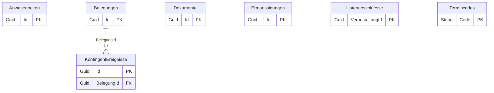
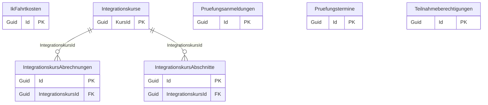
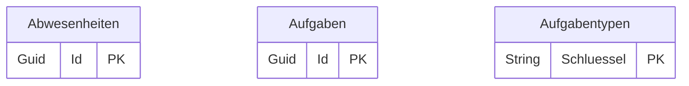
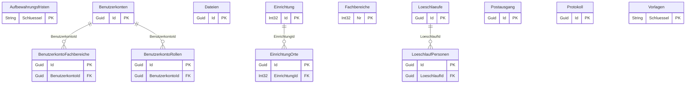

# Datenbank – Tabellenstrukturen

Automatisch erzeugt aus dem EF-Modell (`DatenbankDokuTests`, Zwecktexte in `DatenmodellBeschreibung.cs`), nicht von Hand ändern.
SQLite, angelegt beim ersten Start per `EnsureCreated` aus dem Modell (noch keine Migrationen, siehe docs/betrieb.md); die Schemaversion
steht in der Tabelle `Schemainfo`. Speicherformate: Ids als 16-Byte-BLOB (UUIDv7, Big Endian), Kalendertage als Ganzzahl JJJJMMTT,
Zeitpunkte (`DateTimeOffset`) und Termine als UTC-Millisekunden seit 1970, Aufzählungen als Text. Namen sortieren per Collation
`DIN5007_2`. Keine Kopien: Namen, Anzeigetexte und Stände werden zur Laufzeit aus den Quellen gelesen. Keine JSON-Spalten: Listen
stehen in eigenen Tabellen (je Eintrag eine Zeile).

**Bitemporale Versionstabellen** (Namen, Merkmale, Adressen, …): `GueltigVon`/`GueltigBis` = fachliche Zeit (halboffen);
Wissenszeit, Person und Grund stehen im Änderungsvorgang (`ErfasstDurchVorgangId`, ersetzt durch `ErsetztDurchVorgangId` → Tabelle
`Aenderungsvorgaenge`); `Erfassungsart` = Rolle der Zeile im Vorgang. „Einstufung“: F = führend, A = nur nach Anonymisierung
(siehe `Spalteneinstufung.cs`).

**Lesbare Sichten:** Zu jeder Tabelle gibt es eine Sicht `v_<Tabelle>` (Ids als GUID-Text, Tage als JJJJ-MM-TT, Zeitpunkte als
UTC-Text; bei Versionstabellen zusätzlich `ErfasstAm`, `ErfasstVon`, `Grund`, `ErsetztAm` aus dem Vorgang) – zum Prüfen im DB-Browser.

## Bitemporale Datenhaltung

Alle Personenangaben (Namen, Merkmale wie Titel, Rollen, Sprache, Geburtsdatum, Anrede, Adressen, Adresskennzeichen, Rufnummern,
E-Mail-Adressen, Organisationen, Vollmachten, Einwilligungen, Qualifikationen) und weitere Stammdaten (Entgelte, Ortsmerkmale) werden
**bitemporal** („zwei Zeitachsen“) gespeichert:

| Achse | Spalten | Bedeutung | Beispiel |
|---|---|---|---|
| **Gültigkeitszeit** (valid time) | `GueltigVon`, `GueltigBis` | Wann galt die Angabe **in der Welt**? Halboffen: `GueltigVon` einschließlich, `GueltigBis` ausschließlich (`NULL` = offen). | „wohnte bis 31.07. in der Lindenstraße“ |
| **Wissenszeit** (transaction/system time) | `ErfasstAm`, `ErsetztAm` | Wann **wussten wir** es? Ab `ErfasstAm`, bis `ErsetztAm` (`NULL` = aktueller Wissensstand). | „das wussten wir vom 15.03. bis zum 20.09.“ |

**Versionen werden nie geändert.** Jede Änderung – eine Änderung ab Datum (z. B. ein gemeldeter Umzug), eine Korrektur, das Beenden –
erzeugt neue Zeilen und markiert die bisherige als ersetzt (`ErsetztAm`). `ErsetztAm` heißt also nicht „war falsch“, sondern „ab da
wussten wir es anders bzw. genauer“. Nur so bleibt beantwortbar, was das System zu einem früheren Zeitpunkt wusste (z. B. warum ein Brief
an die alte Adresse ging).

**Änderungsvorgang:** Zeitpunkt, Person und Grund stehen nicht in jeder Zeile, sondern einmal je Aktion in der Tabelle
`Aenderungsvorgaenge`; die Zeilen verweisen mit `ErfasstDurchVorgangId` (angelegt durch) und `ErsetztDurchVorgangId` (ersetzt durch)
darauf. `ErfasstAm` ist der Zeitpunkt des anlegenden, `ErsetztAm` der des ersetzenden Vorgangs. `Erfassungsart` (Ersterfassung, Änderung ab
Datum, Korrektur, Abgrenzung, Beendet) beschreibt die Rolle der Zeile im Vorgang. Die Sichten `v_…` zeigen alles wieder zusammen.

**Stabile Identität vs. Version:** Die Spalte `Id` ist die Zeilen-Id einer *Version*. Gegenstände, von denen eine Person mehrere haben kann,
tragen zusätzlich eine stabile Identität, die über alle Versionen gleich bleibt: `AdressId` (eine Adresse), `NummerId` (eine Rufnummer) usw.
Darauf verweisen andere Versionen, z. B. das Kennzeichen „üblicher Aufenthaltsort“ (`PersonAdressKennzeichen.AdressId`).
`AdressId` ist also **kein Adresstyp** – der Typ ergibt sich aus den Kennzeichen.

### Beispiel: Umzug mit nachträglicher Korrektur

- Frau Muster wohnt seit 01.01.2020 in der Lindenstraße 5 (bei uns erfasst am 10.01.2020).
- Am 15.03.2026 meldet sie: „Ab 01.08. wohne ich im Bergweg 2.“ (Vorgang „Umzug gemeldet“)
- Am 10.07. geht die Kursbestätigung raus – in die Lindenstraße.
- Am 20.09. legt sie die Meldebescheinigung vor: Der Umzug war schon am 01.07. (Vorgang „Meldebescheinigung“, Funktion
  „Umzugsdatum korrigieren“)

| Zeile | Adresse | gültig von | gültig bis (einschl.) | erfasst (Vorgang) | ersetzt (Vorgang) | Erfassungsart |
|---|---|---|---|---|---|---|
| A | Lindenstr. 5 | 01.01.2020 | offen | 10.01.2020 (Ersterfassung) | 15.03.2026 (Umzug gemeldet) | Ersterfassung |
| B | Lindenstr. 5 | 01.01.2020 | 31.07.2026 | 15.03.2026 (Umzug gemeldet) | 20.09.2026 (Meldebescheinigung) | Abgrenzung |
| C | Bergweg 2 | 01.08.2026 | offen | 15.03.2026 (Umzug gemeldet) | 20.09.2026 (Meldebescheinigung) | Änderung ab Datum |
| D | Lindenstr. 5 | 01.01.2020 | 30.06.2026 | 20.09.2026 (Meldebescheinigung) | – | Korrektur |
| E | Bergweg 2 | 01.07.2026 | offen | 20.09.2026 (Meldebescheinigung) | – | Korrektur |

(In der Datenbank steht `GueltigBis` ausschließlich, also bei B `20260801`, bei D `20260701`.)

So liest man es:
- B sagt **„wohnte bis 31.07. in der Lindenstraße“** – das war unser Wissen vom 15.03. bis 20.09. (`ErfasstAm` bis `ErsetztAm`).
- D sagt **„wohnte bis 30.06. in der Lindenstraße“** – das ist unser Wissen seit 20.09. (`ErsetztAm` leer = aktueller Stand).

Zwei typische Fragen:
- **„Wo wohnte sie am 10.07.?“** (heutiger Wissensstand) → nur nicht ersetzte Zeilen D, E → **Bergweg 2**.
- **„Wohin hätten wir am 10.07. geschrieben?“** (Wissensstand 10.07.) → Zeilen, die am 10.07. bekannt und nicht ersetzt waren: B, C →
  **Lindenstraße 5**. Der Brief ging also zu Recht dorthin, obwohl wir heute wissen, dass sie schon umgezogen war.

Beide Fragen beantwortet dieselbe Abfrage mit zwei Parametern – Stichtag `:tag` und Wissensstand `:bekannt`:

```sql
SELECT a.*
FROM PersonAdressen a
JOIN Aenderungsvorgaenge e ON e.Id = a.ErfasstDurchVorgangId
LEFT JOIN Aenderungsvorgaenge r ON r.Id = a.ErsetztDurchVorgangId
WHERE a.PersonId = :person
  AND a.GueltigVon <= :tag AND (a.GueltigBis IS NULL OR a.GueltigBis > :tag)   -- galt am Stichtag
  AND e.Am <= :bekannt AND (r.Id IS NULL OR r.Am > :bekannt);                 -- war zu diesem Zeitpunkt bekannt
-- „Wo wohnte sie am 10.07.?“                 :tag = 20260710, :bekannt = jetzt (UTC-Millisekunden)
-- „Wohin hätten wir am 10.07. geschrieben?“  :tag = 20260710, :bekannt = 10.07.2026 24:00 Ortszeit als UTC-Millisekunden
```

Für den aktuellen Wissensstand genügt `a.ErsetztDurchVorgangId IS NULL`. Im Code übernimmt das `ZeitlicheHistorie.AlsStichtag(gueltigAm,
bekanntAm)`; `Person.StandAm(tag, bekannt)` liefert den gesamten Stand. Speicherformate: Tage als Ganzzahl JJJJMMTT, Zeitpunkte als
UTC-Millisekunden seit 1970, Ids als 16 Byte (UUIDv7, Big Endian); zum Lesen von Hand dienen die Sichten `v_…` (z. B. `v_PersonAdressen`).

### Sortierung nach DIN 5007-2 (Collation `DIN5007_2`)

Personen werden nach Nachname, dann Vorname sortiert, wie im Telefonbuch (DIN 5007-2): ä→ae, ö→oe, ü→ue, ß→ss, Akzente ohne Zeichen,
Groß-/Kleinschreibung egal; der Namensvorsatz („von“) steht in einer eigenen Spalte und zählt für die Sortierung nicht. Dafür tragen die
Spalten `PersonNamen.Nachname` und `PersonNamen.Vorname` die SQLite-Collation `DIN5007_2`; der Index `IX_PersonNamen_Sortierung`
(Nachname, Vorname) liegt auf ihr, die Personenliste blättert per Keyset (Nachname, Vorname, Id) über diesen Index (geprüft mit
`EXPLAIN QUERY PLAN`). Es gibt keine gespeicherte Sortierspalte.

Die Collation registriert die Anwendung bei jeder Verbindung (`SqliteErweiterungen`). **Werkzeuge ohne diese Collation** (z. B. „DB
Browser for SQLite“, die sqlite3-Kommandozeile) können die Datenbank lesen, aber
- nicht nach diesen Spalten sortieren oder vergleichen (`ORDER BY Nachname` → Fehler „no such collation sequence: DIN5007_2“),
- keine Namensversionen schreiben (der Index braucht die Collation) und kein `PRAGMA integrity_check` ausführen.
Zum Prüfen deshalb die lesbaren Sichten bzw. die Anwendung verwenden; Änderungen an den Daten nur über die Anwendung.

## Übersicht

### Personen

- [Aenderungsvorgaenge](#aenderungsvorgaenge) – Änderungsvorgang: Zeitpunkt, Person, Grund – einmal je Aktion; Versionszeilen verweisen mit ErfasstDurch-/ErsetztDurchVorgangId darauf.
- [DublettenAusschluesse](#dublettenausschluesse) – Als „keine Dublette“ markierte Personenpaare.
- [Identitaetspruefungen](#identitaetspruefungen) – Nachweis der Ausweisprüfung (z. B. für Integrationskurse).
- [ImportZuordnungen](#importzuordnungen) – Zuordnung Altnummer → Person eines Importlaufs.
- [Importlaeufe](#importlaeufe) – CSV-Importläufe (Probelauf, Übernahme, Protokoll).
- [Lichtbilder](#lichtbilder) – Lichtbild einer Person (Ausweis, Teilnahmenachweis).
- [Organisationen](#organisationen) – Firmen, Behörden, Vereine (Auftraggeber, Arbeitgeber, Bevollmächtigte).
- [PersonAdressKennzeichen](#personadresskennzeichen) – Welche Adresse ab wann üblicher Aufenthaltsort bzw. Briefanschrift ist.
- [PersonAdressen](#personadressen) – Postadressen (je AdressId ein Gegenstand mit Versionen).
- [PersonEMails](#personemails) – E-Mail-Adressen (versioniert, mit bevorzugter Adresse).
- [PersonEinwilligungen](#personeinwilligungen) – Einwilligungen je Kanal und Zweck (versioniert, Nachweis).
- [PersonFachbereiche](#personfachbereiche) – Zuordnung einer Person zu Fachbereichen (Organisation).
- [PersonMerkmale](#personmerkmale) – Versionierte Einzelangaben: Geburtsdatum, Sprache, Rollen (Bitmaske), Titel, Anrede, Geschlecht, Geburtsname, Ansprache.
- [PersonNamen](#personnamen) – Namensversionen (Vorname, Vorsatz, Nachname, Zusatz); Sortierung nach DIN 5007-2 per Collation.
- [PersonOrganisationen](#personorganisationen) – Zugehörigkeit zu Organisationen (versioniert); der Name kommt aus Organisationen.
- [PersonQualifikationen](#personqualifikationen) – Qualifikationen und Lehrbefugnisse mit Gültigkeit und Nachweis (versioniert).
- [PersonRufnummern](#personrufnummern) – Rufnummern mit Messengerdiensten und Einwilligung (versioniert).
- [PersonVollmachten](#personvollmachten) – Buchungsvollmachten (versioniert, mit Nachweis; Name des Bevollmächtigten als Nachweis eingefroren).
- [Personen](#personen) – Person (Teilnehmende, Lehrkräfte, Mitarbeitende …): nur Kennung und Prozesszustand; alle Angaben stehen versioniert in den Person…-Tabellen.

```mermaid
erDiagram
    Aenderungsvorgaenge {
        Guid Id PK
    }
    DublettenAusschluesse {
        Guid PersonA PK
        Guid PersonB PK
    }
    Identitaetspruefungen {
        Guid Id PK
    }
    ImportZuordnungen {
        Guid Id PK
        Guid ImportlaufId FK
    }
    Importlaeufe {
        Guid Id PK
    }
    Lichtbilder {
        Guid Id PK
    }
    Organisationen {
        Guid Id PK
    }
    PersonAdressKennzeichen {
        Guid Id PK
        Guid ErfasstDurchVorgangId FK
        Guid ErsetztDurchVorgangId FK
        Guid PersonId FK
    }
    PersonAdressen {
        Guid Id PK
        Guid ErfasstDurchVorgangId FK
        Guid ErsetztDurchVorgangId FK
        Guid PersonId FK
    }
    PersonEMails {
        Guid Id PK
        Guid ErfasstDurchVorgangId FK
        Guid ErsetztDurchVorgangId FK
        Guid PersonId FK
    }
    PersonEinwilligungen {
        Guid Id PK
        Guid ErfasstDurchVorgangId FK
        Guid ErsetztDurchVorgangId FK
        Guid PersonId FK
    }
    PersonFachbereiche {
        Guid Id PK
        Guid PersonId FK
    }
    PersonMerkmale {
        Guid Id PK
        Guid ErfasstDurchVorgangId FK
        Guid ErsetztDurchVorgangId FK
        Guid PersonId FK
    }
    PersonNamen {
        Guid Id PK
        Guid ErfasstDurchVorgangId FK
        Guid ErsetztDurchVorgangId FK
        Guid PersonId FK
    }
    PersonOrganisationen {
        Guid Id PK
        Guid ErfasstDurchVorgangId FK
        Guid ErsetztDurchVorgangId FK
        Guid OrganisationId FK
        Guid PersonId FK
    }
    PersonQualifikationen {
        Guid Id PK
        Guid ErfasstDurchVorgangId FK
        Guid ErsetztDurchVorgangId FK
        Guid PersonId FK
    }
    PersonRufnummern {
        Guid Id PK
        Guid ErfasstDurchVorgangId FK
        Guid ErsetztDurchVorgangId FK
        Guid PersonId FK
    }
    PersonVollmachten {
        Guid Id PK
        Guid ErfasstDurchVorgangId FK
        Guid ErsetztDurchVorgangId FK
        Guid PersonId FK
    }
    Personen {
        Guid Id PK
    }
    Aenderungsvorgaenge ||--o{ PersonAdressKennzeichen : "ErfasstDurchVorgangId"
    Aenderungsvorgaenge ||--o{ PersonAdressKennzeichen : "ErsetztDurchVorgangId"
    Aenderungsvorgaenge ||--o{ PersonAdressen : "ErfasstDurchVorgangId"
    Aenderungsvorgaenge ||--o{ PersonAdressen : "ErsetztDurchVorgangId"
    Aenderungsvorgaenge ||--o{ PersonEMails : "ErfasstDurchVorgangId"
    Aenderungsvorgaenge ||--o{ PersonEMails : "ErsetztDurchVorgangId"
    Aenderungsvorgaenge ||--o{ PersonEinwilligungen : "ErfasstDurchVorgangId"
    Aenderungsvorgaenge ||--o{ PersonEinwilligungen : "ErsetztDurchVorgangId"
    Aenderungsvorgaenge ||--o{ PersonMerkmale : "ErfasstDurchVorgangId"
    Aenderungsvorgaenge ||--o{ PersonMerkmale : "ErsetztDurchVorgangId"
    Aenderungsvorgaenge ||--o{ PersonNamen : "ErfasstDurchVorgangId"
    Aenderungsvorgaenge ||--o{ PersonNamen : "ErsetztDurchVorgangId"
    Aenderungsvorgaenge ||--o{ PersonOrganisationen : "ErfasstDurchVorgangId"
    Aenderungsvorgaenge ||--o{ PersonOrganisationen : "ErsetztDurchVorgangId"
    Aenderungsvorgaenge ||--o{ PersonQualifikationen : "ErfasstDurchVorgangId"
    Aenderungsvorgaenge ||--o{ PersonQualifikationen : "ErsetztDurchVorgangId"
    Aenderungsvorgaenge ||--o{ PersonRufnummern : "ErfasstDurchVorgangId"
    Aenderungsvorgaenge ||--o{ PersonRufnummern : "ErsetztDurchVorgangId"
    Aenderungsvorgaenge ||--o{ PersonVollmachten : "ErfasstDurchVorgangId"
    Aenderungsvorgaenge ||--o{ PersonVollmachten : "ErsetztDurchVorgangId"
    Importlaeufe ||--o{ ImportZuordnungen : "ImportlaufId"
    Organisationen ||--o{ PersonOrganisationen : "OrganisationId"
    Personen ||--o{ PersonAdressKennzeichen : "PersonId"
    Personen ||--o{ PersonAdressen : "PersonId"
    Personen ||--o{ PersonEMails : "PersonId"
    Personen ||--o{ PersonEinwilligungen : "PersonId"
    Personen ||--o{ PersonFachbereiche : "PersonId"
    Personen ||--o{ PersonMerkmale : "PersonId"
    Personen ||--o{ PersonNamen : "PersonId"
    Personen ||--o{ PersonOrganisationen : "PersonId"
    Personen ||--o{ PersonQualifikationen : "PersonId"
    Personen ||--o{ PersonRufnummern : "PersonId"
    Personen ||--o{ PersonVollmachten : "PersonId"
```



### Kurse, Termine und Orte

- [Ferien](#ferien) – Schulferien und Feiertage (Serien lassen sie aus).
- [KursBuchungsrechte](#kursbuchungsrechte) – Buchungswege der Richtlinie des Kurses.
- [KursEntgelte](#kursentgelte) – Entgelt eines Kurses (versioniert, z. B. Erhöhung ab Frühjahr).
- [KursLehranforderungen](#kurslehranforderungen) – Anforderungen an die Lehrkräfte des Kurses.
- [KursRaumanforderungen](#kursraumanforderungen) – Raumanforderungen des Kurses (aus der Kursart übernommen, änderbar).
- [KursSerieOrte](#kursserieorte) – Orte der Serienregel.
- [KursSerieWochentage](#kursseriewochentage) – Wochentage der Serienregel.
- [KursTeam](#kursteam) – Lehrkräfte im Kursteam (Leitung markiert); Namen zur Laufzeit.
- [KursartBuchungsrechte](#kursartbuchungsrechte) – Buchungswege der Richtlinie einer Kursart (wer darf buchen/überbuchen).
- [KursartLehranforderungen](#kursartlehranforderungen) – Anforderungen an Lehrkräfte der Kursart (Vorlage).
- [KursartRaumanforderungen](#kursartraumanforderungen) – Raumanforderungen der Kursart (Vorlage), je Anforderung eine Zeile.
- [Kursarten](#kursarten) – Kursarten mit Nutzungsart, Vorlagen für Raum- und Lehranforderungen und Buchungsrichtlinie (Spalten Richtlinie_…).
- [Kurse](#kurse) – Kurs mit Planungsdaten, Buchungsrichtlinie (Richtlinie_…) und Serienregel (Serie_…); Nutzungsart über die Kursart.
- [Kursunterlagen](#kursunterlagen) – Unterlagen zu Kursen (Datei, Freigabe, Sichtbarkeit).
- [MerkmalInaktiveWerte](#merkmalinaktivewerte) – Nicht mehr wählbare Auswahlwerte eines Merkmals.
- [MerkmalWerte](#merkmalwerte) – Auswahlwerte eines Merkmals.
- [Merkmale](#merkmale) – Merkmalskatalog (Ausstattung, Qualifikationen) mit Typ und Einheit.
- [OrtKapazitaeten](#ortkapazitaeten) – Kapazität eines Orts je Nutzungsart.
- [OrtMerkmale](#ortmerkmale) – Ausstattung und Zulassungen eines Orts (versioniert, mit Nachweis).
- [Orte](#orte) – Liegenschaften, Gebäude, Räume, virtuelle Räume, Treffpunkte (Hierarchie).
- [Qualifikationsausnahmen](#qualifikationsausnahmen) – Begründete Ausnahmen bei fehlender Qualifikation einer Lehrkraft.
- [Semester](#semester) – Semester (Programmzeitraum) mit Kürzel.
- [VeranstaltungOrte](#veranstaltungorte) – Orte eines Termins (hybrid: mehrere), optional eigene Höchstzahl.
- [Veranstaltungen](#veranstaltungen) – Einzelne Termine eines Kurses (UTC-Zeiten), Lehrkraft, Ausfall.

```mermaid
erDiagram
    Aenderungsvorgaenge {
        Guid Id PK
    }
    Ferien {
        Guid Id PK
    }
    KursBuchungsrechte {
        Guid Id PK
        Guid KursId FK
    }
    KursEntgelte {
        Guid Id PK
        Guid ErfasstDurchVorgangId FK
        Guid ErsetztDurchVorgangId FK
        Guid KursId FK
    }
    KursLehranforderungen {
        Guid Id PK
        Guid KursId FK
    }
    KursRaumanforderungen {
        Guid Id PK
        Guid KursId FK
    }
    KursSerieOrte {
        Guid Id PK
        Guid KursId FK
    }
    KursSerieWochentage {
        Guid Id PK
        Guid KursId FK
    }
    KursTeam {
        Guid Id PK
        Guid KursId FK
    }
    KursartBuchungsrechte {
        Guid Id PK
        Guid KursartId FK
    }
    KursartLehranforderungen {
        Guid Id PK
        Guid KursartId FK
    }
    KursartRaumanforderungen {
        Guid Id PK
        Guid KursartId FK
    }
    Kursarten {
        Guid Id PK
        Guid KursartId PK
    }
    Kurse {
        Guid Id PK
        Guid KursId PK
    }
    Kursunterlagen {
        Guid Id PK
    }
    MerkmalInaktiveWerte {
        Guid Id PK
        String MerkmalSchluessel FK
    }
    MerkmalWerte {
        Guid Id PK
        String MerkmalSchluessel FK
    }
    Merkmale {
        String Schluessel PK
    }
    OrtKapazitaeten {
        Guid Id PK
        Guid OrtId FK
    }
    OrtMerkmale {
        Guid Id PK
        Guid ErfasstDurchVorgangId FK
        Guid ErsetztDurchVorgangId FK
        Guid OrtId FK
    }
    Orte {
        Guid Id PK
    }
    Qualifikationsausnahmen {
        Guid Id PK
    }
    Semester {
        Guid Id PK
    }
    VeranstaltungOrte {
        Guid Id PK
        Guid VeranstaltungId FK
    }
    Veranstaltungen {
        Guid Id PK
        Guid KursId FK
    }
    Aenderungsvorgaenge ||--o{ KursEntgelte : "ErfasstDurchVorgangId"
    Aenderungsvorgaenge ||--o{ KursEntgelte : "ErsetztDurchVorgangId"
    Aenderungsvorgaenge ||--o{ OrtMerkmale : "ErfasstDurchVorgangId"
    Aenderungsvorgaenge ||--o{ OrtMerkmale : "ErsetztDurchVorgangId"
    Kursarten ||--o{ KursartBuchungsrechte : "KursartId"
    Kursarten ||--o{ KursartLehranforderungen : "KursartId"
    Kursarten ||--o{ KursartRaumanforderungen : "KursartId"
    Kurse ||--o{ KursBuchungsrechte : "KursId"
    Kurse ||--o{ KursEntgelte : "KursId"
    Kurse ||--o{ KursLehranforderungen : "KursId"
    Kurse ||--o{ KursRaumanforderungen : "KursId"
    Kurse ||--o{ KursSerieOrte : "KursId"
    Kurse ||--o{ KursSerieWochentage : "KursId"
    Kurse ||--o{ KursTeam : "KursId"
    Kurse ||--o{ Veranstaltungen : "KursId"
    Merkmale ||--o{ MerkmalInaktiveWerte : "MerkmalSchluessel"
    Merkmale ||--o{ MerkmalWerte : "MerkmalSchluessel"
    Orte ||--o{ OrtKapazitaeten : "OrtId"
    Orte ||--o{ OrtMerkmale : "OrtId"
    Veranstaltungen ||--o{ VeranstaltungOrte : "VeranstaltungId"
```



### Anmeldung und Teilnahme

- [Anwesenheiten](#anwesenheiten) – Anwesenheit je Termin und Person (Weg: Liste, QR, Selbst-Check-in).
- [Belegungen](#belegungen) – Anmeldung einer Person zu einem Kurs (Status, Weg, Entgelt, Kontingent).
- [Dokumente](#dokumente) – Archiv erzeugter Briefe und Bescheinigungen (PDF mit SHA-256).
- [Ermaessigungen](#ermaessigungen) – Ermäßigungsberechtigungen mit Nachweis und Zeitraum.
- [KontingentEreignisse](#kontingentereignisse) – Ereignisse eines Kontingents (eingebucht, besucht, verfallen; nur anfügen).
- [Listenabschluesse](#listenabschluesse) – Abschluss einer Anwesenheitsliste (wer, wann).
- [Termincodes](#termincodes) – QR-Codes für den Check-in je Termin und Ort.



### Finanzen

- [Bankverbindungen](#bankverbindungen) – Bankverbindungen von Personen bzw. Organisationen.
- [Belege](#belege) – Rechnungen, Gutschriften, Mahnungen (GoBD: festgeschrieben, Empfänger eingefroren, Hash).
- [Belegpositionen](#belegpositionen) – Positionen eines Belegs.
- [Finanzeinstellungen](#finanzeinstellungen) – Bankverbindung, Gläubiger-Id, Zahlungsziel, Gebühren der Einrichtung.
- [Finanzprotokoll](#finanzprotokoll) – Manipulationsgeschütztes Änderungsprotokoll der Finanzdaten (Hash-Kette).
- [Honorarvertraege](#honorarvertraege) – Honorarverträge mit Lehrkräften (Honorarmodell).
- [HonorarvertragParameter](#honorarvertragparameter) – Parameter eines Honorarvertrags (Name/Wert).
- [Kontoauszuege](#kontoauszuege) – Eingelesene Kontoauszüge.
- [Mahnlaeufe](#mahnlaeufe) – Mahnvorschläge und freigegebene Mahnläufe.
- [Mahnposten](#mahnposten) – Posten eines Mahnlaufs (Abbild zum Zeitpunkt des Laufs).
- [Mahnstufen](#mahnstufen) – Mahnstufen mit Abstand und Gebühr.
- [Nummernkreise](#nummernkreise) – Fortlaufende Belegnummern je Art und Jahr.
- [SepaMandate](#sepamandate) – SEPA-Lastschriftmandate.
- [Uebergaben](#uebergaben) – Übergaben an die Kämmerei (GoBD-Export).
- [Umsaetze](#umsaetze) – Umsätze eines Kontoauszugs mit Zuordnung zu Belegen.
- [Zahlungslaeufe](#zahlungslaeufe) – Lastschrift- und Überweisungsläufe (Vorschlag, Freigabe, Export).
- [Zahlungsposten](#zahlungsposten) – Posten eines Zahlungslaufs (Abbild der SEPA-Datei).

```mermaid
erDiagram
    Bankverbindungen {
        Guid PersonId PK
    }
    Belege {
        Guid Id PK
    }
    Belegpositionen {
        Guid BelegId PK
        Int32 Nr PK
    }
    Finanzeinstellungen {
        Int32 Id PK
    }
    Finanzprotokoll {
        Int64 Nr PK
    }
    Honorarvertraege {
        Guid Id PK
    }
    HonorarvertragParameter {
        Guid Id PK
        Guid HonorarvertragId FK
    }
    Kontoauszuege {
        Guid Id PK
    }
    Mahnlaeufe {
        Guid Id PK
    }
    Mahnposten {
        Guid Id PK
        Guid MahnlaufId FK
    }
    Mahnstufen {
        Guid Id PK
        Int32 FinanzeinstellungenId FK
    }
    Nummernkreise {
        Belegart Art PK
        Int32 Jahr PK
    }
    SepaMandate {
        Guid Id PK
    }
    Uebergaben {
        Guid Id PK
    }
    Umsaetze {
        Guid Id PK
    }
    Zahlungslaeufe {
        Guid Id PK
    }
    Zahlungsposten {
        Guid Id PK
        Guid ZahlungslaufId FK
    }
    Belege ||--o{ Belegpositionen : "BelegId"
    Finanzeinstellungen ||--o{ Mahnstufen : "FinanzeinstellungenId"
    Honorarvertraege ||--o{ HonorarvertragParameter : "HonorarvertragId"
    Mahnlaeufe ||--o{ Mahnposten : "MahnlaufId"
    Zahlungslaeufe ||--o{ Zahlungsposten : "ZahlungslaufId"
```



### Integrationskurse

- [IkFahrtkosten](#ikfahrtkosten) – Fahrtkostenerstattung für Integrationskurse.
- [IntegrationskursAbrechnungen](#integrationskursabrechnungen) – Abrechnungen je Abschnitt (Beleg, Vorgang beim BAMF).
- [IntegrationskursAbschnitte](#integrationskursabschnitte) – Kursabschnitte mit Unterrichtseinheiten.
- [Integrationskurse](#integrationskurse) – BAMF-Daten eines Integrationskurses (Kursnummer, Art, Sätze).
- [Pruefungsanmeldungen](#pruefungsanmeldungen) – Anmeldungen und Ergebnisse zu Prüfungen.
- [Pruefungstermine](#pruefungstermine) – Prüfungstermine (DTZ, LiD …).
- [Teilnahmeberechtigungen](#teilnahmeberechtigungen) – Berechtigungen bzw. Verpflichtungen zur Teilnahme (Aktenzeichen).



### Aufgaben

- [Abwesenheiten](#abwesenheiten) – Abwesenheiten mit Vertretung (Namen aus den Benutzerkonten).
- [Aufgaben](#aufgaben) – Aufgaben in Gruppenkörben mit Bearbeitung und Eskalation; Namen aus den Benutzerkonten.
- [Aufgabentypen](#aufgabentypen) – Aufgabentypen (Korb, Frist, Eskalation).



### Portale und Webshop

- [Kursstaende](#kursstaende) – Veröffentlichungsstand je Kurs für Delta-Abrufe (ETag).
- [Portalanliegen](#portalanliegen) – Anliegen aus den Portalen (Ausfall, Bankverbindung, Merkmal …) mit Bearbeitung.
- [PortalanliegenAngaben](#portalanliegenangaben) – Angaben eines Anliegens (Name/Wert).
- [SchnellanmeldungEinwilligungen](#schnellanmeldungeinwilligungen) – Einwilligungsnachweise einer Schnellanmeldung.
- [Schnellanmeldungen](#schnellanmeldungen) – Schnellanmeldungen per Kurs-QR mit Stornolink.
- [ShopbuchungEinwilligungen](#shopbuchungeinwilligungen) – Einwilligungsnachweise einer Shopbuchung (AGB, Datenschutz).
- [ShopbuchungPositionen](#shopbuchungpositionen) – Ergebnis je Kurs einer Shopbuchung.
- [Shopbuchungen](#shopbuchungen) – Buchungen aus dem Webshop (Idempotenz, Ergebnis).
- [Shopkonten](#shopkonten) – Kundenkonten des Webshops.
- [Warenkoerbe](#warenkoerbe) – Warenkörbe des Webshops.
- [WarenkorbPositionen](#warenkorbpositionen) – Kurse im Warenkorb.
- [Zugangstokens](#zugangstokens) – Zugangs- und Kalendertokens (nur Hash gespeichert).


### System

- [Aufbewahrungsfristen](#aufbewahrungsfristen) – Aufbewahrungsfristen je Datenart (Datenschutz).
- [Benutzerkonten](#benutzerkonten) – Anmeldekonten; Name nur bei Funktionskonten, sonst aus der Person.
- [BenutzerkontoFachbereiche](#benutzerkontofachbereiche) – Zuständige Fachbereiche eines Kontos.
- [BenutzerkontoRollen](#benutzerkontorollen) – Rollen eines Kontos (die erste ist beim Anmelden aktiv).
- [Dateien](#dateien) – Gespeicherte Dateien (Inhalt, Virenprüfung).
- [Einrichtung](#einrichtung) – Briefkopf der Einrichtung (Name, Logo, Website).
- [EinrichtungOrte](#einrichtungorte) – Orte im Briefkopf.
- [Fachbereiche](#fachbereiche) – Fachbereiche der VHS.
- [Loeschlaeufe](#loeschlaeufe) – Löschläufe mit Vier-Augen-Freigabe.
- [LoeschlaufPersonen](#loeschlaufpersonen) – Personen eines Löschlaufs (bis zur Ausführung).
- [Postausgang](#postausgang) – Ausgehende Mails mit Status (Abbild der gesendeten Nachricht).
- [Protokoll](#protokoll) – Auditprotokoll (nur anfügen, Pseudonyme statt Personendaten).
- [Vorlagen](#vorlagen) – Text- und Mailvorlagen (Anredestil).



## Aenderungsvorgaenge

Änderungsvorgang: Zeitpunkt, Person, Grund – einmal je Aktion; Versionszeilen verweisen mit ErfasstDurch-/ErsetztDurchVorgangId darauf. (Bereich: Personen)

Klasse: `VibeVHS.Domain.Gemeinsam.Aenderungsvorgang`

| Spalte | Typ | Pflicht | Schlüssel/Verweis | Einstufung / Hinweis |
|---|---|---|---|---|
| Id | BLOB | ja | PK |  |
| Am | INTEGER | ja | Index |  |
| Grund | TEXT(500) | ja |  |  |
| Von | TEXT(200) | ja |  |  |

Indizes: `IX_Aenderungsvorgaenge_Am` (Am)

## DublettenAusschluesse

Als „keine Dublette“ markierte Personenpaare. (Bereich: Personen)

Klasse: `VibeVHS.Application.Personen.DublettenAusschluss`

| Spalte | Typ | Pflicht | Schlüssel/Verweis | Einstufung / Hinweis |
|---|---|---|---|---|
| PersonA | BLOB | ja | PK |  |
| PersonB | BLOB | ja | PK |  |
| Am | INTEGER | ja |  |  |
| Von | TEXT(200) | ja |  |  |

## Identitaetspruefungen

Nachweis der Ausweisprüfung (z. B. für Integrationskurse). (Bereich: Personen)

Klasse: `VibeVHS.Domain.Integration.Identitaetspruefung`

| Spalte | Typ | Pflicht | Schlüssel/Verweis | Einstufung / Hinweis |
|---|---|---|---|---|
| Id | BLOB | ja | PK |  |
| Bemerkung | TEXT(500) |  |  |  |
| Dokument | TEXT(40) | ja |  |  |
| GeprueftAm | INTEGER | ja |  |  |
| GeprueftVon | TEXT | ja |  |  |
| PersonId | BLOB | ja | Index |  |
| StimmtUeberein | INTEGER | ja |  |  |

Indizes: `IX_Identitaetspruefungen_PersonId` (PersonId)

## ImportZuordnungen

Zuordnung Altnummer → Person eines Importlaufs. (Bereich: Personen)

Klasse: `VibeVHS.Domain.Personen.Importzuordnung`

| Spalte | Typ | Pflicht | Schlüssel/Verweis | Einstufung / Hinweis |
|---|---|---|---|---|
| Id | BLOB | ja | PK |  |
| Altnummer | TEXT | ja |  |  |
| ImportlaufId | BLOB | ja | → Importlaeufe, Index |  |
| PersonId | BLOB | ja |  |  |

Indizes: `IX_ImportZuordnungen_ImportlaufId` (ImportlaufId)

## Importlaeufe

CSV-Importläufe (Probelauf, Übernahme, Protokoll). (Bereich: Personen)

Klasse: `VibeVHS.Domain.Personen.Importlauf`

| Spalte | Typ | Pflicht | Schlüssel/Verweis | Einstufung / Hinweis |
|---|---|---|---|---|
| Id | BLOB | ja | PK |  |
| Am | INTEGER | ja |  |  |
| Angelegt | INTEGER | ja |  |  |
| Art | TEXT | ja |  |  |
| Datei | TEXT | ja |  |  |
| Dubletten | INTEGER | ja |  |  |
| Fehler | INTEGER | ja |  |  |
| Sha256 | TEXT | ja | Index |  |
| Von | TEXT | ja |  |  |
| Zeilen | INTEGER | ja |  |  |

Indizes: `IX_Importlaeufe_Sha256` (Sha256)

## Lichtbilder

Lichtbild einer Person (Ausweis, Teilnahmenachweis). (Bereich: Personen)

Klasse: `VibeVHS.Domain.Integration.Lichtbild`

| Spalte | Typ | Pflicht | Schlüssel/Verweis | Einstufung / Hinweis |
|---|---|---|---|---|
| Id | BLOB | ja | PK |  |
| AufgenommenAm | INTEGER | ja |  |  |
| AufgenommenVon | TEXT | ja |  |  |
| GeloeschtAm | INTEGER |  |  |  |
| Inhalt | BLOB | ja |  |  |
| KursId | BLOB | ja | Index |  |
| LoeschenAb | INTEGER | ja |  |  |
| PersonId | BLOB | ja | Index |  |
| Typ | TEXT | ja |  |  |

Indizes: `IX_Lichtbilder_PersonId_KursId` (PersonId, KursId)

## Organisationen

Firmen, Behörden, Vereine (Auftraggeber, Arbeitgeber, Bevollmächtigte). (Bereich: Personen)

Klasse: `VibeVHS.Domain.Personen.Organisation`

| Spalte | Typ | Pflicht | Schlüssel/Verweis | Einstufung / Hinweis |
|---|---|---|---|---|
| Id | BLOB | ja | PK | F: Schlüssel |
| Art | TEXT(40) | ja |  | F: Stammdatum Organisation |
| LeitwegId | TEXT |  |  | F: XRechnung |
| Name | TEXT(300) | ja |  | F: Stammdatum Organisation |
| Ort | TEXT(200) |  |  | F: Stammdatum Organisation |
| RechnungsEMail | TEXT |  |  | F: Stammdatum Organisation |
| Rechnungsanschrift | TEXT |  |  | F: Belege frieren ihre Anschrift selbst ein (GoBD) |

## PersonAdressKennzeichen

Welche Adresse ab wann üblicher Aufenthaltsort bzw. Briefanschrift ist. (Bereich: Personen)

Klasse: `VibeVHS.Domain.Personen.AdressKennzeichen`

| Spalte | Typ | Pflicht | Schlüssel/Verweis | Einstufung / Hinweis |
|---|---|---|---|---|
| Id | BLOB | ja | PK |  |
| AdressId | BLOB | ja |  |  |
| Art | TEXT(40) | ja |  |  |
| ErfasstDurchVorgangId | BLOB | ja | → Aenderungsvorgaenge, Index |  |
| Erfassungsart | TEXT(40) | ja |  |  |
| ErsetztDurchVorgangId | BLOB |  | → Aenderungsvorgaenge, Index |  |
| GueltigBis | INTEGER |  |  |  |
| GueltigVon | INTEGER | ja | Index |  |
| PersonId | BLOB | ja | → Personen, Index |  |

Indizes: `IX_PersonAdressKennzeichen_ErfasstDurchVorgangId` (ErfasstDurchVorgangId); `IX_PersonAdressKennzeichen_ErsetztDurchVorgangId` (ErsetztDurchVorgangId); `IX_PersonAdressKennzeichen_PersonId_GueltigVon` (PersonId, GueltigVon)

## PersonAdressen

Postadressen (je AdressId ein Gegenstand mit Versionen). (Bereich: Personen)

Klasse: `VibeVHS.Domain.Personen.Postadresse`

| Spalte | Typ | Pflicht | Schlüssel/Verweis | Einstufung / Hinweis |
|---|---|---|---|---|
| Id | BLOB | ja | PK |  |
| AdressId | BLOB | ja | Index |  |
| ErfasstDurchVorgangId | BLOB | ja | → Aenderungsvorgaenge, Index |  |
| Erfassungsart | TEXT(40) | ja |  |  |
| ErsetztDurchVorgangId | BLOB |  | → Aenderungsvorgaenge, Index |  |
| GueltigBis | INTEGER |  |  |  |
| GueltigVon | INTEGER | ja | Index |  |
| Land | TEXT(2) | ja |  |  |
| Ort | TEXT(200) | ja |  |  |
| PersonId | BLOB | ja | → Personen, Index |  |
| Postleitzahl | TEXT(20) | ja |  |  |
| Strasse | TEXT(200) | ja |  |  |
| Zusatz | TEXT(200) |  |  |  |

Indizes: `IX_PersonAdressen_AdressId` (AdressId); `IX_PersonAdressen_ErfasstDurchVorgangId` (ErfasstDurchVorgangId); `IX_PersonAdressen_ErsetztDurchVorgangId` (ErsetztDurchVorgangId); `IX_PersonAdressen_PersonId_GueltigVon` (PersonId, GueltigVon)

## PersonEMails

E-Mail-Adressen (versioniert, mit bevorzugter Adresse). (Bereich: Personen)

Klasse: `VibeVHS.Domain.Personen.EMailAdresse`

| Spalte | Typ | Pflicht | Schlüssel/Verweis | Einstufung / Hinweis |
|---|---|---|---|---|
| Id | BLOB | ja | PK |  |
| AdressId | BLOB | ja | Index |  |
| Adresse | TEXT(320) | ja |  |  |
| Art | TEXT(40) | ja |  |  |
| Bevorzugt | INTEGER | ja |  |  |
| ErfasstDurchVorgangId | BLOB | ja | → Aenderungsvorgaenge, Index |  |
| Erfassungsart | TEXT(40) | ja |  |  |
| ErsetztDurchVorgangId | BLOB |  | → Aenderungsvorgaenge, Index |  |
| GueltigBis | INTEGER |  |  |  |
| GueltigVon | INTEGER | ja | Index |  |
| PersonId | BLOB | ja | → Personen, Index |  |

Indizes: `IX_PersonEMails_AdressId` (AdressId); `IX_PersonEMails_ErfasstDurchVorgangId` (ErfasstDurchVorgangId); `IX_PersonEMails_ErsetztDurchVorgangId` (ErsetztDurchVorgangId); `IX_PersonEMails_PersonId_GueltigVon` (PersonId, GueltigVon)

## PersonEinwilligungen

Einwilligungen je Kanal und Zweck (versioniert, Nachweis). (Bereich: Personen)

Klasse: `VibeVHS.Domain.Personen.Einwilligung`

| Spalte | Typ | Pflicht | Schlüssel/Verweis | Einstufung / Hinweis |
|---|---|---|---|---|
| Id | BLOB | ja | PK |  |
| ErfasstDurchVorgangId | BLOB | ja | → Aenderungsvorgaenge, Index |  |
| Erfassungsart | TEXT(40) | ja |  |  |
| ErsetztDurchVorgangId | BLOB |  | → Aenderungsvorgaenge, Index |  |
| Erteilt | INTEGER | ja |  |  |
| GueltigBis | INTEGER |  |  |  |
| GueltigVon | INTEGER | ja | Index |  |
| Kanal | TEXT(40) | ja |  |  |
| PersonId | BLOB | ja | → Personen, Index |  |
| Zweck | TEXT(40) | ja |  |  |

Indizes: `IX_PersonEinwilligungen_ErfasstDurchVorgangId` (ErfasstDurchVorgangId); `IX_PersonEinwilligungen_ErsetztDurchVorgangId` (ErsetztDurchVorgangId); `IX_PersonEinwilligungen_PersonId_GueltigVon` (PersonId, GueltigVon)

## PersonFachbereiche

Zuordnung einer Person zu Fachbereichen (Organisation). (Bereich: Personen)

Klasse: `VibeVHS.Domain.Gemeinsam.Listenwert`1[[System.Int32, System.Private.CoreLib, Version=11.0.0.0, Culture=neutral, PublicKeyToken=7cec85d7bea7798e]]`

| Spalte | Typ | Pflicht | Schlüssel/Verweis | Einstufung / Hinweis |
|---|---|---|---|---|
| Id | BLOB | ja | PK |  |
| PersonId | BLOB | ja | → Personen, Index |  |
| Wert | INTEGER | ja |  |  |

Indizes: `IX_PersonFachbereiche_PersonId` (PersonId)

## PersonMerkmale

Versionierte Einzelangaben: Geburtsdatum, Sprache, Rollen (Bitmaske), Titel, Anrede, Geschlecht, Geburtsname, Ansprache. (Bereich: Personen)

Klasse: `VibeVHS.Domain.Personen.PersonMerkmal`

| Spalte | Typ | Pflicht | Schlüssel/Verweis | Einstufung / Hinweis |
|---|---|---|---|---|
| Id | BLOB | ja | PK |  |
| Art | TEXT(40) | ja |  |  |
| ErfasstDurchVorgangId | BLOB | ja | → Aenderungsvorgaenge, Index |  |
| Erfassungsart | TEXT(40) | ja |  |  |
| ErsetztDurchVorgangId | BLOB |  | → Aenderungsvorgaenge, Index |  |
| GueltigBis | INTEGER |  |  |  |
| GueltigVon | INTEGER | ja | Index |  |
| Inhalt | TEXT(200) | ja |  |  |
| PersonId | BLOB | ja | → Personen, Index |  |

Indizes: `IX_PersonMerkmale_ErfasstDurchVorgangId` (ErfasstDurchVorgangId); `IX_PersonMerkmale_ErsetztDurchVorgangId` (ErsetztDurchVorgangId); `IX_PersonMerkmale_PersonId_GueltigVon` (PersonId, GueltigVon)

## PersonNamen

Namensversionen (Vorname, Vorsatz, Nachname, Zusatz); Sortierung nach DIN 5007-2 per Collation. (Bereich: Personen)

Klasse: `VibeVHS.Domain.Personen.PersonName`

| Spalte | Typ | Pflicht | Schlüssel/Verweis | Einstufung / Hinweis |
|---|---|---|---|---|
| Id | BLOB | ja | PK |  |
| ErfasstDurchVorgangId | BLOB | ja | → Aenderungsvorgaenge, Index |  |
| Erfassungsart | TEXT(40) | ja |  |  |
| ErsetztDurchVorgangId | BLOB |  | → Aenderungsvorgaenge, Index |  |
| GueltigBis | INTEGER |  |  |  |
| GueltigVon | INTEGER | ja | Index |  |
| Nachname | TEXT(200) | ja | Index |  |
| PersonId | BLOB | ja | → Personen, Index |  |
| Vorname | TEXT(200) | ja | Index |  |
| Vorsatz | TEXT(30) | ja |  |  |
| Zusatz | TEXT(20) | ja |  |  |

Indizes: `IX_PersonNamen_ErfasstDurchVorgangId` (ErfasstDurchVorgangId); `IX_PersonNamen_PersonId_GueltigVon` (PersonId, GueltigVon); `IX_PersonNamen_Sortierung` (ErsetztDurchVorgangId, Nachname COLLATE DIN5007_2, Vorname COLLATE DIN5007_2)

## PersonOrganisationen

Zugehörigkeit zu Organisationen (versioniert); der Name kommt aus Organisationen. (Bereich: Personen)

Klasse: `VibeVHS.Domain.Personen.Organisationszugehoerigkeit`

| Spalte | Typ | Pflicht | Schlüssel/Verweis | Einstufung / Hinweis |
|---|---|---|---|---|
| Id | BLOB | ja | PK |  |
| ErfasstDurchVorgangId | BLOB | ja | → Aenderungsvorgaenge, Index |  |
| Erfassungsart | TEXT(40) | ja |  |  |
| ErsetztDurchVorgangId | BLOB |  | → Aenderungsvorgaenge, Index |  |
| Funktion | TEXT(200) |  |  |  |
| GueltigBis | INTEGER |  |  |  |
| GueltigVon | INTEGER | ja | Index |  |
| OrganisationId | BLOB | ja | → Organisationen, Index |  |
| PersonId | BLOB | ja | → Personen, Index |  |

Indizes: `IX_PersonOrganisationen_ErfasstDurchVorgangId` (ErfasstDurchVorgangId); `IX_PersonOrganisationen_ErsetztDurchVorgangId` (ErsetztDurchVorgangId); `IX_PersonOrganisationen_OrganisationId` (OrganisationId); `IX_PersonOrganisationen_PersonId_GueltigVon` (PersonId, GueltigVon)

## PersonQualifikationen

Qualifikationen und Lehrbefugnisse mit Gültigkeit und Nachweis (versioniert). (Bereich: Personen)

Klasse: `VibeVHS.Domain.Personen.PersonQualifikation`

| Spalte | Typ | Pflicht | Schlüssel/Verweis | Einstufung / Hinweis |
|---|---|---|---|---|
| Id | BLOB | ja | PK |  |
| AusstellendeStelle | TEXT(200) |  |  |  |
| Bezeichnung | TEXT(200) | ja |  |  |
| ErfasstDurchVorgangId | BLOB | ja | → Aenderungsvorgaenge, Index |  |
| Erfassungsart | TEXT(40) | ja |  |  |
| ErsetztDurchVorgangId | BLOB |  | → Aenderungsvorgaenge, Index |  |
| GueltigBis | INTEGER |  |  |  |
| GueltigVon | INTEGER | ja | Index |  |
| Nachweis | TEXT(500) |  |  |  |
| PersonId | BLOB | ja | → Personen, Index |  |
| Schluessel | TEXT(40) | ja |  |  |
| WertText | TEXT(200) |  |  |  |

Indizes: `IX_PersonQualifikationen_ErfasstDurchVorgangId` (ErfasstDurchVorgangId); `IX_PersonQualifikationen_ErsetztDurchVorgangId` (ErsetztDurchVorgangId); `IX_PersonQualifikationen_PersonId_GueltigVon` (PersonId, GueltigVon)

## PersonRufnummern

Rufnummern mit Messengerdiensten und Einwilligung (versioniert). (Bereich: Personen)

Klasse: `VibeVHS.Domain.Personen.Rufnummer`

| Spalte | Typ | Pflicht | Schlüssel/Verweis | Einstufung / Hinweis |
|---|---|---|---|---|
| Id | BLOB | ja | PK |  |
| Art | TEXT(40) | ja |  |  |
| Bevorzugt | INTEGER | ja |  |  |
| Dienste | INTEGER(40) | ja |  |  |
| Einwilligung | INTEGER | ja |  |  |
| ErfasstDurchVorgangId | BLOB | ja | → Aenderungsvorgaenge, Index |  |
| Erfassungsart | TEXT(40) | ja |  |  |
| ErsetztDurchVorgangId | BLOB |  | → Aenderungsvorgaenge, Index |  |
| GueltigBis | INTEGER |  |  |  |
| GueltigVon | INTEGER | ja | Index |  |
| Nummer | TEXT(50) | ja |  |  |
| NummerId | BLOB | ja | Index |  |
| PersonId | BLOB | ja | → Personen, Index |  |

Indizes: `IX_PersonRufnummern_ErfasstDurchVorgangId` (ErfasstDurchVorgangId); `IX_PersonRufnummern_ErsetztDurchVorgangId` (ErsetztDurchVorgangId); `IX_PersonRufnummern_NummerId` (NummerId); `IX_PersonRufnummern_PersonId_GueltigVon` (PersonId, GueltigVon)

## PersonVollmachten

Buchungsvollmachten (versioniert, mit Nachweis; Name des Bevollmächtigten als Nachweis eingefroren). (Bereich: Personen)

Klasse: `VibeVHS.Domain.Personen.Buchungsvollmacht`

| Spalte | Typ | Pflicht | Schlüssel/Verweis | Einstufung / Hinweis |
|---|---|---|---|---|
| Id | BLOB | ja | PK |  |
| Art | TEXT(40) | ja |  |  |
| BevollmaechtigterId | BLOB | ja | Index |  |
| BevollmaechtigterName | TEXT(300) | ja |  |  |
| ErfasstDurchVorgangId | BLOB | ja | → Aenderungsvorgaenge, Index |  |
| Erfassungsart | TEXT(40) | ja |  |  |
| ErsetztDurchVorgangId | BLOB |  | → Aenderungsvorgaenge, Index |  |
| GueltigBis | INTEGER |  |  |  |
| GueltigVon | INTEGER | ja | Index |  |
| Nachweis | TEXT(500) | ja |  |  |
| PersonId | BLOB | ja | → Personen, Index |  |
| VollmachtId | BLOB | ja |  |  |

Indizes: `IX_PersonVollmachten_BevollmaechtigterId` (BevollmaechtigterId); `IX_PersonVollmachten_ErfasstDurchVorgangId` (ErfasstDurchVorgangId); `IX_PersonVollmachten_ErsetztDurchVorgangId` (ErsetztDurchVorgangId); `IX_PersonVollmachten_PersonId_GueltigVon` (PersonId, GueltigVon)

## Personen

Person (Teilnehmende, Lehrkräfte, Mitarbeitende …): nur Kennung und Prozesszustand; alle Angaben stehen versioniert in den Person…-Tabellen. (Bereich: Personen)

Klasse: `VibeVHS.Domain.Personen.Person`

| Spalte | Typ | Pflicht | Schlüssel/Verweis | Einstufung / Hinweis |
|---|---|---|---|---|
| Id | BLOB | ja | PK | F: Schlüssel |
| AngelegtAm | INTEGER | ja |  | F: Zeitpunkt der Ersterfassung |
| AnonymisiertAm | INTEGER |  |  | F: Anonymisierung (Prozess) |
| AnonymisiertGebiet | TEXT(100) |  |  | A: Kreis/PLZ-Gebiet statt Adresse |
| AnonymisiertGeburtskohorte | TEXT(20) |  |  | A: Geburtsjahr-Kohorte statt Geburtsdatum |
| ArchiviertAm | INTEGER |  |  | F: Archivierung (Prozess) |
| Datenschutz | TEXT(20) | ja | Index | F: Datenschutzstatus (aktiv, gesperrt, archiviert, anonymisiert) |
| GesperrtAm | INTEGER |  |  | F: Sperre (Prozess) |
| GesperrtBis | INTEGER |  |  | F: Sperre (Prozess) |
| Sperrgrund | TEXT(2000) |  |  | F: Sperre (Prozess) |
| Status | TEXT(30) | ja | Index | F: Prozesszustand (aktiv, ruhend, zusammengeführt …), Änderungen im Protokoll |
| ZusammengefuehrtIn | BLOB |  |  | F: Dublettenzusammenführung (Prozess) |

Indizes: `IX_Personen_Datenschutz` (Datenschutz); `IX_Personen_Status` (Status)

## Ferien

Schulferien und Feiertage (Serien lassen sie aus). (Bereich: Kurse, Termine und Orte)

Klasse: `VibeVHS.Domain.Programm.Ferienzeitraum`

| Spalte | Typ | Pflicht | Schlüssel/Verweis | Einstufung / Hinweis |
|---|---|---|---|---|
| Id | BLOB | ja | PK |  |
| Bis | INTEGER | ja |  |  |
| Bundesland | TEXT(10) | ja |  |  |
| Name | TEXT(100) | ja |  |  |
| Quelle | TEXT |  |  |  |
| Von | INTEGER | ja |  |  |

## KursBuchungsrechte

Buchungswege der Richtlinie des Kurses. (Bereich: Kurse, Termine und Orte)

Klasse: `VibeVHS.Domain.Programm.Buchungsrecht`

| Spalte | Typ | Pflicht | Schlüssel/Verweis | Einstufung / Hinweis |
|---|---|---|---|---|
| Id | BLOB | ja | PK |  |
| DarfBuchen | INTEGER | ja |  |  |
| DarfUeberbuchen | INTEGER | ja |  |  |
| KursId | BLOB | ja | → Kurse, Index |  |
| Weg | TEXT(40) | ja |  |  |

Indizes: `IX_KursBuchungsrechte_KursId` (KursId)

## KursEntgelte

Entgelt eines Kurses (versioniert, z. B. Erhöhung ab Frühjahr). (Bereich: Kurse, Termine und Orte)

Klasse: `VibeVHS.Domain.Programm.KursEntgelt`

| Spalte | Typ | Pflicht | Schlüssel/Verweis | Einstufung / Hinweis |
|---|---|---|---|---|
| Id | BLOB | ja | PK |  |
| Cent | INTEGER | ja |  |  |
| ErfasstDurchVorgangId | BLOB | ja | → Aenderungsvorgaenge, Index |  |
| Erfassungsart | TEXT(40) | ja |  |  |
| ErmaessigtCent | INTEGER |  |  |  |
| ErsetztDurchVorgangId | BLOB |  | → Aenderungsvorgaenge, Index |  |
| GueltigBis | INTEGER |  |  |  |
| GueltigVon | INTEGER | ja | Index |  |
| KursId | BLOB | ja | → Kurse, Index |  |

Indizes: `IX_KursEntgelte_ErfasstDurchVorgangId` (ErfasstDurchVorgangId); `IX_KursEntgelte_ErsetztDurchVorgangId` (ErsetztDurchVorgangId); `IX_KursEntgelte_KursId_GueltigVon` (KursId, GueltigVon)

## KursLehranforderungen

Anforderungen an die Lehrkräfte des Kurses. (Bereich: Kurse, Termine und Orte)

Klasse: `VibeVHS.Domain.Gemeinsam.Listenwert`1[[System.String, System.Private.CoreLib, Version=11.0.0.0, Culture=neutral, PublicKeyToken=7cec85d7bea7798e]]`

| Spalte | Typ | Pflicht | Schlüssel/Verweis | Einstufung / Hinweis |
|---|---|---|---|---|
| Id | BLOB | ja | PK |  |
| KursId | BLOB | ja | → Kurse, Index |  |
| Wert | TEXT(100) |  |  |  |

Indizes: `IX_KursLehranforderungen_KursId` (KursId)

## KursRaumanforderungen

Raumanforderungen des Kurses (aus der Kursart übernommen, änderbar). (Bereich: Kurse, Termine und Orte)

Klasse: `VibeVHS.Domain.Gemeinsam.Listenwert`1[[System.String, System.Private.CoreLib, Version=11.0.0.0, Culture=neutral, PublicKeyToken=7cec85d7bea7798e]]`

| Spalte | Typ | Pflicht | Schlüssel/Verweis | Einstufung / Hinweis |
|---|---|---|---|---|
| Id | BLOB | ja | PK |  |
| KursId | BLOB | ja | → Kurse, Index |  |
| Wert | TEXT(100) |  |  |  |

Indizes: `IX_KursRaumanforderungen_KursId` (KursId)

## KursSerieOrte

Orte der Serienregel. (Bereich: Kurse, Termine und Orte)

Klasse: `VibeVHS.Domain.Gemeinsam.Listenwert`1[[System.Guid, System.Private.CoreLib, Version=11.0.0.0, Culture=neutral, PublicKeyToken=7cec85d7bea7798e]]`

| Spalte | Typ | Pflicht | Schlüssel/Verweis | Einstufung / Hinweis |
|---|---|---|---|---|
| Id | BLOB | ja | PK |  |
| KursId | BLOB | ja | → Kurse, Index |  |
| Wert | BLOB | ja |  |  |

Indizes: `IX_KursSerieOrte_KursId` (KursId)

## KursSerieWochentage

Wochentage der Serienregel. (Bereich: Kurse, Termine und Orte)

Klasse: `VibeVHS.Domain.Gemeinsam.Listenwert`1[[System.DayOfWeek, System.Private.CoreLib, Version=11.0.0.0, Culture=neutral, PublicKeyToken=7cec85d7bea7798e]]`

| Spalte | Typ | Pflicht | Schlüssel/Verweis | Einstufung / Hinweis |
|---|---|---|---|---|
| Id | BLOB | ja | PK |  |
| KursId | BLOB | ja | → Kurse, Index |  |
| Wert | TEXT(40) | ja |  |  |

Indizes: `IX_KursSerieWochentage_KursId` (KursId)

## KursTeam

Lehrkräfte im Kursteam (Leitung markiert); Namen zur Laufzeit. (Bereich: Kurse, Termine und Orte)

Klasse: `VibeVHS.Domain.Programm.KursDozent`

| Spalte | Typ | Pflicht | Schlüssel/Verweis | Einstufung / Hinweis |
|---|---|---|---|---|
| Id | BLOB | ja | PK |  |
| KursId | BLOB | ja | → Kurse, Index |  |
| Leitung | INTEGER | ja |  |  |
| PersonId | BLOB | ja | Index |  |

Indizes: `IX_KursTeam_KursId` (KursId); `IX_KursTeam_PersonId` (PersonId)

## KursartBuchungsrechte

Buchungswege der Richtlinie einer Kursart (wer darf buchen/überbuchen). (Bereich: Kurse, Termine und Orte)

Klasse: `VibeVHS.Domain.Programm.Buchungsrecht`

| Spalte | Typ | Pflicht | Schlüssel/Verweis | Einstufung / Hinweis |
|---|---|---|---|---|
| Id | BLOB | ja | PK |  |
| DarfBuchen | INTEGER | ja |  |  |
| DarfUeberbuchen | INTEGER | ja |  |  |
| KursartId | BLOB | ja | → Kursarten, Index |  |
| Weg | TEXT(40) | ja |  |  |

Indizes: `IX_KursartBuchungsrechte_KursartId` (KursartId)

## KursartLehranforderungen

Anforderungen an Lehrkräfte der Kursart (Vorlage). (Bereich: Kurse, Termine und Orte)

Klasse: `VibeVHS.Domain.Gemeinsam.Listenwert`1[[System.String, System.Private.CoreLib, Version=11.0.0.0, Culture=neutral, PublicKeyToken=7cec85d7bea7798e]]`

| Spalte | Typ | Pflicht | Schlüssel/Verweis | Einstufung / Hinweis |
|---|---|---|---|---|
| Id | BLOB | ja | PK |  |
| KursartId | BLOB | ja | → Kursarten, Index |  |
| Wert | TEXT(100) |  |  |  |

Indizes: `IX_KursartLehranforderungen_KursartId` (KursartId)

## KursartRaumanforderungen

Raumanforderungen der Kursart (Vorlage), je Anforderung eine Zeile. (Bereich: Kurse, Termine und Orte)

Klasse: `VibeVHS.Domain.Gemeinsam.Listenwert`1[[System.String, System.Private.CoreLib, Version=11.0.0.0, Culture=neutral, PublicKeyToken=7cec85d7bea7798e]]`

| Spalte | Typ | Pflicht | Schlüssel/Verweis | Einstufung / Hinweis |
|---|---|---|---|---|
| Id | BLOB | ja | PK |  |
| KursartId | BLOB | ja | → Kursarten, Index |  |
| Wert | TEXT(100) |  |  |  |

Indizes: `IX_KursartRaumanforderungen_KursartId` (KursartId)

## Kursarten

Kursarten mit Nutzungsart, Vorlagen für Raum- und Lehranforderungen und Buchungsrichtlinie (Spalten Richtlinie_…). (Bereich: Kurse, Termine und Orte)

Klasse: `VibeVHS.Domain.Programm.Kursart`, `VibeVHS.Domain.Programm.Buchungsrichtlinie`

| Spalte | Typ | Pflicht | Schlüssel/Verweis | Einstufung / Hinweis |
|---|---|---|---|---|
| Id | BLOB | ja | PK |  |
| KursartId | BLOB | ja | PK, → Kursarten |  |
| AustragefristStunden | INTEGER | ja |  |  |
| BearbeitungsgebuehrCent | INTEGER | ja |  |  |
| Belegung | TEXT(40) | ja |  |  |
| EinbuchungsfristStunden | INTEGER | ja |  |  |
| FerienAuslassen | INTEGER | ja |  |  |
| KontingentAnzahl | INTEGER |  |  |  |
| KontingentGueltigMonate | INTEGER |  |  |  |
| NachrueckfristTage | INTEGER | ja |  |  |
| Name | TEXT(200) | ja |  |  |
| NichterscheinenZaehlt | INTEGER | ja |  |  |
| Nutzungsart | TEXT(40) | ja |  |  |
| SelbstCheckin | TEXT(40) | ja |  |  |
| Sichtbarkeit | TEXT(40) | ja |  |  |
| StornofristTage | INTEGER | ja |  |  |
| UmbuchungsgebuehrCent | INTEGER | ja |  |  |
| VorabEinbuchung | INTEGER | ja |  |  |
| Warteliste | INTEGER | ja |  |  |

## Kurse

Kurs mit Planungsdaten, Buchungsrichtlinie (Richtlinie_…) und Serienregel (Serie_…); Nutzungsart über die Kursart. (Bereich: Kurse, Termine und Orte)

Klasse: `VibeVHS.Domain.Programm.Kurs`, `VibeVHS.Domain.Programm.Buchungsrichtlinie`, `VibeVHS.Domain.Programm.Serienregel`

| Spalte | Typ | Pflicht | Schlüssel/Verweis | Einstufung / Hinweis |
|---|---|---|---|---|
| Id | BLOB | ja | PK | F: Schlüssel |
| KursId | BLOB | ja | PK, → Kurse |  |
| Anzahl | INTEGER |  |  |  |
| ArchiviertAm | INTEGER |  |  | F: Archivierung (Prozess) |
| AuftraggeberId | BLOB |  |  | F: Verweis auf die Organisation |
| AustragefristStunden | INTEGER | ja |  |  |
| BearbeitungsgebuehrCent | INTEGER | ja |  |  |
| Beginn | TEXT | ja |  |  |
| Belegung | TEXT(40) | ja |  |  |
| Beschreibung | TEXT |  |  | F: Planungsdatum |
| Bildungsurlaub | TEXT(100) |  |  | F: Anerkennung |
| DauerMinuten | INTEGER | ja |  |  |
| DozentId | BLOB |  |  |  |
| EinbuchungsfristStunden | INTEGER | ja |  |  |
| Ende | INTEGER |  |  |  |
| ErzeugtBis | INTEGER |  |  | F: Prozesszustand: wie weit die Termine einer unbefristeten Serie erzeugt sind |
| Fachbereich | INTEGER | ja |  | F: Planungsdatum |
| FerienAuslassen | INTEGER | ja |  |  |
| IntervallWochen | INTEGER | ja |  |  |
| KontingentAnzahl | INTEGER |  |  |  |
| KontingentGueltigMonate | INTEGER |  |  |  |
| KursartId | BLOB | ja |  | F: Planungsdatum |
| Kursnummer | TEXT(30) | ja | eindeutig | F: Planungsdatum |
| MaxTeilnehmende | INTEGER | ja |  | F: Planungsdatum |
| MinTeilnehmende | INTEGER | ja |  | F: Planungsdatum |
| NachrueckfristTage | INTEGER | ja |  |  |
| NichterscheinenZaehlt | INTEGER | ja |  |  |
| SelbstCheckin | TEXT(40) | ja |  |  |
| SemesterId | BLOB | ja | Index | F: Planungsdatum |
| Sichtbarkeit | TEXT(40) | ja |  | F: Planungsdatum |
| Start | INTEGER | ja |  |  |
| Status | TEXT(40) | ja |  | F: Prozesszustand |
| StornofristTage | INTEGER | ja |  |  |
| Titel | TEXT(300) | ja |  | F: Planungsdatum |
| UmbuchungsgebuehrCent | INTEGER | ja |  |  |
| Umfang | TEXT(40) | ja |  | F: Planungsdatum |
| VorabEinbuchung | INTEGER | ja |  |  |
| Warteliste | INTEGER | ja |  |  |

Indizes: `IX_Kurse_Kursnummer` (Kursnummer), eindeutig; `IX_Kurse_SemesterId` (SemesterId)

## Kursunterlagen

Unterlagen zu Kursen (Datei, Freigabe, Sichtbarkeit). (Bereich: Kurse, Termine und Orte)

Klasse: `VibeVHS.Domain.Portal.Kursunterlage`

| Spalte | Typ | Pflicht | Schlüssel/Verweis | Einstufung / Hinweis |
|---|---|---|---|---|
| Id | BLOB | ja | PK |  |
| Abrufe | INTEGER | ja |  |  |
| DateiId | BLOB | ja |  |  |
| GueltigBis | INTEGER | ja |  |  |
| HochgeladenAm | INTEGER | ja |  |  |
| HochgeladenVon | BLOB | ja |  |  |
| KursId | BLOB | ja | Index |  |
| Titel | TEXT | ja |  |  |
| TokenHash | TEXT | ja | eindeutig |  |
| ZurueckgezogenAm | INTEGER |  |  |  |

Indizes: `IX_Kursunterlagen_KursId` (KursId); `IX_Kursunterlagen_TokenHash` (TokenHash), eindeutig

## MerkmalInaktiveWerte

Nicht mehr wählbare Auswahlwerte eines Merkmals. (Bereich: Kurse, Termine und Orte)

Klasse: `VibeVHS.Domain.Gemeinsam.Listenwert`1[[System.String, System.Private.CoreLib, Version=11.0.0.0, Culture=neutral, PublicKeyToken=7cec85d7bea7798e]]`

| Spalte | Typ | Pflicht | Schlüssel/Verweis | Einstufung / Hinweis |
|---|---|---|---|---|
| Id | BLOB | ja | PK |  |
| MerkmalSchluessel | TEXT(200) | ja | → Merkmale, Index |  |
| Wert | TEXT(200) |  |  |  |

Indizes: `IX_MerkmalInaktiveWerte_MerkmalSchluessel` (MerkmalSchluessel)

## MerkmalWerte

Auswahlwerte eines Merkmals. (Bereich: Kurse, Termine und Orte)

Klasse: `VibeVHS.Domain.Gemeinsam.Listenwert`1[[System.String, System.Private.CoreLib, Version=11.0.0.0, Culture=neutral, PublicKeyToken=7cec85d7bea7798e]]`

| Spalte | Typ | Pflicht | Schlüssel/Verweis | Einstufung / Hinweis |
|---|---|---|---|---|
| Id | BLOB | ja | PK |  |
| MerkmalSchluessel | TEXT(200) | ja | → Merkmale, Index |  |
| Wert | TEXT(200) |  |  |  |

Indizes: `IX_MerkmalWerte_MerkmalSchluessel` (MerkmalSchluessel)

## Merkmale

Merkmalskatalog (Ausstattung, Qualifikationen) mit Typ und Einheit. (Bereich: Kurse, Termine und Orte)

Klasse: `VibeVHS.Domain.Programm.Merkmal`

| Spalte | Typ | Pflicht | Schlüssel/Verweis | Einstufung / Hinweis |
|---|---|---|---|---|
| Schluessel | TEXT(40) | ja | PK |  |
| Ausschlussgruppe | TEXT(60) |  |  |  |
| Bezug | TEXT(20) | ja |  |  |
| Einheit | TEXT(30) |  |  |  |
| Gesetzlich | INTEGER | ja |  |  |
| Gruppe | TEXT(60) | ja |  |  |
| Max | INTEGER |  |  |  |
| Mehrfach | INTEGER | ja |  |  |
| Min | INTEGER |  |  |  |
| NachweisPflicht | INTEGER | ja |  |  |
| Name | TEXT(200) | ja |  |  |
| Typ | TEXT(20) | ja |  |  |
| Vererbbar | INTEGER | ja |  |  |
| VorlaufTage | INTEGER | ja |  |  |

## OrtKapazitaeten

Kapazität eines Orts je Nutzungsart. (Bereich: Kurse, Termine und Orte)

Klasse: `VibeVHS.Domain.Programm.OrtKapazitaet`

| Spalte | Typ | Pflicht | Schlüssel/Verweis | Einstufung / Hinweis |
|---|---|---|---|---|
| Id | BLOB | ja | PK |  |
| Nutzungsart | TEXT(40) | ja |  |  |
| OrtId | BLOB | ja | → Orte, Index |  |
| Plaetze | INTEGER | ja |  |  |

Indizes: `IX_OrtKapazitaeten_OrtId` (OrtId)

## OrtMerkmale

Ausstattung und Zulassungen eines Orts (versioniert, mit Nachweis). (Bereich: Kurse, Termine und Orte)

Klasse: `VibeVHS.Domain.Programm.OrtMerkmal`

| Spalte | Typ | Pflicht | Schlüssel/Verweis | Einstufung / Hinweis |
|---|---|---|---|---|
| Id | BLOB | ja | PK |  |
| ErfasstDurchVorgangId | BLOB | ja | → Aenderungsvorgaenge, Index |  |
| Erfassungsart | TEXT(40) | ja |  |  |
| ErsetztDurchVorgangId | BLOB |  | → Aenderungsvorgaenge, Index |  |
| GueltigBis | INTEGER |  |  |  |
| GueltigVon | INTEGER | ja | Index |  |
| Nachweis | TEXT |  |  |  |
| OrtId | BLOB | ja | → Orte, Index |  |
| Schluessel | TEXT(40) | ja |  |  |
| WertText | TEXT |  |  |  |

Indizes: `IX_OrtMerkmale_ErfasstDurchVorgangId` (ErfasstDurchVorgangId); `IX_OrtMerkmale_ErsetztDurchVorgangId` (ErsetztDurchVorgangId); `IX_OrtMerkmale_OrtId_GueltigVon` (OrtId, GueltigVon)

## Orte

Liegenschaften, Gebäude, Räume, virtuelle Räume, Treffpunkte (Hierarchie). (Bereich: Kurse, Termine und Orte)

Klasse: `VibeVHS.Domain.Programm.Ort`

| Spalte | Typ | Pflicht | Schlüssel/Verweis | Einstufung / Hinweis |
|---|---|---|---|---|
| Id | BLOB | ja | PK | F: Schlüssel |
| Aktiv | INTEGER | ja |  | F: Prozesszustand |
| Art | TEXT(40) | ja |  | F: Stammdatum Ort |
| Breitengrad | REAL |  |  | F: Geo |
| ElternId | BLOB |  | Index | F: Hierarchie |
| Kurzname | TEXT(40) |  |  | F: Stammdatum Ort |
| Laengengrad | REAL |  |  | F: Geo |
| Lage | TEXT(1000) |  |  | F: Wegbeschreibung |
| Name | TEXT(200) | ja |  | F: Stammdatum Ort |
| Postleitzahl | TEXT(10) |  |  | F: Adresse des Orts |
| Stadt | TEXT(100) |  |  | F: Adresse des Orts |
| Strasse | TEXT(200) |  |  | F: Adresse des Orts (nicht personenbezogen) |
| Zugang | TEXT(500) |  |  | F: Zugangshinweis |

Indizes: `IX_Orte_ElternId` (ElternId)

## Qualifikationsausnahmen

Begründete Ausnahmen bei fehlender Qualifikation einer Lehrkraft. (Bereich: Kurse, Termine und Orte)

Klasse: `VibeVHS.Domain.Programm.Qualifikationsausnahme`

| Spalte | Typ | Pflicht | Schlüssel/Verweis | Einstufung / Hinweis |
|---|---|---|---|---|
| Id | BLOB | ja | PK |  |
| Begruendung | TEXT(1000) | ja |  |  |
| ErteiltAm | INTEGER | ja |  |  |
| ErteiltVon | TEXT(200) | ja |  |  |
| KursId | BLOB | ja | Index |  |
| PersonId | BLOB | ja |  |  |
| Schluessel | TEXT(40) | ja |  |  |

Indizes: `IX_Qualifikationsausnahmen_KursId` (KursId)

## Semester

Semester (Programmzeitraum) mit Kürzel. (Bereich: Kurse, Termine und Orte)

Klasse: `VibeVHS.Domain.Programm.Semester`

| Spalte | Typ | Pflicht | Schlüssel/Verweis | Einstufung / Hinweis |
|---|---|---|---|---|
| Id | BLOB | ja | PK |  |
| ArchiviertAm | INTEGER |  |  |  |
| Beginn | INTEGER | ja |  |  |
| Ende | INTEGER | ja |  |  |
| Kuerzel | TEXT(10) | ja |  |  |
| Name | TEXT(100) | ja |  |  |

## VeranstaltungOrte

Orte eines Termins (hybrid: mehrere), optional eigene Höchstzahl. (Bereich: Kurse, Termine und Orte)

Klasse: `VibeVHS.Domain.Programm.VeranstaltungsOrt`

| Spalte | Typ | Pflicht | Schlüssel/Verweis | Einstufung / Hinweis |
|---|---|---|---|---|
| Id | BLOB | ja | PK |  |
| Hoechstzahl | INTEGER |  |  |  |
| OrtId | BLOB | ja | Index |  |
| VeranstaltungId | BLOB | ja | → Veranstaltungen, Index |  |

Indizes: `IX_VeranstaltungOrte_OrtId` (OrtId); `IX_VeranstaltungOrte_VeranstaltungId` (VeranstaltungId)

## Veranstaltungen

Einzelne Termine eines Kurses (UTC-Zeiten), Lehrkraft, Ausfall. (Bereich: Kurse, Termine und Orte)

Klasse: `VibeVHS.Domain.Programm.Veranstaltung`

| Spalte | Typ | Pflicht | Schlüssel/Verweis | Einstufung / Hinweis |
|---|---|---|---|---|
| Id | BLOB | ja | PK |  |
| AusSerie | INTEGER | ja |  |  |
| Ausgefallen | INTEGER | ja |  |  |
| AusgefallenAm | INTEGER |  |  |  |
| Ausnahme | INTEGER | ja |  |  |
| Beginn | INTEGER | ja | Index |  |
| Bemerkung | TEXT(500) |  |  |  |
| DozentId | BLOB |  | Index |  |
| Ende | INTEGER | ja |  |  |
| KursId | BLOB | ja | → Kurse, Index |  |
| Nummer | INTEGER | ja |  |  |

Indizes: `IX_Veranstaltungen_Beginn` (Beginn); `IX_Veranstaltungen_DozentId` (DozentId); `IX_Veranstaltungen_KursId` (KursId)

## Anwesenheiten

Anwesenheit je Termin und Person (Weg: Liste, QR, Selbst-Check-in). (Bereich: Anmeldung und Teilnahme)

Klasse: `VibeVHS.Domain.Durchfuehrung.Anwesenheit`

| Spalte | Typ | Pflicht | Schlüssel/Verweis | Einstufung / Hinweis |
|---|---|---|---|---|
| Id | BLOB | ja | PK |  |
| BelegungId | BLOB | ja | eindeutig |  |
| Bemerkung | TEXT(500) |  |  |  |
| Datum | INTEGER | ja |  |  |
| ErfasstAm | INTEGER | ja |  |  |
| ErfasstVon | TEXT(200) | ja |  |  |
| ErstErfasstAm | INTEGER | ja |  |  |
| KursId | BLOB | ja | Index |  |
| Minuten | INTEGER | ja |  |  |
| OrtId | BLOB |  |  |  |
| PersonId | BLOB | ja | Index |  |
| Status | TEXT(40) | ja |  |  |
| VeranstaltungId | BLOB | ja | eindeutig |  |
| Vorlaeufig | INTEGER | ja |  |  |
| VorlaeufigGrund | TEXT |  |  |  |
| Weg | TEXT(40) | ja |  |  |

Indizes: `IX_Anwesenheiten_KursId` (KursId); `IX_Anwesenheiten_PersonId` (PersonId); `IX_Anwesenheiten_VeranstaltungId_BelegungId` (VeranstaltungId, BelegungId), eindeutig

## Belegungen

Anmeldung einer Person zu einem Kurs (Status, Weg, Entgelt, Kontingent). (Bereich: Anmeldung und Teilnahme)

Klasse: `VibeVHS.Domain.Anmeldung.Belegung`

| Spalte | Typ | Pflicht | Schlüssel/Verweis | Einstufung / Hinweis |
|---|---|---|---|---|
| Id | BLOB | ja | PK |  |
| AngebotBis | INTEGER |  | Index |  |
| Belegungsart | TEXT(40) | ja |  |  |
| BevollmaechtigterId | BLOB |  | Index |  |
| BevollmaechtigterName | TEXT(300) |  |  |  |
| EntgeltCent | INTEGER | ja |  |  |
| ErinnertAm | INTEGER |  |  |  |
| Ermaessigt | INTEGER | ja |  |  |
| ErmaessigungNachweis | TEXT(500) |  |  |  |
| GebuchtAm | INTEGER | ja |  |  |
| GebuchtInRolle | TEXT(50) |  |  |  |
| GebuchtVon | TEXT(200) | ja |  |  |
| GebuchtVonKennung | TEXT(100) |  |  |  |
| GebuehrCent | INTEGER |  |  |  |
| KontingentAnzahl | INTEGER |  |  |  |
| KontingentGueltigBis | INTEGER |  |  |  |
| KursId | BLOB | ja | Index |  |
| Kursnummer | TEXT(30) | ja |  |  |
| PersonId | BLOB | ja | Index |  |
| Status | TEXT(40) | ja | Index |  |
| StorniertAm | INTEGER |  |  |  |
| StorniertVon | TEXT(200) |  |  |  |
| StornoGrund | TEXT(500) |  |  |  |
| UmgebuchtNachId | BLOB |  |  |  |
| UmgebuchtVonId | BLOB |  |  |  |
| VollmachtId | BLOB |  |  |  |
| WartelisteSeit | INTEGER |  |  |  |
| Weg | TEXT(40) | ja |  |  |
| Zahlart | TEXT(40) | ja |  |  |

Indizes: `IX_Belegungen_BevollmaechtigterId` (BevollmaechtigterId); `IX_Belegungen_KursId` (KursId); `IX_Belegungen_PersonId` (PersonId); `IX_Belegungen_Status_AngebotBis` (Status, AngebotBis)

## Dokumente

Archiv erzeugter Briefe und Bescheinigungen (PDF mit SHA-256). (Bereich: Anmeldung und Teilnahme)

Klasse: `VibeVHS.Domain.Dokumente.Dokument`

| Spalte | Typ | Pflicht | Schlüssel/Verweis | Einstufung / Hinweis |
|---|---|---|---|---|
| Id | BLOB | ja | PK |  |
| AnonymisiertAm | INTEGER |  |  |  |
| Art | TEXT(40) | ja |  |  |
| BelegungId | BLOB |  | Index |  |
| DatenJson | TEXT | ja |  |  |
| ErsetztDurch | BLOB |  |  |  |
| ErstelltAm | INTEGER | ja |  |  |
| ErstelltVon | TEXT(200) | ja |  |  |
| Klartext | TEXT | ja |  |  |
| KursId | BLOB |  | Index |  |
| NeuausstellungGrund | TEXT(500) |  |  |  |
| NeuausstellungVon | BLOB |  |  |  |
| Pdf | BLOB | ja |  |  |
| PersonId | BLOB | ja | Index |  |
| Sha256 | TEXT(64) | ja |  |  |
| Titel | TEXT(300) | ja |  |  |
| UebersetzbarBis | INTEGER | ja |  |  |
| UebersetzungsToken | TEXT(64) | ja | eindeutig |  |

Indizes: `IX_Dokumente_BelegungId` (BelegungId); `IX_Dokumente_KursId` (KursId); `IX_Dokumente_PersonId` (PersonId); `IX_Dokumente_UebersetzungsToken` (UebersetzungsToken), eindeutig

## Ermaessigungen

Ermäßigungsberechtigungen mit Nachweis und Zeitraum. (Bereich: Anmeldung und Teilnahme)

Klasse: `VibeVHS.Domain.Anmeldung.Ermaessigung`

| Spalte | Typ | Pflicht | Schlüssel/Verweis | Einstufung / Hinweis |
|---|---|---|---|---|
| Id | BLOB | ja | PK |  |
| Art | TEXT(100) | ja |  |  |
| ErfasstAm | INTEGER | ja |  |  |
| ErfasstVon | TEXT(200) | ja |  |  |
| GueltigBis | INTEGER | ja |  |  |
| GueltigVon | INTEGER | ja |  |  |
| Nachweis | TEXT(500) | ja |  |  |
| PersonId | BLOB | ja | Index |  |

Indizes: `IX_Ermaessigungen_PersonId` (PersonId)

## KontingentEreignisse

Ereignisse eines Kontingents (eingebucht, besucht, verfallen; nur anfügen). (Bereich: Anmeldung und Teilnahme)

Klasse: `VibeVHS.Domain.Anmeldung.KontingentEreignis`

| Spalte | Typ | Pflicht | Schlüssel/Verweis | Einstufung / Hinweis |
|---|---|---|---|---|
| Id | BLOB | ja | PK |  |
| Anzahl | INTEGER | ja |  |  |
| Art | TEXT(40) | ja |  |  |
| BelegungId | BLOB | ja | → Belegungen, eindeutig |  |
| Bemerkung | TEXT(300) |  |  |  |
| Laufnummer | INTEGER | ja | eindeutig |  |
| OrtId | BLOB |  |  |  |
| VeranstaltungId | BLOB |  | Index |  |
| Von | TEXT(200) | ja |  |  |
| Zeitpunkt | INTEGER | ja |  |  |

Indizes: `IX_KontingentEreignisse_BelegungId_Laufnummer` (BelegungId, Laufnummer), eindeutig; `IX_KontingentEreignisse_VeranstaltungId` (VeranstaltungId)

## Listenabschluesse

Abschluss einer Anwesenheitsliste (wer, wann). (Bereich: Anmeldung und Teilnahme)

Klasse: `VibeVHS.Domain.Durchfuehrung.Listenabschluss`

| Spalte | Typ | Pflicht | Schlüssel/Verweis | Einstufung / Hinweis |
|---|---|---|---|---|
| VeranstaltungId | BLOB | ja | PK |  |
| Am | INTEGER | ja |  |  |
| KursId | BLOB | ja |  |  |
| Von | TEXT(200) | ja |  |  |

## Termincodes

QR-Codes für den Check-in je Termin und Ort. (Bereich: Anmeldung und Teilnahme)

Klasse: `VibeVHS.Domain.Durchfuehrung.Termincode`

| Spalte | Typ | Pflicht | Schlüssel/Verweis | Einstufung / Hinweis |
|---|---|---|---|---|
| Code | TEXT(40) | ja | PK |  |
| ErstelltAm | INTEGER | ja |  |  |
| GueltigBis | INTEGER | ja |  |  |
| GueltigVon | INTEGER | ja |  |  |
| OrtId | BLOB | ja | Index |  |
| VeranstaltungId | BLOB | ja | Index |  |

Indizes: `IX_Termincodes_VeranstaltungId_OrtId` (VeranstaltungId, OrtId)

## Bankverbindungen

Bankverbindungen von Personen bzw. Organisationen. (Bereich: Finanzen)

Klasse: `VibeVHS.Domain.Finanzen.Bankverbindung`

| Spalte | Typ | Pflicht | Schlüssel/Verweis | Einstufung / Hinweis |
|---|---|---|---|---|
| PersonId | BLOB | ja | PK |  |
| Bic | TEXT(11) |  |  |  |
| Iban | TEXT(34) | ja |  |  |
| Kontoinhaber | TEXT(200) | ja |  |  |

## Belege

Rechnungen, Gutschriften, Mahnungen (GoBD: festgeschrieben, Empfänger eingefroren, Hash). (Bereich: Finanzen)

Klasse: `VibeVHS.Domain.Finanzen.Beleg`

| Spalte | Typ | Pflicht | Schlüssel/Verweis | Einstufung / Hinweis |
|---|---|---|---|---|
| Id | BLOB | ja | PK |  |
| AnonymisiertAm | INTEGER |  |  |  |
| Art | TEXT(40) | ja |  |  |
| Belegdatum | INTEGER | ja |  |  |
| BetragCent | INTEGER | ja |  |  |
| BezugBelegId | BLOB |  | Index |  |
| DokumentId | BLOB |  |  |  |
| EmpfaengerAnschrift | TEXT(1000) |  |  |  |
| EmpfaengerName | TEXT(300) | ja |  |  |
| ErfasstAm | INTEGER | ja |  |  |
| ErfasstVon | TEXT(200) | ja |  |  |
| Faellig | INTEGER |  |  |  |
| FestgeschriebenAm | INTEGER |  |  |  |
| FestgeschriebenVon | TEXT(200) |  |  |  |
| Grundlage | TEXT |  |  |  |
| Jahr | INTEGER |  |  |  |
| Laufnummer | INTEGER |  |  |  |
| Nummer | TEXT(30) |  | eindeutig |  |
| OrganisationId | BLOB |  | Index |  |
| PersonId | BLOB |  | Index |  |
| Sha256 | TEXT(64) |  |  |  |
| StorniertDurchId | BLOB |  |  |  |
| Text | TEXT(2000) |  |  |  |
| UebergabeId | BLOB |  |  |  |
| Xml | TEXT |  |  |  |

Indizes: `IX_Belege_BezugBelegId` (BezugBelegId); `IX_Belege_Nummer` (Nummer), eindeutig; `IX_Belege_OrganisationId` (OrganisationId); `IX_Belege_PersonId` (PersonId)

## Belegpositionen

Positionen eines Belegs. (Bereich: Finanzen)

Klasse: `VibeVHS.Domain.Finanzen.Belegposition`

| Spalte | Typ | Pflicht | Schlüssel/Verweis | Einstufung / Hinweis |
|---|---|---|---|---|
| BelegId | BLOB | ja | PK, → Belege |  |
| Nr | INTEGER | ja | PK |  |
| Art | TEXT(40) | ja |  |  |
| BelegungId | BLOB |  | Index |  |
| BetragCent | INTEGER | ja |  |  |
| EinzelCent | INTEGER | ja |  |  |
| KursId | BLOB |  |  |  |
| Menge | TEXT | ja |  |  |
| Text | TEXT(500) | ja |  |  |
| VeranstaltungId | BLOB |  | Index |  |

Indizes: `IX_Belegpositionen_BelegungId` (BelegungId); `IX_Belegpositionen_VeranstaltungId` (VeranstaltungId)

## Finanzeinstellungen

Bankverbindung, Gläubiger-Id, Zahlungsziel, Gebühren der Einrichtung. (Bereich: Finanzen)

Klasse: `VibeVHS.Domain.Finanzen.Finanzeinstellungen`

| Spalte | Typ | Pflicht | Schlüssel/Verweis | Einstufung / Hinweis |
|---|---|---|---|---|
| Id | INTEGER | ja | PK |  |
| Anschrift | TEXT | ja |  |  |
| Bic | TEXT |  |  |  |
| GlaeubigerId | TEXT | ja |  |  |
| Iban | TEXT | ja |  |  |
| Kontoinhaber | TEXT | ja |  |  |
| RuecklastschriftGebuehrCent | INTEGER | ja |  |  |
| Steuerhinweis | TEXT | ja |  |  |
| Steuernummer | TEXT |  |  |  |
| UstId | TEXT |  |  |  |
| VorabankuendigungTage | INTEGER | ja |  |  |
| ZahlungszielTage | INTEGER | ja |  |  |

## Finanzprotokoll

Manipulationsgeschütztes Änderungsprotokoll der Finanzdaten (Hash-Kette). (Bereich: Finanzen)

Klasse: `VibeVHS.Domain.Finanzen.Finanzprotokolleintrag`

| Spalte | Typ | Pflicht | Schlüssel/Verweis | Einstufung / Hinweis |
|---|---|---|---|---|
| Nr | INTEGER | ja | PK |  |
| Aktion | TEXT(60) | ja |  |  |
| BenutzerKennung | TEXT(100) | ja |  |  |
| Hash | TEXT(64) | ja |  |  |
| Nachher | TEXT |  |  |  |
| ObjektId | BLOB |  |  |  |
| ObjektTyp | TEXT(60) | ja |  |  |
| Vorher | TEXT |  |  |  |
| VorigerHash | TEXT(64) | ja |  |  |
| Zeitpunkt | INTEGER | ja |  |  |

## Honorarvertraege

Honorarverträge mit Lehrkräften (Honorarmodell). (Bereich: Finanzen)

Klasse: `VibeVHS.Domain.Finanzen.Honorarvertrag`

| Spalte | Typ | Pflicht | Schlüssel/Verweis | Einstufung / Hinweis |
|---|---|---|---|---|
| Id | BLOB | ja | PK |  |
| Bezeichnung | TEXT | ja |  |  |
| ErfasstAm | INTEGER | ja |  |  |
| ErfasstVon | TEXT |  |  |  |
| GueltigAb | INTEGER | ja |  |  |
| GueltigBis | INTEGER |  |  |  |
| KursId | BLOB |  |  |  |
| Modell | TEXT(60) | ja |  |  |
| PersonId | BLOB | ja | Index |  |

Indizes: `IX_Honorarvertraege_PersonId` (PersonId)

## HonorarvertragParameter

Parameter eines Honorarvertrags (Name/Wert). (Bereich: Finanzen)

Klasse: `VibeVHS.Domain.Gemeinsam.Eintrag`

| Spalte | Typ | Pflicht | Schlüssel/Verweis | Einstufung / Hinweis |
|---|---|---|---|---|
| Id | BLOB | ja | PK |  |
| HonorarvertragId | BLOB | ja | → Honorarvertraege, Index |  |
| Schluessel | TEXT(200) | ja |  |  |
| Wert | TEXT(200) | ja |  |  |

Indizes: `IX_HonorarvertragParameter_HonorarvertragId` (HonorarvertragId)

## Kontoauszuege

Eingelesene Kontoauszüge. (Bereich: Finanzen)

Klasse: `VibeVHS.Domain.Finanzen.Kontoauszug`

| Spalte | Typ | Pflicht | Schlüssel/Verweis | Einstufung / Hinweis |
|---|---|---|---|---|
| Id | BLOB | ja | PK |  |
| AuszugId | TEXT | ja | Index |  |
| Bis | INTEGER |  |  |  |
| Datei | TEXT | ja |  |  |
| EingelesenAm | INTEGER | ja |  |  |
| EingelesenVon | TEXT | ja |  |  |
| EndsaldoCent | INTEGER |  |  |  |
| Iban | TEXT |  |  |  |
| Sha256 | TEXT | ja | eindeutig |  |
| Von | INTEGER |  |  |  |

Indizes: `IX_Kontoauszuege_AuszugId` (AuszugId); `IX_Kontoauszuege_Sha256` (Sha256), eindeutig

## Mahnlaeufe

Mahnvorschläge und freigegebene Mahnläufe. (Bereich: Finanzen)

Klasse: `VibeVHS.Domain.Finanzen.Mahnlauf`

| Spalte | Typ | Pflicht | Schlüssel/Verweis | Einstufung / Hinweis |
|---|---|---|---|---|
| Id | BLOB | ja | PK |  |
| ErstelltAm | INTEGER | ja |  |  |
| ErstelltVon | TEXT | ja |  |  |
| FreigegebenAm | INTEGER |  |  |  |
| FreigegebenVon | TEXT |  |  |  |
| Status | TEXT(40) | ja |  |  |

## Mahnposten

Posten eines Mahnlaufs (Abbild zum Zeitpunkt des Laufs). (Bereich: Finanzen)

Klasse: `VibeVHS.Domain.Finanzen.Mahnposten`

| Spalte | Typ | Pflicht | Schlüssel/Verweis | Einstufung / Hinweis |
|---|---|---|---|---|
| Id | BLOB | ja | PK |  |
| Ausgeschlossen | INTEGER | ja |  |  |
| Faellig | INTEGER | ja |  |  |
| GebuehrCent | INTEGER | ja |  |  |
| MahnlaufId | BLOB | ja | → Mahnlaeufe, Index |  |
| MahnungId | BLOB |  |  |  |
| Name | TEXT | ja |  |  |
| OffenCent | INTEGER | ja |  |  |
| OrganisationId | BLOB |  |  |  |
| PersonId | BLOB |  |  |  |
| RechnungId | BLOB | ja |  |  |
| RechnungNummer | TEXT | ja |  |  |
| Stufe | INTEGER | ja |  |  |
| Stufenname | TEXT | ja |  |  |

Indizes: `IX_Mahnposten_MahnlaufId` (MahnlaufId)

## Mahnstufen

Mahnstufen mit Abstand und Gebühr. (Bereich: Finanzen)

Klasse: `VibeVHS.Domain.Finanzen.Mahnstufe`

| Spalte | Typ | Pflicht | Schlüssel/Verweis | Einstufung / Hinweis |
|---|---|---|---|---|
| Id | BLOB | ja | PK |  |
| Bezeichnung | TEXT | ja |  |  |
| FinanzeinstellungenId | INTEGER | ja | → Finanzeinstellungen, Index |  |
| GebuehrCent | INTEGER | ja |  |  |
| Stufe | INTEGER | ja |  |  |
| TageNachVorstufe | INTEGER | ja |  |  |

Indizes: `IX_Mahnstufen_FinanzeinstellungenId` (FinanzeinstellungenId)

## Nummernkreise

Fortlaufende Belegnummern je Art und Jahr. (Bereich: Finanzen)

Klasse: `VibeVHS.Domain.Finanzen.Nummernkreis`

| Spalte | Typ | Pflicht | Schlüssel/Verweis | Einstufung / Hinweis |
|---|---|---|---|---|
| Art | TEXT(40) | ja | PK |  |
| Jahr | INTEGER | ja | PK |  |
| Letzte | INTEGER | ja |  |  |
| Version | BLOB | ja |  |  |

## SepaMandate

SEPA-Lastschriftmandate. (Bereich: Finanzen)

Klasse: `VibeVHS.Domain.Finanzen.SepaMandat`

| Spalte | Typ | Pflicht | Schlüssel/Verweis | Einstufung / Hinweis |
|---|---|---|---|---|
| Id | BLOB | ja | PK |  |
| Bic | TEXT(11) |  |  |  |
| ErfasstAm | INTEGER | ja |  |  |
| ErsteNutzungAm | INTEGER |  |  |  |
| Iban | TEXT(34) | ja |  |  |
| Kontoinhaber | TEXT(200) | ja |  |  |
| LetzteNutzungAm | INTEGER |  |  |  |
| PersonId | BLOB | ja | Index |  |
| Referenz | TEXT(35) | ja | eindeutig |  |
| Status | TEXT(40) | ja |  |  |
| UnterschriebenAm | INTEGER | ja |  |  |
| WiderrufenAm | INTEGER |  |  |  |

Indizes: `IX_SepaMandate_PersonId` (PersonId); `IX_SepaMandate_Referenz` (Referenz), eindeutig

## Uebergaben

Übergaben an die Kämmerei (GoBD-Export). (Bereich: Finanzen)

Klasse: `VibeVHS.Domain.Finanzen.Uebergabe`

| Spalte | Typ | Pflicht | Schlüssel/Verweis | Einstufung / Hinweis |
|---|---|---|---|---|
| Id | BLOB | ja | PK |  |
| Am | INTEGER | ja |  |  |
| Anzahl | INTEGER | ja |  |  |
| Datei | TEXT | ja |  |  |
| Inhalt | TEXT | ja |  |  |
| Sha256 | TEXT | ja |  |  |
| SummeCent | INTEGER | ja |  |  |
| Von | TEXT | ja |  |  |

## Umsaetze

Umsätze eines Kontoauszugs mit Zuordnung zu Belegen. (Bereich: Finanzen)

Klasse: `VibeVHS.Domain.Finanzen.Umsatz`

| Spalte | Typ | Pflicht | Schlüssel/Verweis | Einstufung / Hinweis |
|---|---|---|---|---|
| Id | BLOB | ja | PK |  |
| BetragCent | INTEGER | ja |  |  |
| Buchungstag | INTEGER | ja |  |  |
| EndToEndId | TEXT |  | Index |  |
| ErzeugterBelegId | BLOB |  |  |  |
| GegenIban | TEXT |  |  |  |
| GegenName | TEXT |  |  |  |
| KontoauszugId | BLOB | ja | Index |  |
| Nr | INTEGER | ja |  |  |
| Rueckgabegrund | TEXT |  |  |  |
| Sicherheit | TEXT(40) | ja |  |  |
| Status | TEXT(40) | ja |  |  |
| Valuta | INTEGER |  |  |  |
| Verwendungszweck | TEXT(500) | ja |  |  |
| VorschlagBelegId | BLOB |  |  |  |
| VorschlagText | TEXT |  |  |  |
| ZugeordnetAm | INTEGER |  |  |  |
| ZugeordnetBelegId | BLOB |  |  |  |
| ZugeordnetVon | TEXT |  |  |  |

Indizes: `IX_Umsaetze_EndToEndId` (EndToEndId); `IX_Umsaetze_KontoauszugId` (KontoauszugId)

## Zahlungslaeufe

Lastschrift- und Überweisungsläufe (Vorschlag, Freigabe, Export). (Bereich: Finanzen)

Klasse: `VibeVHS.Domain.Finanzen.Zahlungslauf`

| Spalte | Typ | Pflicht | Schlüssel/Verweis | Einstufung / Hinweis |
|---|---|---|---|---|
| Id | BLOB | ja | PK |  |
| Art | TEXT(40) | ja |  |  |
| Ausfuehrung | INTEGER | ja |  |  |
| ErstelltAm | INTEGER | ja |  |  |
| ErstelltVon | TEXT | ja |  |  |
| ExportiertAm | INTEGER |  |  |  |
| FreigegebenAm | INTEGER |  |  |  |
| FreigegebenVon | TEXT |  |  |  |
| NachrichtId | TEXT(35) | ja |  |  |
| Status | TEXT(40) | ja |  |  |
| Xml | TEXT |  |  |  |

## Zahlungsposten

Posten eines Zahlungslaufs (Abbild der SEPA-Datei). (Bereich: Finanzen)

Klasse: `VibeVHS.Domain.Finanzen.Zahlungsposten`

| Spalte | Typ | Pflicht | Schlüssel/Verweis | Einstufung / Hinweis |
|---|---|---|---|---|
| Id | BLOB | ja | PK |  |
| Ausgeschlossen | INTEGER | ja |  |  |
| BelegId | BLOB | ja |  |  |
| BelegNummer | TEXT | ja |  |  |
| BetragCent | INTEGER | ja |  |  |
| Bic | TEXT |  |  |  |
| EndToEndId | TEXT | ja |  |  |
| Iban | TEXT | ja |  |  |
| MandatDatum | INTEGER |  |  |  |
| MandatId | BLOB |  |  |  |
| MandatReferenz | TEXT |  |  |  |
| Name | TEXT | ja |  |  |
| PersonId | BLOB | ja |  |  |
| Sequenz | TEXT |  |  |  |
| Verwendungszweck | TEXT | ja |  |  |
| ZahlungslaufId | BLOB | ja | → Zahlungslaeufe, Index |  |

Indizes: `IX_Zahlungsposten_ZahlungslaufId` (ZahlungslaufId)

## IkFahrtkosten

Fahrtkostenerstattung für Integrationskurse. (Bereich: Integrationskurse)

Klasse: `VibeVHS.Domain.Integration.IkFahrtkosten`

| Spalte | Typ | Pflicht | Schlüssel/Verweis | Einstufung / Hinweis |
|---|---|---|---|---|
| Id | BLOB | ja | PK |  |
| BeantragtAm | INTEGER | ja |  |  |
| Begruendung | TEXT | ja |  |  |
| BetragCent | INTEGER | ja |  |  |
| EntfernungKm | TEXT | ja |  |  |
| GutschriftId | BLOB |  |  |  |
| Jahr | INTEGER | ja |  |  |
| KursId | BLOB | ja | Index |  |
| Monat | INTEGER | ja |  |  |
| PersonId | BLOB | ja |  |  |
| Status | TEXT(40) | ja |  |  |

Indizes: `IX_IkFahrtkosten_KursId` (KursId)

## IntegrationskursAbrechnungen

Abrechnungen je Abschnitt (Beleg, Vorgang beim BAMF). (Bereich: Integrationskurse)

Klasse: `VibeVHS.Domain.Integration.Abschnittsabrechnung`

| Spalte | Typ | Pflicht | Schlüssel/Verweis | Einstufung / Hinweis |
|---|---|---|---|---|
| Id | BLOB | ja | PK |  |
| Am | INTEGER | ja |  |  |
| BelegId | BLOB | ja |  |  |
| IntegrationskursId | BLOB | ja | → Integrationskurse, Index |  |
| Nr | INTEGER | ja |  |  |
| Vorgang | TEXT | ja |  |  |

Indizes: `IX_IntegrationskursAbrechnungen_IntegrationskursId` (IntegrationskursId)

## IntegrationskursAbschnitte

Kursabschnitte mit Unterrichtseinheiten. (Bereich: Integrationskurse)

Klasse: `VibeVHS.Domain.Integration.Kursabschnitt`

| Spalte | Typ | Pflicht | Schlüssel/Verweis | Einstufung / Hinweis |
|---|---|---|---|---|
| Id | BLOB | ja | PK |  |
| Bezeichnung | TEXT | ja |  |  |
| IntegrationskursId | BLOB | ja | → Integrationskurse, Index |  |
| Nr | INTEGER | ja |  |  |
| Ue | INTEGER | ja |  |  |

Indizes: `IX_IntegrationskursAbschnitte_IntegrationskursId` (IntegrationskursId)

## Integrationskurse

BAMF-Daten eines Integrationskurses (Kursnummer, Art, Sätze). (Bereich: Integrationskurse)

Klasse: `VibeVHS.Domain.Integration.Integrationskursdaten`

| Spalte | Typ | Pflicht | Schlüssel/Verweis | Einstufung / Hinweis |
|---|---|---|---|---|
| KursId | BLOB | ja | PK |  |
| Art | TEXT(40) | ja |  |  |
| BamfKursnummer | TEXT(40) | ja |  |  |
| KostenbeitragCentJeUe | INTEGER | ja |  |  |
| KostenerstattungCentJeUe | INTEGER | ja |  |  |
| KursbeginnGemeldetAm | INTEGER |  |  |  |
| KursbeginnVorgang | TEXT |  |  |  |

## Pruefungsanmeldungen

Anmeldungen und Ergebnisse zu Prüfungen. (Bereich: Integrationskurse)

Klasse: `VibeVHS.Domain.Integration.Pruefungsanmeldung`

| Spalte | Typ | Pflicht | Schlüssel/Verweis | Einstufung / Hinweis |
|---|---|---|---|---|
| Id | BLOB | ja | PK |  |
| AngemeldetAm | INTEGER | ja |  |  |
| Ergebnis | TEXT(40) | ja |  |  |
| PersonId | BLOB | ja | Index |  |
| PruefungId | BLOB | ja | Index |  |
| Punkte | INTEGER |  |  |  |

Indizes: `IX_Pruefungsanmeldungen_PersonId` (PersonId); `IX_Pruefungsanmeldungen_PruefungId` (PruefungId)

## Pruefungstermine

Prüfungstermine (DTZ, LiD …). (Bereich: Integrationskurse)

Klasse: `VibeVHS.Domain.Integration.Pruefungstermin`

| Spalte | Typ | Pflicht | Schlüssel/Verweis | Einstufung / Hinweis |
|---|---|---|---|---|
| Id | BLOB | ja | PK |  |
| Art | TEXT(40) | ja |  |  |
| Beginn | INTEGER | ja |  |  |
| GemeldetAm | INTEGER |  |  |  |
| KursId | BLOB |  |  |  |
| Ort | TEXT | ja |  |  |

## Teilnahmeberechtigungen

Berechtigungen bzw. Verpflichtungen zur Teilnahme (Aktenzeichen). (Bereich: Integrationskurse)

Klasse: `VibeVHS.Domain.Integration.Teilnahmeberechtigung`

| Spalte | Typ | Pflicht | Schlüssel/Verweis | Einstufung / Hinweis |
|---|---|---|---|---|
| Id | BLOB | ja | PK |  |
| Aktenzeichen | TEXT(60) | ja |  |  |
| Art | TEXT(40) | ja |  |  |
| Ausgestellt | INTEGER | ja |  |  |
| Befreiungsgrund | TEXT |  |  |  |
| ErfasstAm | INTEGER | ja |  |  |
| ErfasstVon | TEXT | ja |  |  |
| Fahrtkosten | INTEGER | ja |  |  |
| GueltigBis | INTEGER |  |  |  |
| Kostenbefreit | INTEGER | ja |  |  |
| PersonId | BLOB | ja | Index |  |
| Stelle | TEXT(200) | ja |  |  |
| UeUmfang | INTEGER | ja |  |  |

Indizes: `IX_Teilnahmeberechtigungen_PersonId` (PersonId)

## Abwesenheiten

Abwesenheiten mit Vertretung (Namen aus den Benutzerkonten). (Bereich: Aufgaben)

Klasse: `VibeVHS.Domain.Aufgaben.Abwesenheit`

| Spalte | Typ | Pflicht | Schlüssel/Verweis | Einstufung / Hinweis |
|---|---|---|---|---|
| Id | BLOB | ja | PK |  |
| BeendetAm | INTEGER |  |  |  |
| Bis | INTEGER | ja |  |  |
| ErfasstAm | INTEGER | ja |  |  |
| ErfasstVon | TEXT | ja |  |  |
| Grund | TEXT |  |  |  |
| Login | TEXT | ja | Index |  |
| VertretungLogin | TEXT |  |  |  |
| Von | INTEGER | ja |  |  |

Indizes: `IX_Abwesenheiten_Login` (Login)

## Aufgaben

Aufgaben in Gruppenkörben mit Bearbeitung und Eskalation; Namen aus den Benutzerkonten. (Bereich: Aufgaben)

Klasse: `VibeVHS.Domain.Aufgaben.Aufgabe`

| Spalte | Typ | Pflicht | Schlüssel/Verweis | Einstufung / Hinweis |
|---|---|---|---|---|
| Id | BLOB | ja | PK |  |
| AngelegtAm | INTEGER | ja |  |  |
| BearbeiterKennung | TEXT(100) |  |  |  |
| Beschreibung | TEXT |  |  |  |
| Dringlichkeit | TEXT(40) | ja |  |  |
| ErledigtAm | INTEGER |  |  |  |
| ErledigtVon | TEXT(200) |  |  |  |
| EskaliertAm | INTEGER |  |  |  |
| Fachbereich | INTEGER |  |  |  |
| Faellig | INTEGER | ja |  |  |
| Gruppe | TEXT(60) | ja | Index |  |
| Schluessel | TEXT(200) | ja | eindeutig |  |
| Status | TEXT(40) | ja | Index |  |
| Titel | TEXT(300) | ja |  |  |
| Typ | TEXT(60) | ja |  |  |
| UebernommenAm | INTEGER |  |  |  |
| Vermerk | TEXT(1000) |  |  |  |
| Ziel | TEXT(300) |  |  |  |

Indizes: `IX_Aufgaben_Schluessel` (Schluessel), eindeutig; `IX_Aufgaben_Status_Gruppe` (Status, Gruppe)

## Aufgabentypen

Aufgabentypen (Korb, Frist, Eskalation). (Bereich: Aufgaben)

Klasse: `VibeVHS.Domain.Aufgaben.Aufgabentyp`

| Spalte | Typ | Pflicht | Schlüssel/Verweis | Einstufung / Hinweis |
|---|---|---|---|---|
| Schluessel | TEXT(60) | ja | PK |  |
| Beschreibung | TEXT |  |  |  |
| EskalationNachTagen | INTEGER | ja |  |  |
| FestePerson | TEXT(100) |  |  |  |
| JeFachbereich | INTEGER | ja |  |  |
| MenschGibtFrei | INTEGER |  |  |  |
| Name | TEXT(200) | ja |  |  |
| Rolle | TEXT(60) | ja |  |  |
| VorlaufTage | INTEGER |  |  |  |

## Kursstaende

Veröffentlichungsstand je Kurs für Delta-Abrufe (ETag). (Bereich: Portale und Webshop)

Klasse: `VibeVHS.Domain.Shop.Kursstand`

| Spalte | Typ | Pflicht | Schlüssel/Verweis | Einstufung / Hinweis |
|---|---|---|---|---|
| KursId | BLOB | ja | PK |  |
| Entfernt | INTEGER | ja |  |  |
| GeaendertAm | INTEGER | ja |  |  |
| Hash | TEXT | ja |  |  |
| Kursnummer | TEXT | ja |  |  |

## Portalanliegen

Anliegen aus den Portalen (Ausfall, Bankverbindung, Merkmal …) mit Bearbeitung. (Bereich: Portale und Webshop)

Klasse: `VibeVHS.Domain.Portal.Portalantrag`

| Spalte | Typ | Pflicht | Schlüssel/Verweis | Einstufung / Hinweis |
|---|---|---|---|---|
| Id | BLOB | ja | PK |  |
| Art | TEXT(40) | ja |  |  |
| BezugId | BLOB |  |  |  |
| DateiId | BLOB |  |  |  |
| EingereichtAm | INTEGER | ja |  |  |
| EntschiedenAm | INTEGER |  |  |  |
| EntschiedenVon | TEXT |  |  |  |
| Fachbereich | INTEGER |  |  |  |
| PersonId | BLOB | ja | Index |  |
| Status | TEXT(40) | ja | Index |  |
| Text | TEXT | ja |  |  |
| Titel | TEXT | ja |  |  |
| Vermerk | TEXT |  |  |  |

Indizes: `IX_Portalanliegen_PersonId` (PersonId); `IX_Portalanliegen_Status` (Status)

## PortalanliegenAngaben

Angaben eines Anliegens (Name/Wert). (Bereich: Portale und Webshop)

Klasse: `VibeVHS.Domain.Gemeinsam.Eintrag`

| Spalte | Typ | Pflicht | Schlüssel/Verweis | Einstufung / Hinweis |
|---|---|---|---|---|
| Id | BLOB | ja | PK |  |
| PortalanliegenId | BLOB | ja | → Portalanliegen, Index |  |
| Schluessel | TEXT(1000) | ja |  |  |
| Wert | TEXT(1000) | ja |  |  |

Indizes: `IX_PortalanliegenAngaben_PortalanliegenId` (PortalanliegenId)

## SchnellanmeldungEinwilligungen

Einwilligungsnachweise einer Schnellanmeldung. (Bereich: Portale und Webshop)

Klasse: `VibeVHS.Domain.Shop.Einwilligungsnachweis`

| Spalte | Typ | Pflicht | Schlüssel/Verweis | Einstufung / Hinweis |
|---|---|---|---|---|
| Id | BLOB | ja | PK |  |
| Art | TEXT | ja |  |  |
| Erteilt | INTEGER | ja |  |  |
| SchnellanmeldungId | BLOB | ja | → Schnellanmeldungen, Index |  |
| Version | TEXT | ja |  |  |
| Zeitpunkt | INTEGER | ja |  |  |

Indizes: `IX_SchnellanmeldungEinwilligungen_SchnellanmeldungId` (SchnellanmeldungId)

## Schnellanmeldungen

Schnellanmeldungen per Kurs-QR mit Stornolink. (Bereich: Portale und Webshop)

Klasse: `VibeVHS.Domain.Shop.Schnellanmeldung`

| Spalte | Typ | Pflicht | Schlüssel/Verweis | Einstufung / Hinweis |
|---|---|---|---|---|
| Id | BLOB | ja | PK |  |
| BelegungId | BLOB | ja |  |  |
| KostenfreiBis | INTEGER | ja |  |  |
| Kursnummer | TEXT | ja |  |  |
| PersonId | BLOB | ja | Index |  |
| StorniertAm | INTEGER |  |  |  |
| StornoHash | TEXT | ja | eindeutig |  |
| Weg | TEXT | ja |  |  |
| Zeitpunkt | INTEGER | ja |  |  |

Indizes: `IX_Schnellanmeldungen_PersonId` (PersonId); `IX_Schnellanmeldungen_StornoHash` (StornoHash), eindeutig

## ShopbuchungEinwilligungen

Einwilligungsnachweise einer Shopbuchung (AGB, Datenschutz). (Bereich: Portale und Webshop)

Klasse: `VibeVHS.Domain.Shop.Einwilligungsnachweis`

| Spalte | Typ | Pflicht | Schlüssel/Verweis | Einstufung / Hinweis |
|---|---|---|---|---|
| Id | BLOB | ja | PK |  |
| Art | TEXT | ja |  |  |
| Erteilt | INTEGER | ja |  |  |
| ShopbuchungId | BLOB | ja | → Shopbuchungen, Index |  |
| Version | TEXT | ja |  |  |
| Zeitpunkt | INTEGER | ja |  |  |

Indizes: `IX_ShopbuchungEinwilligungen_ShopbuchungId` (ShopbuchungId)

## ShopbuchungPositionen

Ergebnis je Kurs einer Shopbuchung. (Bereich: Portale und Webshop)

Klasse: `VibeVHS.Domain.Shop.Buchungsposition`

| Spalte | Typ | Pflicht | Schlüssel/Verweis | Einstufung / Hinweis |
|---|---|---|---|---|
| Id | BLOB | ja | PK |  |
| BelegungId | BLOB |  |  |  |
| Hinweis | TEXT |  |  |  |
| Kursnummer | TEXT | ja |  |  |
| ShopbuchungId | BLOB | ja | → Shopbuchungen, Index |  |
| Status | TEXT | ja |  |  |

Indizes: `IX_ShopbuchungPositionen_ShopbuchungId` (ShopbuchungId)

## Shopbuchungen

Buchungen aus dem Webshop (Idempotenz, Ergebnis). (Bereich: Portale und Webshop)

Klasse: `VibeVHS.Domain.Shop.Shopbuchung`

| Spalte | Typ | Pflicht | Schlüssel/Verweis | Einstufung / Hinweis |
|---|---|---|---|---|
| Id | BLOB | ja | PK |  |
| AnfrageHash | TEXT | ja |  |  |
| Idempotenzschluessel | TEXT | ja | eindeutig |  |
| KontoId | BLOB |  |  |  |
| MandatId | BLOB |  |  |  |
| PersonId | BLOB | ja |  |  |
| WarenkorbId | BLOB | ja | Index |  |
| Zahlart | TEXT | ja |  |  |
| Zeitpunkt | INTEGER | ja |  |  |

Indizes: `IX_Shopbuchungen_Idempotenzschluessel` (Idempotenzschluessel), eindeutig; `IX_Shopbuchungen_WarenkorbId` (WarenkorbId)

## Shopkonten

Kundenkonten des Webshops. (Bereich: Portale und Webshop)

Klasse: `VibeVHS.Domain.Shop.Shopkonto`

| Spalte | Typ | Pflicht | Schlüssel/Verweis | Einstufung / Hinweis |
|---|---|---|---|---|
| Id | BLOB | ja | PK |  |
| BestaetigtAm | INTEGER |  |  |  |
| EMail | TEXT | ja | eindeutig |  |
| ErstelltAm | INTEGER | ja |  |  |
| Geburtsdatum | INTEGER |  |  |  |
| Nachname | TEXT | ja |  |  |
| PersonId | BLOB |  |  |  |
| Sprache | TEXT | ja |  |  |
| Status | TEXT(40) | ja |  |  |
| TokenGueltigBis | INTEGER | ja |  |  |
| TokenHash | TEXT | ja | Index |  |
| Vorname | TEXT | ja |  |  |

Indizes: `IX_Shopkonten_EMail` (EMail), eindeutig; `IX_Shopkonten_TokenHash` (TokenHash)

## Warenkoerbe

Warenkörbe des Webshops. (Bereich: Portale und Webshop)

Klasse: `VibeVHS.Domain.Shop.Warenkorb`

| Spalte | Typ | Pflicht | Schlüssel/Verweis | Einstufung / Hinweis |
|---|---|---|---|---|
| Id | BLOB | ja | PK |  |
| AbgeschlossenAm | INTEGER |  |  |  |
| ErstelltAm | INTEGER | ja |  |  |
| KontoId | BLOB |  |  |  |
| ReserviertBis | INTEGER | ja |  |  |
| Status | TEXT(40) | ja | Index |  |

Indizes: `IX_Warenkoerbe_Status` (Status)

## WarenkorbPositionen

Kurse im Warenkorb. (Bereich: Portale und Webshop)

Klasse: `VibeVHS.Domain.Shop.Warenkorbposition`

| Spalte | Typ | Pflicht | Schlüssel/Verweis | Einstufung / Hinweis |
|---|---|---|---|---|
| Id | BLOB | ja | PK |  |
| KursId | BLOB | ja |  |  |
| Kursnummer | TEXT | ja |  |  |
| WarenkorbId | BLOB | ja | → Warenkoerbe, Index |  |
| Warteliste | INTEGER | ja |  |  |

Indizes: `IX_WarenkorbPositionen_WarenkorbId` (WarenkorbId)

## Zugangstokens

Zugangs- und Kalendertokens (nur Hash gespeichert). (Bereich: Portale und Webshop)

Klasse: `VibeVHS.Domain.Durchfuehrung.Zugangstoken`

| Spalte | Typ | Pflicht | Schlüssel/Verweis | Einstufung / Hinweis |
|---|---|---|---|---|
| Id | BLOB | ja | PK |  |
| Art | TEXT(40) | ja |  |  |
| ErstelltAm | INTEGER | ja |  |  |
| Hash | TEXT(64) | ja | eindeutig |  |
| PersonId | BLOB | ja | Index |  |
| Ursprung | BLOB |  |  |  |
| WiderrufGrund | TEXT(300) |  |  |  |
| WiderrufenAm | INTEGER |  |  |  |
| ZuletztGenutzt | INTEGER |  |  |  |

Indizes: `IX_Zugangstokens_Hash` (Hash), eindeutig; `IX_Zugangstokens_PersonId` (PersonId)

## Aufbewahrungsfristen

Aufbewahrungsfristen je Datenart (Datenschutz). (Bereich: System)

Klasse: `VibeVHS.Domain.Datenschutz.Aufbewahrungsfrist`

| Spalte | Typ | Pflicht | Schlüssel/Verweis | Einstufung / Hinweis |
|---|---|---|---|---|
| Schluessel | TEXT(40) | ja | PK |  |
| AbJahresende | INTEGER | ja |  |  |
| Bezeichnung | TEXT(200) | ja |  |  |
| Hinweis | TEXT(500) |  |  |  |
| Jahre | INTEGER | ja |  |  |
| Rechtsgrundlage | TEXT(300) | ja |  |  |

## Benutzerkonten

Anmeldekonten; Name nur bei Funktionskonten, sonst aus der Person. (Bereich: System)

Klasse: `VibeVHS.Application.Sicherheit.Benutzerkonto`

| Spalte | Typ | Pflicht | Schlüssel/Verweis | Einstufung / Hinweis |
|---|---|---|---|---|
| Id | BLOB | ja | PK | F: Schlüssel |
| Aktiv | INTEGER | ja |  | F: Prozesszustand |
| Funktion | TEXT(300) |  |  | F: Funktionsbezeichnung |
| Hinweis | TEXT(500) |  |  | F: Notiz |
| Login | TEXT(100) | ja | eindeutig | F: Anmeldename |
| Name | TEXT(200) |  |  | F: Name nur bei Funktionskonten ohne Person (sonst leer, der Name kommt aus der Person) |
| PersonId | BLOB |  |  | F: einzige Verknüpfung Konto ↔ Person |

Indizes: `IX_Benutzerkonten_Login` (Login), eindeutig

## BenutzerkontoFachbereiche

Zuständige Fachbereiche eines Kontos. (Bereich: System)

Klasse: `VibeVHS.Domain.Gemeinsam.Listenwert`1[[System.Int32, System.Private.CoreLib, Version=11.0.0.0, Culture=neutral, PublicKeyToken=7cec85d7bea7798e]]`

| Spalte | Typ | Pflicht | Schlüssel/Verweis | Einstufung / Hinweis |
|---|---|---|---|---|
| Id | BLOB | ja | PK |  |
| BenutzerkontoId | BLOB | ja | → Benutzerkonten, Index |  |
| Wert | INTEGER | ja |  |  |

Indizes: `IX_BenutzerkontoFachbereiche_BenutzerkontoId` (BenutzerkontoId)

## BenutzerkontoRollen

Rollen eines Kontos (die erste ist beim Anmelden aktiv). (Bereich: System)

Klasse: `VibeVHS.Domain.Gemeinsam.Listenwert`1[[VibeVHS.Application.Sicherheit.Rolle, VibeVHS.Application, Version=1.0.0.0, Culture=neutral, PublicKeyToken=null]]`

| Spalte | Typ | Pflicht | Schlüssel/Verweis | Einstufung / Hinweis |
|---|---|---|---|---|
| Id | BLOB | ja | PK |  |
| BenutzerkontoId | BLOB | ja | → Benutzerkonten, Index |  |
| Wert | TEXT(40) | ja |  |  |

Indizes: `IX_BenutzerkontoRollen_BenutzerkontoId` (BenutzerkontoId)

## Dateien

Gespeicherte Dateien (Inhalt, Virenprüfung). (Bereich: System)

Klasse: `VibeVHS.Domain.Portal.Datei`

| Spalte | Typ | Pflicht | Schlüssel/Verweis | Einstufung / Hinweis |
|---|---|---|---|---|
| Id | BLOB | ja | PK |  |
| ErstelltAm | INTEGER | ja |  |  |
| Groesse | INTEGER | ja |  |  |
| Inhalt | BLOB | ja |  |  |
| Name | TEXT | ja |  |  |
| Sha256 | TEXT | ja |  |  |
| Typ | TEXT | ja |  |  |

## Einrichtung

Briefkopf der Einrichtung (Name, Logo, Website). (Bereich: System)

Klasse: `VibeVHS.Domain.Stammdaten.Einrichtung`

| Spalte | Typ | Pflicht | Schlüssel/Verweis | Einstufung / Hinweis |
|---|---|---|---|---|
| Id | INTEGER | ja | PK |  |
| Bundesland | TEXT(50) | ja |  |  |
| Kurzname | TEXT(50) | ja |  |  |
| Logo | BLOB |  |  |  |
| Name | TEXT(200) | ja |  |  |
| Website | TEXT(200) |  |  |  |

## EinrichtungOrte

Orte im Briefkopf. (Bereich: System)

Klasse: `VibeVHS.Domain.Gemeinsam.Listenwert`1[[System.String, System.Private.CoreLib, Version=11.0.0.0, Culture=neutral, PublicKeyToken=7cec85d7bea7798e]]`

| Spalte | Typ | Pflicht | Schlüssel/Verweis | Einstufung / Hinweis |
|---|---|---|---|---|
| Id | BLOB | ja | PK |  |
| EinrichtungId | INTEGER | ja | → Einrichtung, Index |  |
| Wert | TEXT(100) |  |  |  |

Indizes: `IX_EinrichtungOrte_EinrichtungId` (EinrichtungId)

## Fachbereiche

Fachbereiche der VHS. (Bereich: System)

Klasse: `VibeVHS.Domain.Stammdaten.Fachbereich`

| Spalte | Typ | Pflicht | Schlüssel/Verweis | Einstufung / Hinweis |
|---|---|---|---|---|
| Nr | INTEGER | ja | PK |  |
| Name | TEXT(200) | ja |  |  |

## Loeschlaeufe

Löschläufe mit Vier-Augen-Freigabe. (Bereich: System)

Klasse: `VibeVHS.Domain.Datenschutz.Loeschlauf`

| Spalte | Typ | Pflicht | Schlüssel/Verweis | Einstufung / Hinweis |
|---|---|---|---|---|
| Id | BLOB | ja | PK |  |
| Anonymisiert | INTEGER | ja |  |  |
| AusgefuehrtAm | INTEGER |  |  |  |
| ErstelltAm | INTEGER | ja |  |  |
| ErstelltVon | TEXT(200) | ja |  |  |
| Freigabe1Am | INTEGER |  |  |  |
| Freigabe1Kennung | TEXT(100) |  |  |  |
| Freigabe1Name | TEXT(200) |  |  |  |
| Freigabe2Am | INTEGER |  |  |  |
| Freigabe2Kennung | TEXT(100) |  |  |  |
| Freigabe2Name | TEXT(200) |  |  |  |
| Gesperrt | INTEGER | ja |  |  |
| Regel | TEXT(300) | ja |  |  |
| Status | TEXT(40) | ja |  |  |
| Uebersprungen | INTEGER | ja |  |  |
| ZuAnonymisieren | INTEGER | ja |  |  |
| ZuSperren | INTEGER | ja |  |  |

## LoeschlaufPersonen

Personen eines Löschlaufs (bis zur Ausführung). (Bereich: System)

Klasse: `VibeVHS.Domain.Gemeinsam.Listenwert`1[[System.Guid, System.Private.CoreLib, Version=11.0.0.0, Culture=neutral, PublicKeyToken=7cec85d7bea7798e]]`

| Spalte | Typ | Pflicht | Schlüssel/Verweis | Einstufung / Hinweis |
|---|---|---|---|---|
| Id | BLOB | ja | PK |  |
| LoeschlaufId | BLOB | ja | → Loeschlaeufe, Index |  |
| Wert | BLOB | ja |  |  |

Indizes: `IX_LoeschlaufPersonen_LoeschlaufId` (LoeschlaufId)

## Postausgang

Ausgehende Mails mit Status (Abbild der gesendeten Nachricht). (Bereich: System)

Klasse: `VibeVHS.Application.Postausgang.AusgehendeNachricht`

| Spalte | Typ | Pflicht | Schlüssel/Verweis | Einstufung / Hinweis |
|---|---|---|---|---|
| Id | BLOB | ja | PK |  |
| AnhangInhalt | TEXT |  |  |  |
| AnhangName | TEXT(200) |  |  |  |
| AnhangTyp | TEXT(100) |  |  |  |
| AusgeloestVon | TEXT(200) | ja |  |  |
| Betreff | TEXT(500) | ja |  |  |
| Empfaenger | TEXT(320) | ja |  |  |
| EmpfaengerAnzeige | TEXT(200) |  |  |  |
| ErstelltAm | INTEGER | ja | Index |  |
| Fehler | TEXT |  |  |  |
| Inhalt | TEXT | ja |  |  |
| Kanal | TEXT(40) | ja |  |  |
| PersonId | BLOB |  | Index |  |
| Rueckmeldung | TEXT |  |  |  |
| Sprache | TEXT(10) | ja |  |  |
| Status | TEXT(40) | ja | Index |  |
| Uebersetzungslink | TEXT |  |  |  |
| Versuche | INTEGER | ja |  |  |
| WeitereAnhaenge | TEXT | ja |  | JSON |
| ZugestelltAm | INTEGER |  |  |  |

Indizes: `IX_Postausgang_PersonId` (PersonId); `IX_Postausgang_Status_ErstelltAm` (Status, ErstelltAm)

## Protokoll

Auditprotokoll (nur anfügen, Pseudonyme statt Personendaten). (Bereich: System)

Klasse: `VibeVHS.Application.Protokoll.AuditEintrag`

| Spalte | Typ | Pflicht | Schlüssel/Verweis | Einstufung / Hinweis |
|---|---|---|---|---|
| Id | BLOB | ja | PK |  |
| Aktion | TEXT(100) | ja |  |  |
| Benutzer | TEXT(200) | ja |  |  |
| BenutzerKennung | TEXT(100) | ja |  |  |
| Beschreibung | TEXT | ja |  |  |
| Erfolgreich | INTEGER | ja |  |  |
| ObjektId | BLOB |  | Index |  |
| ObjektTyp | TEXT(100) |  | Index |  |
| Rolle | TEXT(50) |  |  |  |
| Zeitpunkt | INTEGER | ja | Index |  |

Indizes: `IX_Protokoll_ObjektTyp_ObjektId` (ObjektTyp, ObjektId); `IX_Protokoll_Zeitpunkt` (Zeitpunkt)

## Vorlagen

Text- und Mailvorlagen (Anredestil). (Bereich: System)

Klasse: `VibeVHS.Domain.Vorlagen.Textvorlage`

| Spalte | Typ | Pflicht | Schlüssel/Verweis | Einstufung / Hinweis |
|---|---|---|---|---|
| Schluessel | TEXT(60) | ja | PK |  |
| Anredestil | TEXT(20) | ja |  |  |
| Betreff | TEXT(300) | ja |  |  |
| Bezeichnung | TEXT(200) | ja |  |  |
| GeaendertAm | INTEGER | ja |  |  |
| GeaendertVon | TEXT(200) | ja |  |  |
| Text | TEXT(8000) | ja |  |  |
