# VibeVHS – Umsetzungsfahrplan

Stand: 17.11.2026

Schritt 4 von 4. Grundlage sind die [Anforderungsanalyse](https://claude.ai/artifact/5zHT9KccZeiUj1xS1BmKNG), das [Architekturdokument](https://claude.ai/artifact/XVL9kYS5XcAYwGsoDQ4CN3) und der [klickbare Prototyp](https://claude.ai/artifact/KR88btCTssLuRhCTYFGnbx).

## MVP-Zuschnitt

Stufe 1 liefert die Verwaltung in neun Iterationen. Schon nach Iteration 3 läuft ein vollständiger Kern-Durchlauf: Kurs anlegen, Person am Tresen anmelden, Bestätigung mit Übersetzungslink erzeugen. Alles Weitere baut darauf auf.

| Bereich | In Stufe 1 | Bewusst später |
| --- | --- | --- |
| Grundlagen | Bitemporale Versionierung, Audit-Log, Outbox, Mock-Login, Docker-Image, Länderregeln NRW | Echte OIDC-Anbindung (sobald der Identitätsdienst der Kommune bekannt ist) |
| Personen | Personen mit Rollen, Historie, Dublettenprüfung, Suche, virtuelle Listen, Vollmachten | Selbstregistrierung (Portal) |
| Programm | Semester, Kurse, Termine, Räume, Konfliktprüfung, Buchungsrichtlinien, Semesterkopie | Programmheft-Export, Raumanzeige |
| Anmeldung | Tresen-Anmeldung, Buchungsprüfung, Warteliste, Storno, Umbuchung | Online-Buchung, Warenkorb |
| Durchführung | Anwesenheit manuell und per QR-Check-in, Bescheinigungen, Dokumentarchiv, QR „Translate this letter“ | Elektronisches Klassenbuch, Feedback |
| Aufgaben | Regeln, Gruppenkörbe, Eskalation, automatisches Schließen, Zeitplaner | Abwesenheiten mit Vertretung (Soll) |
| Finanzen | Teilnehmerkonto, SEPA-Dateien, Mahnwesen, Honorare, Finanzsoftware-Mock, XRechnung-Mock | Online-Zahlung (Portal) |
| Integrationskurse | Berechtigungen, UE-Anwesenheit, Abrechnung, Fahrtkosten, BAMF-Mock | Echte InGe-Online-Anbindung |
| Auswertung und Betrieb | Dashboard, Auswertungen, Statistik-Mock, Löschläufe, Auskunft, Sicherung, Datenübernahme | vhs.cloud, Kursportale, DMS |

## Fahrplan

Drei Phasen mit je einer Abnahme durch Mitarbeitende der Verwaltung. Erst wenn eine Abnahme bestanden ist, beginnt die nächste Phase. So fließen Rückmeldungen früh ein.

```mermaid
---
title: Neun Iterationen, jede Phase endet mit einer Abnahme durch die Verwaltung
---
flowchart LR
    subgraph PA["Phase A · Kern (Iteration 0 bis 3)"]
        direction TB
        I0["<b>I0 · Fundament</b><br/>Solution, Docker, Mock-Login<br/>Versionierung, Protokoll, Outbox"]
        I1["<b>I1 · Personen</b><br/>Historie, Dubletten, Suche<br/>Listen mit virtuellem Scrollen"]
        I2["<b>I2 · Programm</b><br/>Kurse, Termine, Räume<br/>Raumkonflikte, Feiertage NRW"]
        I3["<b>I3 · Anmeldung</b><br/>Tresen, Buchungsprüfung<br/>Warteliste, Bestätigungen"]
        I0 --> I1 --> I2 --> I3
    end
    AA{{"<b>Abnahme A: Kern-Durchlauf</b><br/>Kurs anlegen, Person anmelden,<br/>Bestätigung im Postausgang"}}
    subgraph PB["Phase B · Tagesgeschäft (Iteration 4 bis 6)"]
        direction TB
        I4["<b>I4 · Durchführung</b><br/>Anwesenheit, QR-Check-in<br/>Bescheinigungen, Archiv, QR"]
        I5["<b>I5 · Aufgaben</b><br/>Regeln, Gruppenkörbe<br/>Zeitplaner, Erinnerungen"]
        I6["<b>I6 · Finanzen</b><br/>Konto, SEPA, Mahnwesen<br/>Honorare, Fibu- und Bank-Mock"]
        I4 --> I5 --> I6
    end
    AB{{"<b>Abnahme B: Tagesgeschäft</b><br/>Eine Woche Testbetrieb mit<br/>Verwaltungsmitarbeitenden"}}
    subgraph PC["Phase C · Pilotreife (Iteration 7 und 8)"]
        direction TB
        I7["<b>I7 · Integrationskurse</b><br/>UE-Anwesenheit, Abrechnung<br/>BAMF-Mock, Fahrtkosten"]
        I8["<b>I8 · Betrieb und Daten</b><br/>Dashboard, Statistik, DSGVO<br/>Datenübernahme, Härtung"]
        I7 --> I8
    end
    AC{{"<b>Abnahme C: Pilotbetrieb</b><br/>Altdaten übernommen,<br/>Datenschutz und IT freigegeben"}}
    I3 --> AA --> I4
    I6 --> AB --> I7
    I8 --> AC
```



*Richtwert etwa zwei Wochen je Iteration, Neuschätzung nach Iteration 1. Später ergänzt: I2a Datenschutz (vorgezogen, nach I2) und
I9 Webshop (nach I8) und I10 Hilfe, Dokumentation und Abnahmemodus (vor Abnahme A auf dem Testsystem), siehe Arbeitspakete.*

Nach Abnahme C folgt der Pilotbetrieb. Danach werden die Portale (Stufen 2 und 3) und die echten Schnittstellen (Stufe 4) geplant.

## Arbeitspakete

Jede Iteration endet mit etwas, das die Verwaltung anklicken kann. Die Dauer ist ein Richtwert von etwa zwei Wochen je Iteration und wird nach Iteration 1 neu geschätzt.

| Iteration | Inhalt | Ergebnis zum Anklicken | Anforderungen |
| --- | --- | --- | --- |
| I0 Fundament | Solution und Schichten, Docker-Image, Mock-Login mit Rollen, SQLite mit WAL und Migrationen, Basis für Versionen und Stichtagsabfragen, Audit-Log, Outbox mit Postausgang, Tooltip- und Folgeschritt-Bausteine, Testdaten-Generator | Anmelden als Rolle, leerer Startbildschirm, Postausgang | QA-01 bis QA-06, QA-10, QA-11, QA-31, QA-33, NFA-01, NFA-10, NFA-13 |
| I1 Personen | Personen und Organisationen mit Historie, Adressen mit Aufenthaltsort und Korrespondenzadresse, Rufnummern, E-Mail, Korrektur oder Änderung ab Datum, Dublettenprüfung, FTS5-Suche, virtuelle Liste mit Filtern, Vollmachten, Einwilligungen | Personenliste mit 3.000 Testpersonen, Namensänderung mit Historie | FA-10, FA-18, FA-63, FA-90 bis FA-92, QA-50 bis QA-55 |
| I2 Programm | Semester, Fachbereiche, Kursarten, Kurse mit Dozierendenteam, Serien-Generator und Einzelveranstaltungen, unbefristete Kurse rollierend, Orte (Raum, Gebäude, Liegenschaft, allgemein, virtuell) mit Merkmalen und Kapazitäten je Nutzungsart, hybride Veranstaltungen, Wegbeschreibung, Konflikte, Feiertage NRW, Buchungsrichtlinien, Semesterkopie | Kurs mit 12 Veranstaltungen per Schnellweg anlegen, Raumplan mit Konflikt, Integrationskurs nur in BAMF-Kursort planbar | FA-01 bis FA-04, FA-06, FA-60, FA-61, FA-65, FA-93 bis FA-102, FA-108 bis FA-110 |
| I2a Datenschutz (vorgezogen) | Archivieren von Semestern, Kursen und Personen, Suche nach Inaktivität, Sperren während Aufbewahrungsfristen, Anonymisierung an Ort und Stelle über alle Versionen, regelbasierte Löschläufe mit Vier-Augen-Freigabe, Löschverlangen und Auskunft nach DSGVO; Sperre statt Anonymisierung, solange Belege nach GoBD aufzubewahren sind (FA-131) | Löschlauf mit Vorschau, anonymisierte Person bleibt in alten Kursen gezählt, Auskunft als PDF und JSON | FA-111 bis FA-118 |
| I3 Anmeldung | Tresen-Assistent, Buchungsprüfung mit Begründung, Belegung für alle Veranstaltungen oder als Kontingent, Vorab-Einbuchung mit Kapazitätsprüfung, Warteliste, Storno, Umbuchung, Bestätigung mit Übersetzungslink | Kern-Durchlauf von Kurs bis Bestätigung | FA-11, FA-14 bis FA-16, FA-62, FA-103 bis FA-107, FA-67, FA-68, QA-20, QA-24 |
| I4 Durchführung | Anwesenheitsliste, QR-Check-in je Termin, Bescheinigungen mit Stichtag, Dokumentarchiv, QR-Code auf Briefen | Check-in per Handy, Nachdruck mit altem Namen | FA-20 bis FA-22, QA-21 bis QA-23 |
| I5 Aufgaben | Aufgabenregeln, Gruppenkörbe, Übernehmen und Zuweisen, Eskalation, Zeitplaner mit Mindestzahl, Erinnerungen und Wartelisten-Nachrücken | Startseite mit Aufgaben je Rolle | FA-07, QA-13, QA-30, QA-32, QA-40 bis QA-48 |
| I6 Finanzen | Teilnehmerkonto, SEPA pain.008 und pain.001, camt-Einlesen, Mahnwesen mit Freigabe, Honorarabrechnung, Finanzsoftware-Mock, XRechnung, GoBD: festgeschriebene Belege mit Storno statt Änderung, lückenlose Nummernkreise, Hash-Kette im Protokoll, Aufbewahrungsfristen, Prüfer-Rolle mit Export | Mahnlauf und Lastschriftdatei im Postausgang, Rechnung stornieren statt ändern, Prüfer-Export | FA-30 bis FA-36, FA-126 bis FA-133, FA-139 bis FA-144 |
| I7 Integrationskurse | Module, Berechtigungen, Kostenbefreiung, UE-Anwesenheit, Abrechnung, Fahrtkosten, Prüfungen, BAMF-Mock, Identitätsprüfung (Ausweisprüfung ohne Kopie, Lichtbild für Sichtvergleich beim Check-in, Aufgabe bei Zweifel) | Abrechnung eines Integrationskurses | FA-40 bis FA-44, FA-134 bis FA-137 |
| I8 Betrieb und Daten | Dashboard, Auswertungen mit Export, Statistik-Mock, tägliche Sicherung mit Wiederherstellungstest, Last- und Sicherheitstest, Import von Altdaten aus KuferSQL-Exporten | Pilotsystem mit übernommenen Daten | FA-50 bis FA-52, NFA-02 bis NFA-09 |
| I9 Webshop | Öffentliche Buchungs-API (/api/v1/shop), TYPO3-Extension vibevhs\_shop mit Delta-Abgleich, Web-Komponente \<vhs-kurse>, Gastbuchung und Konto über OIDC; siehe Konzept „Buchungs-Shop-Plugin“ | Kurs auf einer TYPO3-Testseite finden und buchen, Bestätigung im Postausgang | Portal-Anforderungen (Endausbau), Buchungsrechte |
| I10 Hilfe, Doku, Abnahmemodus | Hilfe zur Bedienung, Impressum (pflegbar), Spezifikation und Doku in der Anwendung mit Kommentaren je Abschnitt (eigene Datei), geführte Touren nach dem Abnahme-Drehbuch mit automatischer Tourprüfung; Ausrollen mit Neuaufbau der Testdatenbank (`deploy.ps1 -DbNeu`) | Abnahme-Aufgabe als Tour durchklicken, Kommentar zur Spezifikation schreiben und exportieren | FA-159, FA-160, QA-56, QA-57, NFA-26, NFA-27 |

## Projektstruktur und Arbeitsweise

Der Code entsteht in `c:\repos\vibevhs` auf deinem Rechner als lokales Git-Repository. Die Schichten aus dem Architekturdokument werden zu eigenen Projekten, damit die Abhängigkeitsrichtung vom Compiler geprüft wird.

```
c:\repos\vibevhs\
  VibeVHS.slnx
  src\
    VibeVHS.Domain\            Entitäten, Versionen, Regeln (keine Abhängigkeiten)
    VibeVHS.Application\       Use Cases, Buchungsprüfung, Aufgabenregeln, Ports
    VibeVHS.Infrastructure\    EF Core + PostgreSQL (Npgsql), Outbox, Zeitplaner, PDF, QR
    VibeVHS.Adapters.Mocks\    Mocks für alle 24 Schnittstellen
    VibeVHS.Web\               Blazor Server (Verwaltung) + REST-API
  tests\
    VibeVHS.Domain.Tests\
    VibeVHS.Application.Tests\
    VibeVHS.Integration.Tests\
    VibeVHS.E2E.Tests\         Playwright, axe-core
  tools\Testdaten\             Generator für eine realistische Beispiel-VHS
  deploy\                      Dockerfile, docker-compose (App + Mailpit)
  docs\                        Entscheidungen (ADR), Exporte der Konzepte
```

**Voraussetzungen auf deinem Rechner:** .NET 11 SDK, Git, Docker Desktop (für Image und Mailpit) und ein Editor deiner Wahl (Visual Studio 2026, Rider oder VS Code).

**Ablauf je Iteration:**

1. Ziel und Abnahmekriterien kurz im Thread abstimmen.
2. Umsetzen mit Tests; ich arbeite über eine Verbindung zu deinem Rechner direkt in `c:\repos\vibevhs` und committe in kleinen Schritten.
3. Du startest die Anwendung lokal (`docker compose up` oder `dotnet run`) und klickst das Ergebnis durch.
4. Rückmeldungen fließen in die nächste Iteration; Entscheidungen landen als ADR in `docs`.

Später empfiehlt sich ein zentrales Repository (GitHub oder ein Git-Server der Kommune), damit Builds und Tests automatisch laufen.

## Definition of Done und Risiken

Ein Arbeitspaket ist fertig, wenn es die Bedienregeln aus der Anforderungsanalyse erfüllt, getestet ist und von einer Person aus der Verwaltung durchgeklickt wurde.

- [ ] Use Case läuft von Anfang bis Ende, inklusive angebotener Folgeschritte.
- [ ] Jedes gesperrte Feld und jeder deaktivierte Button erklärt im Tooltip den Grund.
- [ ] Änderungen an Stammdaten sind versioniert, jede Aktion steht im Protokoll.
- [ ] Mails tragen den Übersetzungslink, Briefe den QR-Code.
- [ ] Unit- und Integrationstests grün, Pflichtfälle zur zeitlichen Gültigkeit abgedeckt.
- [ ] Barrierefreiheitsprüfung (axe) ohne Fehler.
- [ ] Migration und Testdaten aktualisiert, Dokumentation angepasst.

| Risiko | Auswirkung | Gegenmaßnahme |
| --- | --- | --- |
| Format der KuferSQL-Exporte unbekannt | Datenübernahme in I8 verzögert sich | Früh eine anonymisierte Exportprobe besorgen und den Import parallel vorbereiten |
| BAMF-Webservices: Zugang und Spezifikation | Echte Anbindung nicht planbar | In Stufe 1 nur Mock; Spezifikation früh beim BAMF anfragen |
| SQLite bei gleichzeitigen Schreibzugriffen | Wartezeiten bei Anmeldestart | **erledigt 24.11.2026:** Wechsel zu PostgreSQL 17 (Zeilensperren statt Dateisperre) |
| Akzeptanz der Verwaltung | System wird nicht genutzt | Abnahme nach jeder Phase, Prototyp als Gesprächsgrundlage, Kolleginnen früh einbinden |
| .NET 11 ist ein STS-Release (Support bis ca. November 2028) | Pflicht-Upgrade während des Betriebs | Upgrade auf .NET 12 (LTS) nach dessen Erscheinen einplanen |
| Datenschutz beim Übersetzungsdienst | Einsatz nicht freigegeben | Adapter austauschbar, selbst gehostete Variante (LibreTranslate) als Rückfall |
| Abhängigkeit von einer Person | Stillstand bei Ausfall | Kleine Commits, ADRs, Tests als lebende Dokumentation |

## Nächste konkrete Schritte

- [ ] Klaus: Fahrplan prüfen und freigeben.
- [ ] Klaus: Rechner mit dem Projekt verbinden, damit ich in `c:\repos\vibevhs` arbeiten und bauen kann; .NET 11 SDK, Git und Docker Desktop installieren.
- [ ] Claude: Iteration 0 starten (Solution, Docker, Mock-Login, Versionierungsbasis, Protokoll, Outbox).
- [ ] Klaus: Eine anonymisierte Exportprobe aus KuferSQL besorgen (für die Datenübernahme).
- [ ] Klaus: Zwei oder drei Personen aus der Verwaltung für die Abnahme A benennen.
- [ ] Mit der vhs EGS klären: Wie werden Barzahlungen heute abgewickelt (Kasse der Kommune, eigene Kasse mit TSE)? Grundlage für FA-145
- [ ] Mit der vhs EGS klären: aktuelle BAMF-Sätze für Erstattung und Kostenbeitrag je UE (im System Platzhalter 4,71 € und 2,29 €)
- [ ] Mit der vhs EGS klären: weitere intern vergebene Lehrfreigaben (z. B. Online-Lehre, Prüferlizenzen)
- [ ] Mit der Kämmerei klären: Sachkonten für den Buchungsexport an die Finanzsoftware
- [ ] Mit der Kommune klären: Anbindung von Virenscanner und Übersetzungsdienst (heute Mock)
